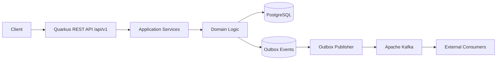

# Dokumentasi StockFlow

Kumpulan dokumen desain dan spesifikasi StockFlow — backend system untuk
inventory management berbasis REST API dan event-driven architecture.

| Dokumen | Isi | Audiens |
| --- | --- | --- |
| [design-system.md](design-system.md) | Dokumen sumber: tinjauan sistem, technology stack, desain database, REST API, business rules, Kafka event design, konfigurasi, security, testing, observability, roadmap, dan Definition of Done | Semua |
| [architecture-plan.md](architecture-plan.md) | Arsitektur plan: prinsip, struktur modul, desain data & messaging, transactional outbox, strategi concurrency & idempotency, observability, keamanan, testing, referensi implementasi, ADR, roadmap, risiko | Arsitek, Tech Lead |
| [srs.md](srs.md) | Software Requirements Specification: kebutuhan fungsional (FR) per modul, non-fungsional (NFR), antarmuka eksternal, kebutuhan data, matriks keterlacakan, kriteria rilis | Product, QA, Engineer |
| [fsd.md](fsd.md) | Functional Specification Document: konvensi API, spesifikasi fungsi (FS-01..FS-12), skema event, idempotency & concurrency, skema database, validasi, error mapping, konfigurasi | Engineer, QA |
| [stockflow-design.md](stockflow-design.md) | **Ekspor gabungan**: seluruh dokumen di atas dalam satu berkas | Distribusi / arsip |

## Ringkasan Sistem

StockFlow adalah **modular monolith** Quarkus dengan **event-driven integration**
melalui Kafka. PostgreSQL adalah **source of truth** untuk stok, dan setiap
perubahan stok dicatat dalam satu transaksi bersama histori transaksi dan
**Transactional Outbox**.

## Cara Membaca

1. Mulai dari **architecture-plan.md** §2–§9 untuk memahami prinsip dan alur.
2. Gunakan **srs.md** §3–§4 sebagai daftar kebutuhan yang harus dipenuhi.
3. Gunakan **fsd.md** §4–§9 sebagai acuan implementasi dan pengujian.
4. **design-system.md** tetap menjadi dokumen sumber apabila terjadi perbedaan
   penafsiran.

## Jaminan Utama yang Wajib Terpenuhi

| Jaminan | Diuji oleh |
| --- | --- |
| Stok tidak pernah negatif, termasuk pada request bersamaan | `StockOutConcurrencyTest` (FSD §6.3) |
| Request berulang tidak menggandakan mutasi stok | `StockMutationApiTest` + `PayloadHasherTest` (FSD §6.1) |
| Balapan `Idempotency-Key` tidak menjadi `500` (pemulihan di luar transaksi yang gagal) | `InventoryServiceTest` (unit) + `StockMutationApiTest` |
| Perubahan stok, histori, dan outbox tersimpan atomik | `StockMutationAtomicityTest` (FSD §9.3) |
| Event dapat dipublikasikan ulang bila gagal | Integration test retry publisher (Phase 4 — belum ada) |
| Migrasi database dapat dijalankan dari lingkungan baru | Flyway `migrate` saat startup |

## Status Implementasi

Kode implementasi berada di root repository (bukan di `docs/`) dan dijalankan dengan
Java 25+ serta Quarkus 3.40.

| Fase | Status | Bukti |
| --- | --- | --- |
| Phase 1 — Foundation | Selesai | `pom.xml`, `mvnw`, `compose.yaml`, migrasi Flyway V1–V5, `common/api`, `common/constants`, `common/exception` |
| Phase 2 — Master Data | Sebagian | `POST/GET /api/v1/products`, `POST/GET /api/v1/warehouses` (+ unit test `ProductServiceTest`) |
| Phase 3 — Inventory Core | Sebagian | Stock in, stock out, histori, idempotency, concurrency (`InventoryMutationService`); 22 test hijau |
| Phase 4 — Kafka Integration | Belum | — |
| Phase 5 — Production Readiness | Belum | Health `q/health` dan metrik Prometheus sudah aktif |

Kode mengikuti standar `refactor-project`: layered `common` + `{domain}/{api,service,repository,entity,mapper,...}`
dengan batas transaksi database di application service (`InventoryMutationService`) — lihat
`architecture-plan.md` §4.3. Panduan menjalankan dan menguji ada di `README.md` pada root repository.

## Roadmap

| Fase | Fokus |
| --- | --- |
| Phase 1 | Foundation — project Quarkus, PostgreSQL, Docker Compose, Flyway, exception & response standar, unit testing |
| Phase 2 | Master Data — CRUD produk & gudang, validasi, database constraints |
| Phase 3 | Inventory Core — stock-in/out, history, concurrency, idempotency, adjustment |
| Phase 4 | Kafka Integration — event schema, transactional outbox, publisher, retry & dead-letter |
| Phase 5 | Production Readiness — auth, observability, integration testing, CI/CD, deployment |
