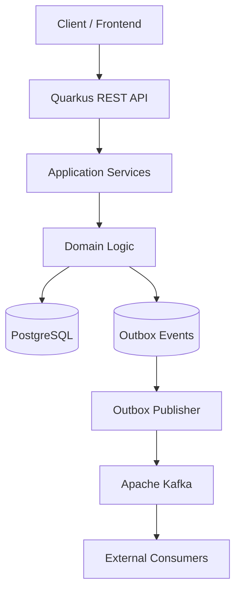
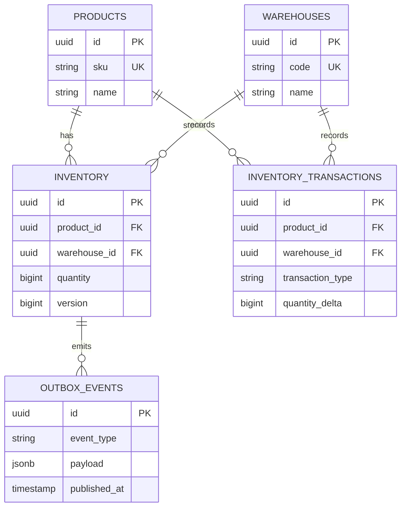
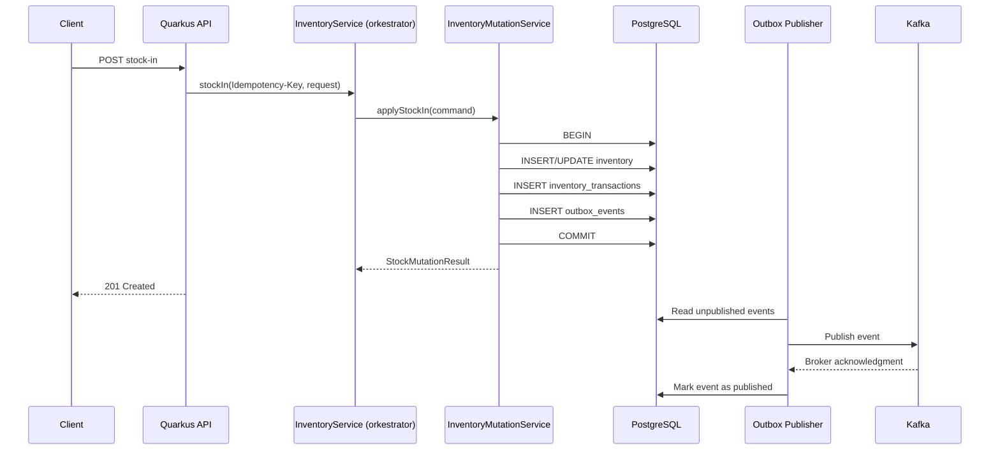
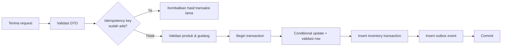

# StockFlow — Architecture Plan

> Turunan resmi dari `docs/design-system.md` (*StockFlow — Inventory Management Backend
> System*). Dokumen ini memformalkan arsitektur StockFlow, sedangkan pola implementasi
> yang sudah terbukti diambil dari layanan Quarkus internal lain (Kafka + Transactional
> Outbox) dan ditandai eksplisit pada §14.

| Item | Keterangan |
| --- | --- |
| Nama Sistem | StockFlow |
| Artifact ID | `stockflow-service` |
| Group ID | `com.stockflow` |
| Versi Dokumen | Draft 1.0 |
| Status | Rencana arsitektur (belum ada implementasi kode) |
| Basis | `docs/design-system.md` |
| Bahasa | Indonesia |

---

## 1. Tujuan & Ruang Lingkup

StockFlow adalah **backend system inventory management** berbasis REST API dan
event-driven architecture. Sistem dibangun dengan Quarkus, PostgreSQL sebagai
database utama, dan Apache Kafka untuk mendistribusikan perubahan stok secara
asynchronous.

### 1.1 Tujuan

| No | Tujuan |
| --- | --- |
| O-1 | Mengelola data produk dan kategori barang |
| O-2 | Mengelola stok berdasarkan kombinasi produk dan gudang |
| O-3 | Mencatat setiap perubahan stok sebagai inventory transaction |
| O-4 | Mencegah stok menjadi negatif |
| O-5 | Menyediakan REST API untuk membaca dan mengubah data stok |
| O-6 | Menerbitkan event perubahan stok melalui Kafka |
| O-7 | Mendukung integrasi dengan sistem eksternal |
| O-8 | Menyediakan audit trail untuk setiap mutasi stok |

### 1.2 Ruang Lingkup Rilis Awal

- Product Management
- Warehouse Management
- Inventory Management
- Stock Adjustment
- Stock In dan Stock Out
- Inventory Transaction History
- Kafka Event Publishing
- Basic Monitoring dan Health Check

### 1.3 Di Luar Ruang Lingkup Rilis Awal

Purchase order, supplier management, reservation, dan stock transfer antar-gudang
berbasis workflow penuh (transfer sudah dirancang pada kontrak API, tetapi
diimplementasikan bertahap — lihat §17).

### 1.4 Technology Stack

| Teknologi | Fungsi |
| --- | --- |
| Java 25+ | Bahasa pemrograman |
| Quarkus | Backend framework |
| RESTEasy Reactive / Quarkus REST | REST API |
| Hibernate ORM with Panache | ORM dan akses database |
| PostgreSQL | Database relasional |
| Apache Kafka | Event streaming dan asynchronous messaging |
| SmallRye Reactive Messaging | Integrasi Kafka dengan Quarkus |
| Flyway | Database migration |
| Bean Validation | Validasi request |
| JUnit 5 | Unit testing |
| Testcontainers | Integration testing |
| Docker Compose | Local development environment |

> Versi dependency dikelola melalui **Quarkus BOM**. Gunakan versi Java dan
> dependency yang kompatibel dengan versi Quarkus yang dipilih.

---

## 2. Prinsip Arsitektur

1. **PostgreSQL adalah sumber kebenaran utama (source of truth) untuk stok.**
2. **Perubahan stok dan pencatatan transaksi dilakukan dalam satu database transaction.**
3. **Event yang harus dipublikasikan dicatat dalam tabel outbox pada transaksi yang sama.**
4. **Kafka digunakan untuk integrasi asynchronous, bukan sebagai pengganti database utama.**
5. **Consumer harus dirancang agar idempotent.**
6. **API menggunakan DTO dan tidak mengekspos entity database secara langsung.**
7. **Stok tidak boleh negatif**, termasuk pada kondisi request bersamaan
   (lihat §9).
8. **Setiap mutasi stok wajib memiliki identitas request unik (idempotency key).**
9. **Audit trail tidak boleh hilang**: histori transaksi bersifat append-only;
   koreksi dilakukan melalui transaksi baru.

---

## 3. Arsitektur Sistem

StockFlow menggunakan **modular monolith dengan event-driven integration**.
Business logic berada dalam satu aplikasi Quarkus; Kafka mendistribusikan event
ke sistem lain tanpa membuat proses bisnis bergantung pada komunikasi synchronous.



### 3.1 Component Responsibilities

| Komponen | Tanggung Jawab |
| --- | --- |
| REST API | Menerima request HTTP dan mengembalikan response |
| Application Services | Mengorkestrasi use case bisnis |
| Domain Logic | Menjalankan aturan inventory dan validasi stok |
| PostgreSQL | Menyimpan data utama secara durable |
| Outbox Events | Menyimpan event yang menunggu dipublikasikan |
| Outbox Publisher | Mengirim event dari outbox ke Kafka |
| Kafka | Mendistribusikan event ke consumer |
| External Consumers | Memproses event untuk kebutuhan sistem lain |

### 3.2 Batasan Arsitektur

| ID | Batasan |
| --- | --- |
| AB-1 | Satu aplikasi deployable (modular monolith), bukan microservices |
| AB-2 | Sinkronisasi antar-modul dilakukan in-process (method call), bukan RPC |
| AB-3 | Komunikasi ke sistem eksternal searah (publish-only) pada rilis awal |
| AB-4 | Consumer eksternal bertanggung jawab atas idempotensinya sendiri |

---

## 4. Struktur Modul

Struktur package menggunakan pendekatan **modular berdasarkan domain bisnis**.

```
stockflow-service/
├── pom.xml
├── mvnw                              # Maven wrapper (mvnw.cmd untuk Windows)
├── .mvn/wrapper/maven-wrapper.properties
├── compose.yaml
├── README.md
├── refactor-plan.md                  # rencana & catatan refactor (skill refactor-project)
├── .gitignore
├── docs/
├── src/
│   ├── main/
│   │   ├── java/com/stockflow/
│   │   │   ├── common/                        # pseudo-function: komponen lintas domain
│   │   │   │   ├── api/                       # ApiResponse, PageResponse, ErrorResponse, TraceId
│   │   │   │   ├── constants/                 # CommonConstants
│   │   │   │   └── exception/                 # ErrorCode, DomainException, GlobalExceptionHandler
│   │   │   ├── product/
│   │   │   │   ├── api/rest/                  # ProductResource
│   │   │   │   ├── api/dto/request/           # CreateProductRequest
│   │   │   │   ├── api/dto/response/          # ProductResponse
│   │   │   │   ├── service/                   # ProductService (batas transaksi)
│   │   │   │   ├── repository/                # ProductRepository + impl/
│   │   │   │   ├── entity/                    # Product
│   │   │   │   └── mapper/                    # ProductMapper
│   │   │   ├── warehouse/                     # struktur sama dengan product
│   │   │   ├── inventory/
│   │   │   │   ├── api/rest/                  # InventoryResource
│   │   │   │   ├── api/dto/request/           # StockInRequest, StockOutRequest
│   │   │   │   ├── api/dto/response/          # StockMutationResponse, InventoryResponse,
│   │   │   │   │                              #   InventoryTransactionResponse
│   │   │   │   ├── service/                   # InventoryService (orkestrator),
│   │   │   │   │                              #   InventoryMutationService (batas transaksi),
│   │   │   │   │                              #   StockMutationCommand, StockMutationResult,
│   │   │   │   │                              #   StockMutationOutcome
│   │   │   │   ├── repository/                # InventoryRepository, InventoryTransactionRepository,
│   │   │   │   │                              #   InventoryMutation + impl/
│   │   │   │   ├── entity/                    # Inventory, InventoryTransaction, TransactionType
│   │   │   │   ├── mapper/                    # InventoryMapper, StockEventPayloadMapper
│   │   │   │   ├── constants/                 # InventoryConstants, InventoryQueryConstants
│   │   │   │   └── util/                      # PayloadHasher
│   │   │   └── outbox/
│   │   │       ├── entity/                    # OutboxEvent
│   │   │       ├── repository/                # OutboxEventRepository + impl/
│   │   │       └── service/                   # publisher (Phase 4)
│   │   └── resources/
│   │       ├── application.properties
│   │       └── db/migration/
│   │           ├── V1__create_products.sql
│   │           ├── V2__create_warehouses.sql
│   │           ├── V3__create_inventory.sql
│   │           ├── V4__create_inventory_transactions.sql
│   │           └── V5__create_outbox_events.sql
│   └── test/
│       └── java/com/stockflow/
│           ├── inventory/                     # StockMutationApiTest, StockMutationAtomicityTest,
│           │                                  #   StockOutConcurrencyTest
│           ├── inventory/util/                # PayloadHasherTest
│           └── support/                       # MasterData
└── target/                                    # build output (di-ignore)
```

Struktur ini mengikuti standar `refactor-project`:
`com.stockflow.{function}.{layer}` dengan `{function}` ∈ {`product`, `warehouse`, `inventory`,
`outbox`} dan `common` sebagai pseudo-function untuk komponen lintas domain. Setiap fungsi hanya
memiliki direktori layer yang benar-benar berisi kode.

### 4.1 Package Responsibilities

| Package | Tanggung Jawab |
| --- | --- |
| `api/rest` | REST resource; selalu mengembalikan `ApiResponse<T>` (via `RestResponse` bila status dinamis); tidak memuat logika bisnis |
| `api/dto/request` \| `api/dto/response` | DTO masuk/keluar dengan Bean Validation; **tidak pernah** mereferensi entity atau kelas domain |
| `service` | Use case, orkestrasi, validasi lintas domain, **dan batas transaksi database** |
| `repository` | Akses data murni (Panache). Interface + `impl/` sesuai Dependency Inversion; tanpa logika bisnis dan tanpa `@Transactional` |
| `entity` | Entity JPA beserta enum domainnya (`TransactionType`) |
| `mapper` | Konversi DTO ↔ entity ↔ payload event; satu-satunya tempat pemetaan |
| `constants` | Nilai konstan domain dan literal query (`{Domain}Constants`, `{Domain}QueryConstants`) |
| `util` | Utilitas murni tanpa state (`PayloadHasher`) |
| `outbox` | Penyimpanan event dan (Phase 4) mekanisme publikasi |
| `common` | Wrapper response, model error, exception dasar, handler global, konstanta bersama |

### 4.2 Aturan Ketergantungan Antar-Modul

| Aturan | Penjelasan |
| --- | --- |
| AD-1 | `api` → `service` → `repository`/`mapper` → `entity` (satu arah, tidak ada lompatan layer) |
| AD-2 | `entity` tidak boleh bergantung pada `api` maupun `repository` |
| AD-3 | Akses antar-domain dilakukan melalui application service, bukan repository milik domain lain |
| AD-4 | `outbox` hanya boleh diakses dari `service`/`repository` |
| AD-5 | Entity JPA tidak boleh keluar dari batas modul (selalu dipetakan ke DTO lewat `mapper`) |
| AD-6 | DTO tidak boleh berisi logika pemetaan; konversi hanya di `mapper` |
| AD-7 | Repository selalu berupa interface; service cukup satu kelas (tanpa `ServiceImpl`) |

### 4.3 Batas Transaksi Database

Transaksi database dibuka dan ditutup di **application service**, bukan di repository.
Satu method service yang mewakili use case menulis semua tabel terkait secara atomik.

| ID | Aturan |
| --- | --- |
| TD-1 | Satu method service use case = **satu transaksi PostgreSQL** |
| TD-2 | Method service yang menulis dianotasi `@Transactional` dan memanggil `flush()` di dalam boundary, agar pelanggaran constraint terdeteksi di dalam transaksi dan dapat diterjemahkan menjadi exception domain |
| TD-3 | Repository **tidak** memakai `@Transactional` dan tidak memuat logika bisnis; ia berpartisipasi pada transaksi milik service |
| TD-4 | Seluruh penulisan satu use case (inventory, histori, outbox) harus berada pada method service yang sama |
| TD-5 | Penanganan kegagalan yang memerlukan query lanjutan (mis. balapan `Idempotency-Key`) harus berada **di luar** transaksi yang gagal, karena transaksi tersebut sudah *rollback-only* |

Konsekuensi TD-5: orkestrasi dipisahkan menjadi dua bean pada layer `service`:

* `InventoryService` — orkestrator, **tanpa** `@Transactional`: validasi header & referensi
  lintas domain, lalu delegasi dan penanganan balapan.
* `InventoryMutationService` — pemegang transaksi use case: pemeriksaan `Idempotency-Key`,
  mutasi `inventory`, penulisan histori, dan penulisan outbox dalam satu transaksi.

Alasan pemilihan: sejalan dengan standar `refactor-project` (§4 Service Standards), atomisitas
tetap terjaga, boundary transaksi tetap eksplisit dan mudah diuji
(`StockMutationAtomicityTest`), serta recovery balapan tetap mungkin karena kegagalan `flush()`
tidak lagi di-`catch` di dalam transaksi yang sama.

```java
// service — batas transaksi berada di sini (bean khusus use case)
@ApplicationScoped
public class InventoryMutationService {

    @Transactional
    public StockMutationResult applyStockIn(StockMutationCommand command) {
        // 1. Idempotency-Key diperiksa di dalam transaksi
        Optional<StockMutationResult> previous = findReused(command);
        if (previous.isPresent()) {
            return previous.get();                    // tanpa mutasi baru (HTTP 200)
        }

        // 2. mutasi inventory: satu statement SQL atomik
        InventoryMutation mutation = inventoryRepository.increaseQuantity(
                command.productId(), command.warehouseId(), command.quantity());

        // 3. histori + 4. event outbox, pada transaksi yang sama
        return record(command, TransactionType.IN, mutation.inventoryId(),
                mutation.quantityAfter() - command.quantity(), mutation.quantityAfter());
    }
}
```

```java
// service — orkestrator, tanpa @Transactional
@ApplicationScoped
public class InventoryService {

    public StockMutationResult stockIn(String idempotencyKey, StockInRequest request) {
        String key = requireIdempotencyKey(idempotencyKey);
        requireActiveReferences(request.productId(), request.warehouseId());

        StockMutationCommand command = StockMutationCommand.of(request.productId(), request.warehouseId(),
                request.quantity(), request.referenceId(), key, request.notes());

        // penanganan balapan berada di luar transaksi (TD-5)
        return execute(command, inventoryMutationService::applyStockIn);
    }
}
```

> `jakarta.transaction.Transactional` tidak menyediakan atribut `readOnly` (berbeda dari
> anotasi Spring), sehingga operasi baca pada service memakai `@Transactional` biasa.

---

## 5. Desain Data

Database awal terdiri dari lima tabel utama: `products`, `warehouses`, `inventory`,
`inventory_transactions`, dan `outbox_events`. Detail kolom penuh ada di
`fsd.md` §7.



> Relasi `inventory` terhadap `outbox_events` pada diagram bersifat **konseptual**.
> Pada implementasi, outbox memakai `aggregate_type` dan `aggregate_id` sehingga
> dapat mencatat event dari berbagai domain.

### 5.1 Constraint dan Index Kunci

| Tabel | Constraint / Index |
| --- | --- |
| `products` | Unique pada `sku` |
| `warehouses` | Unique pada `code` |
| `inventory` | `UNIQUE(product_id, warehouse_id)`; `CHECK (quantity >= 0)` |
| `inventory_transactions` | FK ke produk & gudang; unique pada `idempotency_key`; index `(product_id, created_at)`, `(warehouse_id, created_at)`, `reference_id` |
| `outbox_events` | Index `created_at`; index parsial untuk event yang belum dipublikasikan |

### 5.2 Keputusan Representasi Kuantitas

- Gunakan `BIGINT` untuk jumlah stok bila barang dihitung dalam unit utuh.
- Jika mendukung berat atau volume pecahan, tentukan **precision numerik** yang
  sesuai (mis. `NUMERIC(19,4)`) dan tetapkan skala secara eksplisit.
- Keputusan ini harus konsisten antara `inventory.quantity`,
  `inventory_transactions.quantity_delta/before/after`, dan payload event.

### 5.3 Aturan Integritas Audit

- `quantity_delta` harus konsisten dengan `quantity_before` dan `quantity_after`:
  `quantity_before + quantity_delta = quantity_after`.
- Transaksi **tidak boleh diubah** setelah tercatat; koreksi dilakukan melalui
  transaksi baru.
- Validasi konsistensi ini sebaiknya ditegakkan di level aplikasi **dan**
  diverifikasi oleh integration test.

---

## 6. Desain Messaging (Kafka)

### 6.1 Suggested Topics

| Topic | Purpose |
| --- | --- |
| `stockflow.inventory.stock-in.v1` | Event penambahan stok |
| `stockflow.inventory.stock-out.v1` | Event pengurangan stok |
| `stockflow.inventory.adjusted.v1` | Event penyesuaian stok |
| `stockflow.inventory.transferred.v1` | Event transfer stok |

**Keputusan awal:** seluruh event inventory menggunakan **satu topic**
`stockflow.inventory.events.v1` dengan `eventType` sebagai discriminator.
Pemisahan topic dilakukan ketika kebutuhan operasional dan consumer sudah jelas
(lihat ADR-04).

### 6.2 Event Schema

Contoh `StockInCompleted`:

```json
{
  "eventId": "b6e7a4d1-2c8f-4a5b-9d3e-7f1a2b3c4d5e",
  "eventType": "StockInCompleted",
  "eventVersion": 1,
  "occurredAt": "2026-10-16T14:00:00Z",
  "aggregateId": "c9f0a7d2-8c8d-4f25-a4a2-1e2d9b2c3f11",
  "productId": "c9f0a7d2-8c8d-4f25-a4a2-1e2d9b2c3f11",
  "warehouseId": "a1d4f8c2-2b9e-4a3d-8f5c-6e7a9b0c1d22",
  "quantityBefore": 50,
  "quantityChanged": 100,
  "quantityAfter": 150,
  "transactionId": "f4b4d88d-5b47-4f67-bc6d-1a2b3c4d5e6f",
  "referenceId": "PO-2026-0001"
}
```

**Aturan identitas:**

- `eventId` **wajib berbeda** dari `transactionId`.
- `aggregateId` merepresentasikan identitas aggregate inventory. Karena aggregate
  inventory adalah **kombinasi produk dan gudang**, representasinya harus
  ditetapkan eksplisit — direkomendasikan memakai `id` baris `inventory` (UUID),
  bukan gabungan string `productId:warehouseId`.

### 6.3 Kafka Message Key

Gunakan key yang konsisten: `{productId}:{warehouseId}`.

Dengan demikian, event untuk kombinasi produk dan gudang yang sama dipartisi
secara konsisten sehingga urutan per-partition terjaga.

### 6.4 Delivery Semantics

| Aspek | Ketentuan |
| --- | --- |
| Jaminan pengiriman | **At-least-once** (melalui outbox publisher) |
| Duplikasi | Mungkin terjadi akibat retry; consumer **wajib idempotent** berdasarkan `eventId` |
| Retry | Gunakan retry dengan backoff |
| Kegagalan permanen | Gunakan dead-letter topic |
| Urutan | Jangan mengasumsikan urutan global antar-partition; urutan hanya dijamin per-partition |
| Evolusi skema | Gunakan `eventVersion` (schema versioning) |
| Mekanisme publikasi | Pilih **satu** mekanisme (outbox publisher biasa **atau** CDC seperti Debezium) — jangan menjalankan keduanya untuk event yang sama |

---

## 7. Pola Transactional Outbox

### 7.1 Alur Transaksi & Outbox



### 7.2 Ketentuan Wajib

1. Pembaruan inventory, penyimpanan histori, dan penulisan outbox harus berada
   dalam **satu transaksi PostgreSQL**, yang dibuka oleh satu method repository
   ber-`@Transactional` (§4.3).
2. Publikasi ke Kafka berlangsung **setelah** transaksi database berhasil.
3. Jika publikasi gagal, event tetap berada di outbox dan dapat dicoba kembali.
4. Jika menggunakan beberapa publisher, tambahkan mekanisme **klaim event yang aman**
   (lease/locking) dan kebijakan retry agar event tidak diproses bersamaan tanpa kontrol.
5. Response HTTP ke client dikembalikan setelah commit database — **tidak** menunggu
   publikasi Kafka.

### 7.3 Siklus Hidup Event Outbox

| State | Kondisi | Transisi |
| --- | --- | --- |
| `PENDING` | `published_at IS NULL` | → `PUBLISHED` setelah broker meng-ack |
| `PUBLISHED` | `published_at IS NOT NULL` | Terminal |
| `FAILED_PERMANENT` | Melewati batas `attempts` | Perlu intervensi/DLQ (rekomendasi) |

**Rekomendasi:** tambahkan kolom `attempts` dan `last_error` untuk observabilitas
serta kebijakan batas percobaan (lihat §15 butir R-3).

---

## 8. Strategi Concurrency & Idempotency

### 8.1 Concurrency Control

Untuk operasi **stock out**, pilih salah satu pendekatan:

| Pendekatan | Deskripsi | Catatan |
| --- | --- | --- |
| Pessimistic locking | `SELECT ... FOR UPDATE` pada baris inventory | Paling mudah dipahami; menahan lock sampai commit |
| Atomic conditional update | `UPDATE inventory SET quantity = quantity - :qty WHERE product_id = :p AND warehouse_id = :w AND quantity >= :qty`, lalu validasi jumlah row terpengaruh | Disarankan — menghindari overselling tanpa lock eksplisit |
| Optimistic locking | Memakai kolom `version` | Cocok untuk pola akses dengan konflik rendah |

**Rekomendasi utama:** *conditional update* untuk stock out, karena secara
satu operasi memastikan ketersediaan stok. Jika jumlah row terpengaruh = 0,
kembalikan `409 Conflict`.

### 8.2 Idempotency

| Aspek | Ketentuan |
| --- | --- |
| Cakupan | Setiap operasi mutasi stok (stock-in, stock-out, adjustment, transfer) |
| Carrier | Header `Idempotency-Key` pada request |
| Penyimpanan | Kolom `inventory_transactions.idempotency_key` |
| Pengaman utama | **Unique constraint di database**, bukan hanya pemeriksaan di level aplikasi |
| Perilaku saat duplikat | Kembalikan hasil transaksi yang sudah ada, **bukan** menjalankan perubahan stok lagi |
| Konflik request bersamaan | Manfaatkan `unique violation` sebagai sinyal balapan; ambil transaksi yang menang dan kembalikan hasilnya |

### 8.3 Urutan Pemeriksaan pada Mutasi



---

## 9. REST API — Ringkasan Arsitektural

Base path: `/api/v1`. Kontrak lengkap ada di `fsd.md` §4 dan `srs.md` §5.

| Grup | Endpoint | Jumlah |
| --- | --- | --- |
| Product | `POST/GET /products`, `GET/PUT /products/{id}`, `PATCH /products/{id}/status` | 5 |
| Warehouse | `POST/GET /warehouses`, `GET/PUT /warehouses/{id}` | 4 |
| Inventory | `GET /inventory`, `GET /inventory/{productId}/{warehouseId}`, `POST /inventory/stock-in`, `POST /inventory/stock-out`, `POST /inventory/adjustments`, `GET /inventory/transactions`, `POST /inventory/transfers` | 7 |

**Prinsip kontrak:**

1. Semua response memakai envelope standar: `{ success, message, data }`.
2. Semua request mutasi stok menerima header `Idempotency-Key`.
3. Entity database tidak pernah diekspos langsung; selalu melalui DTO.
4. Pagination wajib untuk endpoint list (`page`, `size` atau cursor).

### 9.1 Peta HTTP Status

| Status | Makna |
| --- | --- |
| `200 OK` | Operasi berhasil |
| `201 Created` | Resource berhasil dibuat |
| `400 Bad Request` | Request tidak valid |
| `404 Not Found` | Resource tidak ditemukan |
| `409 Conflict` | Stok tidak cukup atau konflik bisnis |
| `422 Unprocessable Entity` | Aturan bisnis tidak terpenuhi (jika digunakan secara konsisten) |
| `500 Internal Server Error` | Kesalahan yang tidak tertangani |

**Keputusan:** `409` dipakai untuk **stok tidak cukup**; `422` hanya dipakai untuk
pelanggaran aturan bisnis non-stok agar tidak tumpang tindih (lihat ADR-05).

---

## 10. Konfigurasi & Runtime

Contoh konfigurasi dasar `application.properties`:

```properties
quarkus.application.name=stockflow-service

# PostgreSQL
quarkus.datasource.db-kind=postgresql
quarkus.datasource.username=${DB_USERNAME:stockflow}
quarkus.datasource.password=${DB_PASSWORD:stockflow}
quarkus.datasource.jdbc.url=${DB_JDBC_URL:jdbc:postgresql://localhost:5432/stockflow}

# Hibernate ORM
quarkus.hibernate-orm.schema-management.strategy=validate

# Flyway
quarkus.flyway.migrate-at-start=true

# Kafka
kafka.bootstrap.servers=${KAFKA_BOOTSTRAP_SERVERS:localhost:9092}

# Health and observability
quarkus.smallrye-health.root-path=/q/health
quarkus.micrometer.export.prometheus.enabled=true
```

### 10.1 Ketentuan Konfigurasi

| ID | Ketentuan |
| --- | --- |
| CF-1 | Skema database dikelola **Flyway**; Hibernate memakai `validate` (bukan `update`) |
| CF-2 | Kredensial dibaca dari environment variable / secret manager |
| CF-3 | Channel Kafka didefinisikan eksplisit via `mp.messaging.outgoing.*` dan `mp.messaging.incoming.*` |
| CF-4 | Nama channel pada kode **harus** sama persis dengan nama channel pada konfigurasi |
| CF-5 | Publisher outbox berjalan sebagai scheduled job dengan interval konfigurabel |

### 10.2 Suggested Quarkus Extensions

```
quarkus-rest-jackson
quarkus-hibernate-orm-panache
quarkus-jdbc-postgresql
quarkus-flyway
quarkus-hibernate-validator
quarkus-smallrye-reactive-messaging-kafka
quarkus-smallrye-health
quarkus-micrometer-registry-prometheus
quarkus-junit
quarkus-test-security        # jika pengujian keamanan diperlukan
```

> Pastikan extension test diletakkan pada scope yang tepat dan **verifikasi nama
> extension terhadap versi Quarkus yang digunakan**.

### 10.3 Lingkungan Lokal

Docker Compose menyediakan PostgreSQL, Kafka, dan (opsional) Kafka UI. Nama file
disarankan `compose.yaml` sesuai struktur proyek pada §4.

---

## 11. Observability & Health

### 11.1 Metrik

| Metrik | Alasan |
| --- | --- |
| Jumlah request dan error HTTP | Kesehatan endpoint |
| Latency endpoint | Deteksi degradasi |
| Jumlah stock-in dan stock-out | Volume bisnis |
| Jumlah konflik stok | Indikasi overselling/contention |
| Jumlah event outbox menunggu publikasi | **Backlog** — indikator utama kesehatan integrasi |
| Umur event tertua yang belum dipublikasikan | Deteksi publisher macet |
| Kafka publish failure dan retry count | Keandalan integrasi |
| Consumer lag | Hanya jika aplikasi memiliki consumer sendiri |

### 11.2 Health Check

- Readiness aplikasi harus memeriksa **database** dan **Kafka**.
- Endpoint health tersedia pada root path yang dikonfigurasi (`/q/health`).

### 11.3 Tracing

Tambahkan **correlation ID / trace ID** agar request API dapat ditelusuri hingga
event Kafka:

1. Terima/generate `X-Correlation-Id` pada REST layer.
2. Simpan pada `inventory_transactions` (kolom `correlation_id`, rekomendasi) dan
   pada payload event.
3. Teruskan ke header Kafka pada saat publikasi.

---

## 12. Keamanan

Untuk deployment produksi, tambahkan:

| ID | Kebutuhan |
| --- | --- |
| SEC-1 | Authentication menggunakan OAuth2/OIDC |
| SEC-2 | Role-based authorization dengan role `INVENTORY_READ`, `INVENTORY_WRITE`, `WAREHOUSE_ADMIN` |
| SEC-3 | Validasi input dan batas ukuran request |
| SEC-4 | TLS untuk koneksi database dan Kafka |
| SEC-5 | Kafka ACL untuk membatasi akses producer dan consumer |
| SEC-6 | Secret management untuk kredensial |
| SEC-7 | Audit log untuk operasi sensitif |

> **Jangan menyimpan password atau secret produksi langsung di source code maupun
> file konfigurasi yang masuk ke repository.**

### 12.1 Matriks Otorisasi Usulan

| Endpoint | Role Minimal |
| --- | --- |
| `GET /products`, `GET /warehouses`, `GET /inventory*` | `INVENTORY_READ` |
| `POST/PUT/PATCH /products`, `POST/PUT /warehouses` | `WAREHOUSE_ADMIN` |
| `POST /inventory/stock-in`, `stock-out`, `adjustments`, `transfers` | `INVENTORY_WRITE` |

---

## 13. Strategi Pengujian

### 13.1 Unit Tests

Uji business rules **tanpa** database atau Kafka:

- Stock in menambah jumlah stok.
- Stock out mengurangi jumlah stok.
- Stock out ditolak ketika stok tidak cukup.
- Quantity nol atau negatif ditolak.
- Produk atau gudang tidak ditemukan.
- Request dengan idempotency key yang sama tidak menggandakan transaksi.

### 13.2 Integration Tests

Gunakan PostgreSQL dan Kafka melalui **Testcontainers** untuk menguji:

- Repository dan constraint database.
- Transaction rollback.
- Concurrent stock-out requests (tidak menghasilkan stok negatif).
- Penerbitan event dari outbox.
- Retry publisher.
- Idempotensi consumer.
- Kegagalan koneksi Kafka.

**Sudah terimplementasi** (PostgreSQL nyata via Dev Services/Testcontainers):

| Test | Yang dibuktikan |
| --- | --- |
| `StockMutationApiTest` | Kontrak FS-07/FS-08: status `201`/`200`/`400`/`404`/`409`, histori, dan event outbox |
| `StockMutationAtomicityTest` | Kegagalan di tengah transaksi membatalkan stok, histori, dan outbox sekaligus |
| `StockOutConcurrencyTest` | Dua stock-out bersamaan (stok 100, qty 60) → satu sukses, satu `409`, stok akhir 40 |
| `PayloadHasherTest` | Hash payload stabil dan berubah bila isi request berubah |
| `ProductServiceTest` (unit, repository di-mock) | SKU duplikat ditolak sebelum menyentuh database; hasil `create` berupa DTO |
| `InventoryServiceTest` (unit, dependensi di-mock) | Urutan validasi header sebelum transaksi; pemulihan balapan `Idempotency-Key` (R1) di luar transaksi yang gagal |

Belum terimplementasi: pengujian publisher dan consumer Kafka (Phase 4).

### 13.3 API Tests

Uji status HTTP, request validation, response schema, pagination, dan error response.

---

## 14. Referensi Implementasi dari Layanan Quarkus Internal

Layanan Quarkus internal lain di lingkungan yang sama sudah menerapkan pola serupa
(Kafka command/event, Transactional Outbox, scheduled publisher, DLQ, health check,
metrik). Pola yang **terbukti berhasil dipakai** dan **pitfall yang harus dihindari**
dirangkum berikut.

### 14.1 Pola yang Diadopsi

| ID | Pola | Alasan |
| --- | --- | --- |
| P-1 | Outbox diisi dalam transaksi yang sama dengan perubahan domain | Menghilangkan dual-write problem |
| P-2 | Publisher sebagai **scheduled job** dengan `page-size` dan `poll-interval` konfigurabel | Sederhana, mudah di-tune |
| P-3 | Paging saat membaca outbox dan saat batch (mis. 50/200 per halaman) | Mencegah konsumsi memori berlebih |
| P-4 | Entity outbox generik (`aggregate_type`, `aggregate_id`, `event_type`, `payload`) | Dapat dipakai lintas domain |
| P-5 | Health check konektivitas database (`SELECT 1`) | Readiness dasar |
| P-6 | Counter Micrometer dengan prefix aplikasi (mis. `stockflow.inventory.*`) | Observabilitas konsisten |
| P-7 | Optimistic locking (`@Version`) + retry terbatas | Alternatif konkurensi yang aman |
| P-8 | Relay event ke topic finalisasi terpisah dari publisher outbox | Memisahkan transport internal dari kontrak publik |
| P-9 | Batas transaksi database di method service use case (`@Transactional` pada `InventoryMutationService`) | Satu use case = satu transaksi; repository bebas `@Transactional` dan bebas logika bisnis |

### 14.2 Pitfall yang Harus Dihindari

| ID | Pitfall pada layanan referensi | Mitigasi untuk StockFlow |
| --- | --- | --- |
| R-1 | Nama channel pada kode berbeda dari nama channel pada konfigurasi (mis. `policy-retry` vs `policy-retry-in`) sehingga binding gagal | Terapkan **CF-4**: buat konvensi penamaan dan verifikasi saat startup/test |
| R-2 | Retry dan DLQ hanya dideklarasikan sebagai emitter tetapi tidak pernah dipanggil — fitur "ada" tapi tidak berfungsi | Definisikan **acceptance test** untuk retry/DLQ sejak Fase 4 (§17) |
| R-3 | Tabel outbox tanpa kolom `attempts`/`last_error`, sehingga event yang gagal menahun tidak terdeteksi | Tambahkan `attempts`, `last_error`, dan alarm backlog + umur event tertua |
| R-4 | `@Transactional` membungkus seluruh proses publish termasuk loop paging, dan penandaan `published` dilakukan tanpa menunggu acknowledgement broker | Pisahkan transaksi klaim vs penandaan; publikasikan di luar transaksi; tandai published hanya setelah ack |
| R-5 | Dua library JSON dipakai bersamaan (Jackson untuk menulis, JSON-B untuk membaca) | Standarkan pada **satu** library saja (Jackson) |
| R-6 | `aggregateId` tidak konsisten antar event (ada yang memakai natural key, ada yang memakai numeric id) | Tetapkan satu representasi aggregate identity (§6.2) |
| R-7 | Skema database dibuat otomatis oleh Hibernate (`generation=update`) tanpa tool migrasi | Terapkan **CF-1**: Flyway + `validate` sejak Fase 1 |
| R-8 | Kredensial dan endpoint hard-coded pada file konfigurasi yang masuk repo | Terapkan **CF-2** dan **SEC-6** |
| R-9 | Emitter Kafka tidak diberi key sehingga urutan per-aggregate tidak terjaga | Wajib set key `{productId}:{warehouseId}` (§6.3) |
| R-10 | Konsumen mengonsumsi topic yang juga diproduksi oleh service sendiri, berpotensi echo | Hindari pola ini atau dokumentasikan alasannya secara eksplisit |

---

## 15. Keputusan Arsitektur (ADR)

| ID | Keputusan | Alasan | Konsekuensi |
| --- | --- | --- | --- |
| ADR-01 | Modular monolith, bukan microservices | Kompleksitas operasional rendah di tahap awal; domain masih erat terkait | Perlu disiplin batas modul (§4.2); refactor ke services lebih mahal nanti |
| ADR-02 | Transactional Outbox untuk integrasi event | Atomisitas antara DB dan Kafka | Perlu publisher terjadwal + idempotensi consumer |
| ADR-03 | PostgreSQL sebagai single source of truth | Konsistensi stok | Kafka tidak boleh dipakai untuk membaca state |
| ADR-04 | Satu topic `stockflow.inventory.events.v1` dengan `eventType` sebagai discriminator | Topic belum banyak dan consumer belum jelas | Perlu strategi pemisahan topic di masa depan |
| ADR-05 | `409` untuk stok tidak cukup; `422` untuk aturan bisnis lain | Menghindari tumpang tindih makna status | Harus didokumentasikan pada OpenAPI |
| ADR-06 | Conditional update untuk stock out | Menghindari overselling tanpa lock eksplisit | Perlu verifikasi `rows affected` dan pemetaan ke `409` |
| ADR-07 | Flyway sebagai satu-satunya pengelola skema | Reproducible dari lingkungan baru | Migrasi tidak boleh diubah setelah dirilis |
| ADR-08 | Key Kafka `{productId}:{warehouseId}` | Urutan per-partition untuk aggregate yang sama | Perlu konsistensi pada semua event inventory |
| ADR-09 | Transaksi database dibuka di application service, bukan di repository (**revisi 2026-10-17**, sebelumnya sebaliknya) | Menyelaraskan dengan standar `refactor-project`: service adalah pemilik use case sekaligus batas transaksi, repository murni akses data | Repository dilarang `@Transactional` dan dilarang memuat logika bisnis; penanganan kegagalan yang butuh query lanjutan harus di luar transaksi (`InventoryService` non-transaksional + `InventoryMutationService` transaksional, §4.3) |

---

## 16. Roadmap Implementasi

| Fase | Nama | Deliverable |
| --- | --- | --- |
| Phase 1 | Foundation | Inisialisasi project Quarkus; setup PostgreSQL, Docker Compose, Flyway; exception handling & response standar; setup unit testing |
| Phase 2 | Master Data | CRUD produk; CRUD gudang; validasi dan database constraints |
| Phase 3 | Inventory Core | Stock-in & stock-out; inventory transaction history; concurrency control; idempotency; stock adjustment |
| Phase 4 | Kafka Integration | Definisi event schema; transactional outbox; publisher ke Kafka; consumer idempotent bila diperlukan; retry dan dead-letter handling |
| Phase 5 | Production Readiness | Authentication & authorization; observability; integration testing; CI/CD; deployment dan backup strategy |

> **Status implementasi saat ini:** Phase 1 (foundation, Flyway, exception handling,
> unit test), sebagian Phase 2 (create/list/detail produk & gudang), dan sebagian Phase 3
> (stock-in, stock-out, histori transaksi, idempotency, concurrency control) sudah ada
> pada repository ini. Phase 4 (Kafka) dan sisa Phase 5 belum dikerjakan.

### 16.1 Prasyarat Keluar Tiap Fase

| Fase | Kriteria Keluar |
| --- | --- |
| 1 | `mvn verify` hijau; Flyway migrate berjalan dari database kosong; response & error standar terbukti pada satu endpoint dummy |
| 2 | CRUD produk & gudang lolos API test; unique constraint terbukti menolak duplikat |
| 3 | Concurrent stock-out test membuktikan stok tidak pernah negatif; idempotency test membuktikan request berulang tidak menggandakan mutasi |
| 4 | Event tersimpan atomik dengan perubahan stok; publisher retry terbukti; backlog metrik tersedia |
| 5 | Health check database & Kafka hijau; secret tidak ada di repo; pipeline CI menjalankan unit + integration test |

---

## 17. Risiko & Mitigasi

| ID | Risiko | Dampak | Mitigasi |
| --- | --- | --- | --- |
| RSK-1 | Overselling akibat request bersamaan | Stok negatif, data tidak valid | Conditional update + `CHECK (quantity >= 0)` + integration test konkurensi |
| RSK-2 | Event hilang atau ganda | Konsumen eksternal tidak sinkron | Outbox + idempotensi consumer berdasarkan `eventId` |
| RSK-3 | Publisher outbox macet tanpa terdeteksi | Backlog menumpuk | Alarm backlog & umur event tertua |
| RSK-4 | Drift skema database | Kegagalan deploy | Flyway + `validate` |
| RSK-5 | Kontrak event berubah tanpa kompatibilitas | Konsumen rusak | `eventVersion` dan kebijakan kompatibilitas |
| RSK-6 | Kebocoran kredensial | Insiden keamanan | Secret manager, rotasi kredensial, review repo |

---

## 18. Definition of Done

Project dianggap siap untuk rilis awal apabila:

1. Semua endpoint utama memiliki validasi.
2. Stok tidak dapat menjadi negatif melalui request bersamaan.
3. Setiap mutasi stok tercatat dalam histori transaksi.
4. Request berulang tidak menggandakan mutasi stok.
5. Perubahan stok dan outbox event tersimpan secara atomik.
6. Event dapat dipublikasikan ulang ketika terjadi kegagalan.
7. Consumer yang relevan mendukung idempotensi.
8. Unit test dan integration test berjalan.
9. Database migration dapat dijalankan dari lingkungan baru.
10. Health check dan metrik tersedia.
11. Konfigurasi produksi tidak menyimpan secret di source code.

---

## 19. Future Enhancements

- Stock reservation untuk checkout atau order processing.
- Multi-warehouse transfer dengan transaksi yang terkontrol.
- Reorder point dan low-stock alert.
- Supplier dan purchase order management.
- Batch dan expiry date tracking.
- Stock opname dan reconciliation.
- Audit reporting.
- Schema Registry dan Avro/Protobuf.
- CDC menggunakan Debezium untuk publikasi outbox.
- Kubernetes deployment dan autoscaling.

---

## 20. Rekomendasi Akhir

1. Gunakan nama **StockFlow** dengan artifact ID **`stockflow-service`**.
2. Mulailah dengan **modular monolith** berbasis Quarkus, PostgreSQL sebagai sumber
   data utama, dan Apache Kafka untuk integrasi event-driven.
3. Terapkan **transaksi database yang aman, idempotency, inventory history, serta
   transactional outbox sejak awal**.
4. Tegakkan disiplin operasional sejak Fase 1: Flyway, konfigurasi berbasis
   environment, dan verifikasi nama channel Kafka (§14.2 R-1).
5. Pendekatan ini memberikan fondasi yang relatif sederhana untuk dikembangkan,
   tetapi tetap mendukung integrasi dengan order management, procurement, reporting,
   dan sistem eksternal di masa depan.
