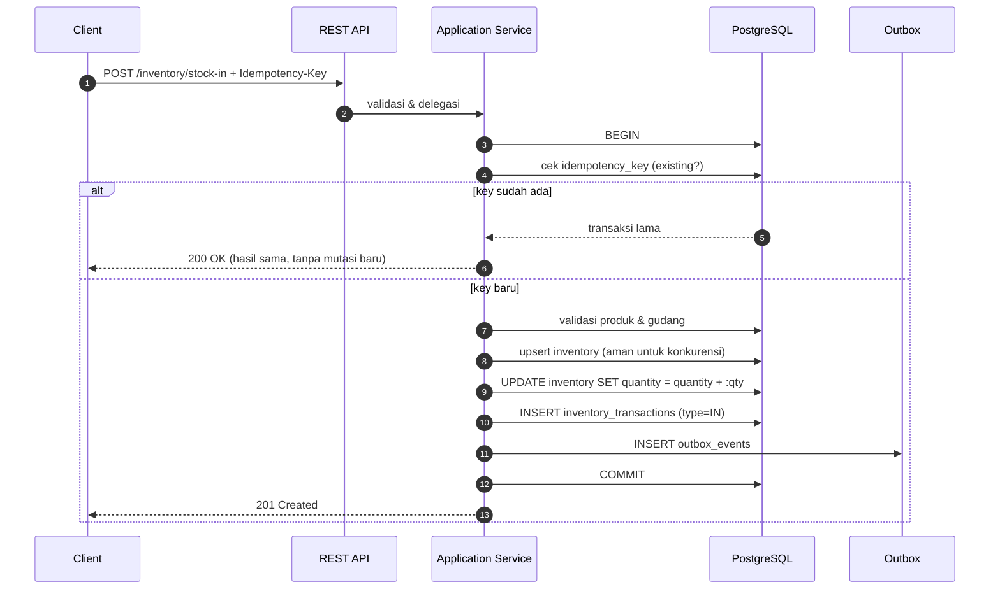
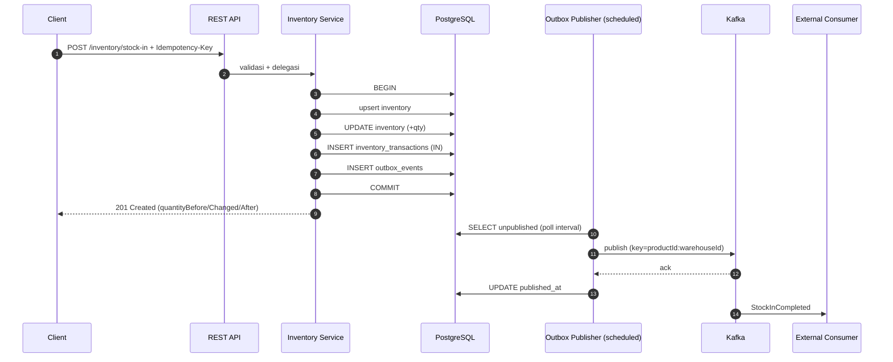

# StockFlow — Functional Specification Document (FSD)

> Turunan resmi dari `docs/design-system.md`. Menjelaskan **bagaimana** setiap
> kebutuhan pada `srs.md` diimplementasikan: alur, kontrak request/response,
> algoritma, aturan validasi, penanganan error, dan struktur data.

| Item | Keterangan |
| --- | --- |
| Nama Sistem | StockFlow |
| Artifact | `com.stockflow:stockflow-service` |
| Versi Dokumen | Draft 1.0 |
| Basis | `docs/design-system.md` |
| Dokumen Terkait | `architecture-plan.md`, `srs.md` |

---

## 1. Ikhtisar

| Bagian | Isi |
| --- | --- |
| §2 | Konvensi umum API (envelope, pagination, error, header) |
| §3 | Aktor & matriks otorisasi |
| §4 | Spesifikasi fungsi (FS-01..FS-12) |
| §5 | Skema event Kafka |
| §6 | Mekanisme idempotency dan concurrency secara rinci |
| §7 | Skema database |
| §8 | Aturan validasi |
| §9 | Pemetaan error & exception handling |
| §10 | Konfigurasi runtime |
| §11 | Referensi implementasi dari `policy-processing-service` |

---

## 2. Konvensi Umum API

### 2.1 Base Path dan Versioning

- Base path: `/api/v1`
- Perubahan breaking → naikkan versi path (`/api/v2`).

### 2.2 Response Envelope

**Sukses:**

```json
{ "success": true, "message": "...", "data": { } }
```

**Gagal:**

```json
{
  "success": false,
  "message": "Insufficient stock for product ... at warehouse ...",
  "error": {
    "code": "INSUFFICIENT_STOCK",
    "details": [],
    "traceId": "8b56c9c1-..."
  }
}
```

### 2.3 Pagination

| Parameter | Default | Batas |
| --- | --- | --- |
| `page` | `0` | ≥ 0 |
| `size` | `20` | 1..100 |
| `sort` | `created_at,desc` | kolom yang diizinkan saja |

**Metadata response:**

```json
{
  "page": 0,
  "size": 20,
  "totalElements": 137,
  "totalPages": 7
}
```

### 2.4 Header Standar

| Header | Arah | Wajib | Keterangan |
| --- | --- | --- | --- |
| `Idempotency-Key` | Request | Ya untuk semua mutasi stok | UUID/string unik per request |
| `X-Correlation-Id` | Request/Response | Tidak | Untuk tracing; digenerate bila tidak ada |
| `Content-Type` | Request | Ya | `application/json` |

### 2.5 Kode Error Standar

| Kode | HTTP | Makna |
| --- | --- | --- |
| `VALIDATION_ERROR` | 400 | Validasi field gagal |
| `PRODUCT_NOT_FOUND` | 404 | Produk tidak ditemukan |
| `WAREHOUSE_NOT_FOUND` | 404 | Gudang tidak ditemukan |
| `INVENTORY_NOT_FOUND` | 404 | Kombinasi produk–gudang tidak ditemukan (bila kontrak memilih 404) |
| `DUPLICATE_SKU` | 409 | SKU sudah dipakai |
| `DUPLICATE_CODE` | 409 | Kode gudang sudah dipakai |
| `INSUFFICIENT_STOCK` | 409 | Stok tidak mencukupi |
| `CONCURRENCY_CONFLICT` | 409 | Konflik konkurensi; client dapat mencoba ulang |
| `BUSINESS_RULE_VIOLATION` | 422 | Aturan bisnis non-stok tidak terpenuhi |
| `INTERNAL_ERROR` | 500 | Kesalahan tidak tertangani |

---

## 3. Aktor & Otorisasi

| Aktor | Role | Izin |
| --- | --- | --- |
| Analis | `INVENTORY_READ` | Baca produk, gudang, stok, histori |
| Operator Gudang | `INVENTORY_WRITE` | Mutasi stok (in/out/adjustment/transfer) + baca |
| Supervisor Gudang | `WAREHOUSE_ADMIN` | CRUD master produk & gudang + semua izin lain |

**Matriks izin per endpoint:**

| Endpoint | `INVENTORY_READ` | `INVENTORY_WRITE` | `WAREHOUSE_ADMIN` |
| --- | --- | --- | --- |
| `GET /products`, `GET /warehouses`, `GET /inventory*` | ✅ | ✅ | ✅ |
| `POST/PUT/PATCH /products*`, `POST/PUT /warehouses*` | ❌ | ❌ | ✅ |
| `POST /inventory/stock-in|stock-out|adjustments|transfers` | ❌ | ✅ | ✅ |

---

## 4. Spesifikasi Fungsi

### FS-01 — Membuat Produk

**Rujukan:** FR-PROD-01

| Aspek | Detail |
| --- | --- |
| Method | `POST /api/v1/products` |
| Auth | `WAREHOUSE_ADMIN` |
| Idempotency | Tidak wajib (dilindungi unique `sku`) |

**Request:**

```json
{
  "sku": "SKU-0001",
  "name": "Kopi Arabika 1kg",
  "description": "Biji kopi arabika single origin",
  "unit": "BAG",
  "active": true
}
```

**Validasi:**

| Field | Aturan |
| --- | --- |
| `sku` | Wajib, ≤ 100 karakter, unik (case-insensitive dianjurkan), pola `[A-Za-z0-9._-]+` |
| `name` | Wajib, ≤ 255 karakter |
| `description` | Opsional |
| `unit` | Wajib, ≤ 30 karakter |
| `active` | Opsional, default `true` |

**Alur:**

1. Validasi DTO (Bean Validation).
2. Normalisasi `sku` (trim, uppercase bila disepakati).
3. Cek keberadaan `sku` → bila ada, kembalikan `409 DUPLICATE_SKU`.
4. Simpan produk (`created_at`, `updated_at` terisi).
5. Kembalikan `201 Created` dengan `data` = produk yang dibuat.

**Response `201`:**

```json
{
  "success": true,
  "message": "Product created successfully",
  "data": { "id": "c9f0a7d2-...", "sku": "SKU-0001", "name": "Kopi Arabika 1kg", "unit": "BAG", "active": true }
}
```

> **Catatan race condition:** pengecekan (langkah 3) bersifat *advisory*.
> Pengaman sebenarnya adalah unique constraint pada `sku`; pelanggaran constraint
> dipetakan menjadi `409 DUPLICATE_SKU`.

---

### FS-02 — Daftar & Detail Produk

**Rujukan:** FR-PROD-02, FR-PROD-03

| Aspek | Detail |
| --- | --- |
| Method | `GET /api/v1/products`, `GET /api/v1/products/{id}` |
| Auth | `INVENTORY_READ` |

**Filter `GET /products`:**

| Parameter | Tipe | Keterangan |
| --- | --- | --- |
| `active` | boolean | Filter status aktif |
| `q` | string | Pencarian pada `sku` dan `name` (contains, case-insensitive) |
| `page`, `size`, `sort` | — | Sesuai §2.3 |

**Perilaku:** `GET /products/{id}` mengembalikan `200` bila ada, `404 PRODUCT_NOT_FOUND`
bila tidak.

---

### FS-03 — Memperbarui Produk

**Rujukan:** FR-PROD-04

| Aspek | Detail |
| --- | --- |
| Method | `PUT /api/v1/products/{id}` |
| Auth | `WAREHOUSE_ADMIN` |

**Aturan:**

1. `name`, `description`, `unit`, `active` dapat diubah.
2. `sku` hanya boleh diubah bila target tidak dipakai produk lain; pelanggaran → `409 DUPLICATE_SKU`.
3. `updated_at` selalu diperbarui.
4. Perubahan tidak menyentuh `inventory` maupun `inventory_transactions`.

---

### FS-04 — Mengubah Status Produk

**Rujukan:** FR-PROD-05

| Aspek | Detail |
| --- | --- |
| Method | `PATCH /api/v1/products/{id}/status` |
| Auth | `WAREHOUSE_ADMIN` |

**Request:** `{ "active": false }`

**Aturan:**

1. Menonaktifkan produk **tidak** menghapus stok atau histori.
2. Operasi mutasi stok baru terhadap produk nonaktif ditolak dengan
   `422 BUSINESS_RULE_VIOLATION` (kode: `PRODUCT_INACTIVE`).
3. Operasi **baca** terhadap produk nonaktif tetap diizinkan.
4. Reaktivasi produk diperbolehkan tanpa syarat tambahan.

---

### FS-05 — Mengelola Gudang

**Rujukan:** FR-WH-01..04

| Fungsi | Method | Auth |
| --- | --- | --- |
| Membuat gudang | `POST /warehouses` | `WAREHOUSE_ADMIN` |
| Daftar gudang | `GET /warehouses` | `INVENTORY_READ` |
| Detail gudang | `GET /warehouses/{id}` | `INVENTORY_READ` |
| Memperbarui gudang | `PUT /warehouses/{id}` | `WAREHOUSE_ADMIN` |

**Request create:**

```json
{ "code": "WH-JKT-01", "name": "Gudang Jakarta", "location": "Cakung, Jakarta Timur", "active": true }
```

**Validasi:**

| Field | Aturan |
| --- | --- |
| `code` | Wajib, ≤ 50 karakter, unik, pola `[A-Za-z0-9._-]+` |
| `name` | Wajib, ≤ 255 karakter |
| `location` | Opsional |
| `active` | Opsional, default `true` |

**Aturan tambahan:** gudang nonaktif tidak boleh dipakai pada mutasi stok baru
(`422 BUSINESS_RULE_VIOLATION`, kode `WAREHOUSE_INACTIVE`).

---

### FS-06 — Membaca Stok

**Rujukan:** FR-INV-01, FR-INV-02

| Aspek | Detail |
| --- | --- |
| Method | `GET /api/v1/inventory`, `GET /api/v1/inventory/{productId}/{warehouseId}` |
| Auth | `INVENTORY_READ` |

**Response detail:**

```json
{
  "success": true,
  "message": "Inventory retrieved successfully",
  "data": {
    "productId": "c9f0a7d2-...",
    "warehouseId": "a1d4f8c2-...",
    "quantity": 150,
    "version": 4,
    "updatedAt": "2026-10-16T14:00:00Z"
  }
}
```

**Keputusan kombinasi belum ada:** kembalikan `404 INVENTORY_NOT_FOUND`.
Keputusan ini **wajib konsisten** di seluruh endpoint baca dan diuji pada API test
(alternatif `200` dengan `quantity = 0` dapat dipilih, tetapi tidak boleh campur).

**Filter `GET /inventory`:** `productId`, `warehouseId`, plus pagination.
Tidak mengembalikan kombinasi yang belum pernah ada.

---

### FS-07 — Stock In

**Rujukan:** FR-INV-03

| Aspek | Detail |
| --- | --- |
| Method | `POST /api/v1/inventory/stock-in` |
| Auth | `INVENTORY_WRITE` |
| Idempotency | **Wajib** (`Idempotency-Key`) |

**Request:**

```json
{
  "productId": "c9f0a7d2-8c8d-4f25-a4a2-1e2d9b2c3f11",
  "warehouseId": "a1d4f8c2-2b9e-4a3d-8f5c-6e7a9b0c1d22",
  "quantity": 100,
  "referenceId": "PO-2026-0001",
  "notes": "Penerimaan barang dari supplier"
}
```

**Validasi:**

| Field | Aturan |
| --- | --- |
| `productId` | Wajib, UUID, produk harus ada dan aktif |
| `warehouseId` | Wajib, UUID, gudang harus ada dan aktif |
| `quantity` | Wajib, integer, > 0 |
| `referenceId` | Opsional, ≤ 100 karakter |
| `notes` | Opsional |
| `Idempotency-Key` | Wajib, ≤ 150 karakter |

**Alur (satu transaksi):**



**Langkah rinci:**

1. Validasi DTO (`quantity > 0`, id wajib terisi).
2. **Begin transaction.**
3. Cek `idempotency_key` pada `inventory_transactions`.
   - Jika ada → ambil transaksi tersebut, kembalikan hasil yang sama (`200 OK`).
   - Jika tidak ada → lanjut.
4. Validasi produk dan gudang ada dan aktif → `404` / `422` bila tidak.
5. Dapatkan/ciptakan baris `inventory` untuk `(product_id, warehouse_id)`
   menggunakan pola aman konkurensi (mis. `INSERT ... ON CONFLICT DO NOTHING`
   lalu `SELECT`, atau `SELECT ... FOR UPDATE`).
6. `quantity_before = inventory.quantity`.
7. `UPDATE inventory SET quantity = quantity + :qty WHERE product_id = :p AND warehouse_id = :w RETURNING quantity`
   → `quantity_after`. Jika baris terpengaruh = 0, perlakuan sebagai konflik konkurensi
   dan ulangi langkah 5.
8. `quantity_delta = +qty`.
9. `INSERT inventory_transactions` dengan seluruh field audit dan `idempotency_key`.
10. `INSERT outbox_events` (`eventType = StockInCompleted`, payload berisi
    `quantityBefore/Changed/After` dan `transactionId`).
11. **Commit.** Response dikembalikan setelah commit.

**Response `201`:**

```json
{
  "success": true,
  "message": "Stock received successfully",
  "data": {
    "productId": "c9f0a7d2-8c8d-4f25-a4a2-1e2d9b2c3f11",
    "warehouseId": "a1d4f8c2-2b9e-4a3d-8f5c-6e7a9b0c1d22",
    "quantityBefore": 50,
    "quantityChanged": 100,
    "quantityAfter": 150,
    "transactionId": "f4b4d88d-5b47-4f67-bc6d-1a2b3c4d5e6f"
  }
}
```

**Error yang mungkin:** `400`, `404`, `409 CONCURRENCY_CONFLICT` (bila retry internal habis), `422`.

---

### FS-08 — Stock Out

**Rujukan:** FR-INV-04

| Aspek | Detail |
| --- | --- |
| Method | `POST /api/v1/inventory/stock-out` |
| Auth | `INVENTORY_WRITE` |
| Idempotency | **Wajib** |

**Request:** sama dengan FS-07 (tanpa `notes` opsional tetap didukung).

**Alur (satu transaksi):**

1. Validasi DTO dan idempotency (sama dengan FS-07 langkah 1–4).
2. **Begin transaction.**
3. **Atomic conditional update** (pendekatan utama):

```sql
UPDATE inventory
   SET quantity = quantity - :qty,
       version  = version + 1,
       updated_at = now()
 WHERE product_id = :productId
   AND warehouse_id = :warehouseId
   AND quantity >= :qty
RETURNING quantity;
```

4. Jika jumlah baris terpengaruh = **0**, maka stok tidak mencukupi (atau baris belum ada):
   - Rollback.
   - Kembalikan `409 INSUFFICIENT_STOCK` dengan pesan yang menyebut produk, gudang,
     dan jumlah tersedia (bila dapat dibaca tanpa mengunci).
5. Jika berhasil: `quantity_after` = nilai `RETURNING`, `quantity_delta = -qty`.
6. `INSERT inventory_transactions` bertipe `OUT`.
7. `INSERT outbox_events` (`StockOutCompleted`).
8. **Commit.**

> **Alternatif (pessimistic):** `SELECT ... FOR UPDATE` pada baris inventory,
> periksa ketersediaan di aplikasi, lalu update. Kedua pendekatan harus menghasilkan
> perilaku identik terhadap `409`. **Pilih satu** untuk implementasi.

**Kriteria penting:** pada dua request bersamaan dengan total kebutuhan melebihi stok,
tepat satu request berhasil; sisanya `409`. Stok akhir tidak pernah negatif.

---

### FS-09 — Stock Adjustment

**Rujukan:** FR-INV-05

| Aspek | Detail |
| --- | --- |
| Method | `POST /api/v1/inventory/adjustments` |
| Auth | `INVENTORY_WRITE` |
| Idempotency | **Wajib** |

**Request:**

```json
{
  "productId": "c9f0a7d2-...",
  "warehouseId": "a1d4f8c2-...",
  "targetQuantity": 80,
  "reason": "STOCK_OPNAME",
  "notes": "Hasil opname fisik periode Oktober"
}
```

**Validasi:**

| Field | Aturan |
| --- | --- |
| `targetQuantity` | Wajib, integer, ≥ 0, harus berbeda dari stok saat ini |
| `reason` | Wajib, enum (`STOCK_OPNAME`, `DAMAGE`, `CORRECTION`, `SYSTEM_MIGRATION`, …) |
| `notes` | Wajib bila `reason = CORRECTION` |

**Alur:**

1. Validasi + idempotency check.
2. Begin transaction; lock baris inventory (`FOR UPDATE`).
3. `quantity_before = inventory.quantity`; `quantity_delta = targetQuantity - quantity_before`.
4. Set `quantity = targetQuantity`.
5. `INSERT inventory_transactions` bertipe `ADJUSTMENT` (delta dapat positif atau negatif).
6. `INSERT outbox_events` (`StockAdjusted`), payload memuat `reason` dan `notes`.
7. Commit.

**Catatan:** adjustment **tidak** boleh menurunkan stok di bawah nol karena
`targetQuantity ≥ 0`; constraint `CHECK (quantity >= 0)` menjadi jaring pengaman terakhir.

---

### FS-10 — Stock Transfer

**Rujukan:** FR-INV-06

| Aspek | Detail |
| --- | --- |
| Method | `POST /api/v1/inventory/transfers` |
| Auth | `INVENTORY_WRITE` |
| Idempotency | **Wajib** |
| Prioritas | S — dapat diimplementasikan bertahap |

**Request:**

```json
{
  "productId": "c9f0a7d2-...",
  "sourceWarehouseId": "a1d4f8c2-...",
  "targetWarehouseId": "b2e5f9d3-...",
  "quantity": 25,
  "referenceId": "TRF-2026-0007",
  "notes": "Pemenuhan permintaan cabang"
}
```

**Aturan:**

1. `sourceWarehouseId != targetWarehouseId` → jika sama, `422 BUSINESS_RULE_VIOLATION`.
2. `quantity > 0`.
3. Kedua gudang harus ada dan aktif.
4. **Satu transaksi database** mencakup pengurangan sumber dan penambahan tujuan.
5. Menghasilkan **dua** baris `inventory_transactions`:
   - `TRANSFER_OUT` (delta negatif) pada sumber
   - `TRANSFER_IN` (delta positif) pada tujuan
   - keduanya memakai `referenceId` yang sama dan `idempotency_key` turunan
     (mis. `{key}:OUT` dan `{key}:IN`) agar unique constraint tetap terjaga.
6. Menghasilkan **satu** event `StockTransferred` (memuat sumber, tujuan, kuantitas).
   Bila kebijakan memilih dua event, keduanya harus berada pada transaksi yang sama.
7. Kekurangan stok pada sumber → `409 INSUFFICIENT_STOCK`, **seluruh** transaksi dibatalkan.

---

### FS-11 — Histori Transaksi

**Rujukan:** FR-INV-07

| Aspek | Detail |
| --- | --- |
| Method | `GET /api/v1/inventory/transactions` |
| Auth | `INVENTORY_READ` |

**Filter:**

| Parameter | Keterangan |
| --- | --- |
| `productId` | Opsional |
| `warehouseId` | Opsional |
| `type` | Opsional: `IN`, `OUT`, `ADJUSTMENT`, `TRANSFER_IN`, `TRANSFER_OUT` |
| `referenceId` | Opsional |
| `from`, `to` | Opsional, filter rentang `created_at` (ISO-8601) |
| `page`, `size`, `sort` | Sesuai §2.3 |

**Item response:**

```json
{
  "id": "f4b4d88d-...",
  "productId": "c9f0a7d2-...",
  "warehouseId": "a1d4f8c2-...",
  "transactionType": "IN",
  "quantityDelta": 100,
  "quantityBefore": 50,
  "quantityAfter": 150,
  "referenceId": "PO-2026-0001",
  "notes": "Penerimaan barang dari supplier",
  "createdAt": "2026-10-16T14:00:00Z"
}
```

**Catatan:** `idempotency_key` **tidak** diekspos pada response API publik
(informasi internal), kecuali disepakati lain.

---

### FS-12 — Health Check & Metrik

**Rujukan:** FR-MON-01, FR-MON-02

| Item | Spesifikasi |
| --- | --- |
| Readiness | Memeriksa konektivitas PostgreSQL (`SELECT 1`) dan Kafka |
| Health path | `/q/health` (konfigurabel melalui `quarkus.smallrye-health.root-path`) |
| Metrics | `/q/metrics` (Prometheus) |

**Metrik bisnis yang wajib tersedia:**

| Nama | Tipe | Keterangan |
| --- | --- | --- |
| `stockflow.inventory.stock_in.count` | Counter | Jumlah operasi stock in |
| `stockflow.inventory.stock_out.count` | Counter | Jumlah operasi stock out |
| `stockflow.inventory.conflict.count` | Counter | Jumlah konflik stok (`409`) |
| `stockflow.outbox.pending.count` | Gauge | Jumlah event belum dipublikasikan |
| `stockflow.outbox.oldest_pending.age_seconds` | Gauge | Umur event tertua yang belum dipublikasikan |
| `stockflow.outbox.publish.failure.count` | Counter | Kegagalan publikasi |
| `stockflow.outbox.publish.retry.count` | Counter | Percobaan publikasi ulang |

---

## 5. Skema Event Kafka

### 5.1 Envelope Umum

| Field | Tipe | Wajib | Keterangan |
| --- | --- | --- | --- |
| `eventId` | UUID | Ya | Unik per event; **berbeda** dari `transactionId` |
| `eventType` | string | Ya | Discriminator, mis. `StockInCompleted` |
| `eventVersion` | integer | Ya | Mulai dari `1` |
| `occurredAt` | timestamp | Ya | Waktu kejadian (UTC) |
| `aggregateId` | UUID | Ya | Identitas aggregate inventory (disarankan `inventory.id`) |
| `productId` | UUID | Ya | |
| `warehouseId` | UUID | Ya | |
| `quantityBefore` | number | Ya | |
| `quantityChanged` | number | Ya | Selalu positif (arah ditentukan `eventType`) |
| `quantityAfter` | number | Ya | |
| `transactionId` | UUID | Ya | ID transaksi pada `inventory_transactions` |
| `referenceId` | string | Tidak | Referensi proses eksternal |
| `correlationId` | string | Tidak | Rekomendasi untuk tracing end-to-end |

### 5.2 Tipe Event

| `eventType` | Topic | `transaction_type` |
| --- | --- | --- |
| `StockInCompleted` | `stockflow.inventory.events.v1` | `IN` |
| `StockOutCompleted` | `stockflow.inventory.events.v1` | `OUT` |
| `StockAdjusted` | `stockflow.inventory.events.v1` | `ADJUSTMENT` |
| `StockTransferred` | `stockflow.inventory.events.v1` | `TRANSFER_IN` / `TRANSFER_OUT` |

### 5.3 Contoh `StockInCompleted`

```json
{
  "eventId": "b6e7a4d1-2c8f-4a5b-9d3e-7f1a2b3c4d5e",
  "eventType": "StockInCompleted",
  "eventVersion": 1,
  "occurredAt": "2026-10-16T14:00:00Z",
  "aggregateId": "9d7a2f13-4c1e-4a77-9b2c-0e5f6a7b8c90",
  "productId": "c9f0a7d2-8c8d-4f25-a4a2-1e2d9b2c3f11",
  "warehouseId": "a1d4f8c2-2b9e-4a3d-8f5c-6e7a9b0c1d22",
  "quantityBefore": 50,
  "quantityChanged": 100,
  "quantityAfter": 150,
  "transactionId": "f4b4d88d-5b47-4f67-bc6d-1a2b3c4d5e6f",
  "referenceId": "PO-2026-0001"
}
```

### 5.4 Aturan Key, Ordering, dan Duplikasi

| Aspek | Ketentuan |
| --- | --- |
| Message key | `{productId}:{warehouseId}` |
| Ordering | Dijamin **per partition** untuk aggregate yang sama; tidak ada urutan global |
| Duplikasi | Mungkin; consumer idempotent berdasarkan `eventId` |
| Retry | Backoff eksponensial dengan batas percobaan |
| Dead-letter | Topic DLQ terpisah untuk kegagalan permanen |
| Evolusi | Perubahan non-breaking → naikkan `eventVersion` minor; breaking → topic/versi baru |

---

## 6. Idempotency & Concurrency (Rinci)

### 6.1 Tabel Kebenaran Idempotency

| Kondisi | Perilaku |
| --- | --- |
| `Idempotency-Key` belum ada | Jalankan mutasi, simpan key pada `inventory_transactions` |
| Key sudah ada, payload identik | Kembalikan hasil transaksi lama, **tanpa** mutasi baru, status `200` |
| Key sudah ada, payload **berbeda** | Tolak dengan `409 CONCURRENCY_CONFLICT` (kode: `IDEMPOTENCY_KEY_REUSED`) |
| Dua request bersamaan dengan key sama | Salah satu gagal pada unique constraint → tangkap, baca transaksi yang menang, kembalikan hasilnya |
| `Idempotency-Key` tidak dikirim pada mutasi | `400 VALIDATION_ERROR` |

### 6.2 Perbandingan Payload untuk Deteksi Reuse

Disarankan menyimpan **hash** payload (`sha256`) pada baris transaksi. Bila key yang
sama datang dengan hash berbeda, permintaan dianggap penyalahgunaan kunci → `409`.

### 6.3 Skenario Konkurensi Stock Out

```mermaid
sequenceDiagram
    autonumber
    participant R1 as Request A (qty 60)
    participant R2 as Request B (qty 60)
    participant DB as PostgreSQL (stok 100)

    R1->>DB: BEGIN
    R2->>DB: BEGIN
    R1->>DB: UPDATE ... WHERE quantity >= 60 RETURNING quantity
    DB-->>R1: 40 (berhasil)
    R2->>DB: UPDATE ... WHERE quantity >= 60 RETURNING quantity
    Note over R2,DB: evaluasi ulang terhadap nilai terbaru → 40 < 60
    DB-->>R2: 0 baris
    R1->>DB: INSERT transaksi + outbox ; COMMIT
    R2->>DB: ROLLBACK
    R1-->>R1: 201 Created
    R2-->>R2: 409 INSUFFICIENT_STOCK
```

**Bukti yang wajib diuji (integration test):**

1. Stok akhir = 40 (bukan −20).
2. Tepat satu request sukses.
3. Hanya satu baris `inventory_transactions` dan satu `outbox_events` yang tercipta.

### 6.4 Retry Internal

| Operasi | Mekanisme | Batas |
| --- | --- | --- |
| Upsert `inventory` saat baris belum ada | `INSERT ... ON CONFLICT DO NOTHING` lalu baca ulang | 3 kali |
| Optimistic locking (bila dipakai) | Retry pada `OptimisticLockException` | 3 kali, lalu `409 CONCURRENCY_CONFLICT` |
| Publisher outbox | Retry terjadwal pada poll berikutnya | Sampai batas `attempts` |

---

## 7. Skema Database

Dikelola **Flyway** dengan skrip versioned. Struktur folder:
`src/main/resources/db/migration/`.

### 7.1 `products`

| Kolom | Tipe | Null | Keterangan |
| --- | --- | --- | --- |
| `id` | UUID | No | PK |
| `sku` | VARCHAR(100) | No | Unik |
| `name` | VARCHAR(255) | No | |
| `description` | TEXT | Yes | |
| `unit` | VARCHAR(30) | No | |
| `active` | BOOLEAN | No | Default `true` |
| `created_at` | TIMESTAMPTZ | No | |
| `updated_at` | TIMESTAMPTZ | No | |

**Constraint:** `UNIQUE (sku)`; index tambahan pada `name` bila pencarian sering dipakai.

### 7.2 `warehouses`

| Kolom | Tipe | Null | Keterangan |
| --- | --- | --- | --- |
| `id` | UUID | No | PK |
| `code` | VARCHAR(50) | No | Unik |
| `name` | VARCHAR(255) | No | |
| `location` | TEXT | Yes | |
| `active` | BOOLEAN | No | Default `true` |
| `created_at` | TIMESTAMPTZ | No | |
| `updated_at` | TIMESTAMPTZ | No | |

**Constraint:** `UNIQUE (code)`.

### 7.3 `inventory`

| Kolom | Tipe | Null | Keterangan |
| --- | --- | --- | --- |
| `id` | UUID | No | PK (dipakai sebagai `aggregateId`) |
| `product_id` | UUID | No | FK → `products(id)` |
| `warehouse_id` | UUID | No | FK → `warehouses(id)` |
| `quantity` | BIGINT | No | Jumlah stok tersedia; default `0` |
| `version` | BIGINT | No | Versi data untuk concurrency |
| `updated_at` | TIMESTAMPTZ | No | |

**Constraint & index:**

| Nama | Definisi |
| --- | --- |
| Unique | `UNIQUE (product_id, warehouse_id)` |
| Check | `CHECK (quantity >= 0)` |
| Index | `(product_id, warehouse_id)` (implisit dari unique) |

### 7.4 `inventory_transactions`

| Kolom | Tipe | Null | Keterangan |
| --- | --- | --- | --- |
| `id` | UUID | No | PK |
| `product_id` | UUID | No | FK → `products(id)` |
| `warehouse_id` | UUID | No | FK → `warehouses(id)` |
| `transaction_type` | VARCHAR(30) | No | `IN`, `OUT`, `ADJUSTMENT`, `TRANSFER_IN`, `TRANSFER_OUT` |
| `quantity_delta` | BIGINT | No | Bertanda positif/negatif |
| `quantity_before` | BIGINT | No | |
| `quantity_after` | BIGINT | No | |
| `reference_id` | VARCHAR(100) | Yes | Referensi proses eksternal |
| `idempotency_key` | VARCHAR(150) | Yes | Unik bila diisi |
| `payload_hash` | VARCHAR(64) | Yes | Rekomendasi: sha256 payload untuk deteksi reuse |
| `reason` | VARCHAR(50) | Yes | Untuk adjustment |
| `notes` | TEXT | Yes | |
| `created_at` | TIMESTAMPTZ | No | Waktu transaksi |

**Constraint & index:**

| Nama | Definisi |
| --- | --- |
| Unique | `UNIQUE (idempotency_key)` |
| Check | `quantity_before + quantity_delta = quantity_after` (dianjurkan) |
| Index | `(product_id, created_at)`, `(warehouse_id, created_at)`, `(reference_id)` |

**Sifat:** append-only. Tidak ada operasi `UPDATE`/`DELETE` pada tabel ini.

### 7.5 `outbox_events`

| Kolom | Tipe | Null | Keterangan |
| --- | --- | --- | --- |
| `id` | UUID | No | PK (Event ID) |
| `aggregate_type` | VARCHAR(100) | No | Jenis aggregate |
| `aggregate_id` | UUID | No | ID aggregate terkait |
| `event_type` | VARCHAR(150) | No | Jenis event |
| `payload` | JSONB | No | Payload event |
| `created_at` | TIMESTAMPTZ | No | Waktu event dibuat |
| `published_at` | TIMESTAMPTZ | Yes | Waktu berhasil dipublikasikan |
| `attempts` | INTEGER | No | Jumlah percobaan (default `0`) — **rekomendasi** |
| `last_error` | TEXT | Yes | Error terakhir — **rekomendasi** |

**Index yang disarankan:**

| Nama | Definisi |
| --- | --- |
| `idx_outbox_created_at` | `(created_at)` |
| `idx_outbox_pending` | Partial: `(created_at) WHERE published_at IS NULL` |

### 7.6 Migrasi Awal (Rencana)

| Versi | Isi |
| --- | --- |
| `V1__create_products.sql` | Tabel `products` + unique `sku` |
| `V2__create_warehouses.sql` | Tabel `warehouses` + unique `code` |
| `V3__create_inventory.sql` | Tabel `inventory` + unique + check quantity |
| `V4__create_inventory_transactions.sql` | Tabel + unique `idempotency_key` + index |
| `V5__create_outbox_events.sql` | Tabel + index + partial index |

---

## 8. Aturan Validasi

### 8.1 Validasi Umum

| ID | Aturan |
| --- | --- |
| V-01 | Semua UUID mengikuti format UUID yang valid |
| V-02 | `quantity` selalu integer > 0 untuk in/out/transfer |
| V-03 | `targetQuantity` ≥ 0 dan ≠ stok saat ini untuk adjustment |
| V-04 | `Idempotency-Key` wajib dan ≤ 150 karakter untuk semua mutasi |
| V-05 | `referenceId` ≤ 100 karakter |
| V-06 | Ukuran request dibatasi (mis. 1 MB) |
| V-07 | Produk dan gudang harus `active = true` untuk mutasi |
| V-08 | `sourceWarehouseId != targetWarehouseId` pada transfer |

### 8.2 Validasi Silang (Cross-field)

| ID | Aturan | Error |
| --- | --- | --- |
| V-09 | `reason = CORRECTION` pada adjustment → `notes` wajib | `400 VALIDATION_ERROR` |
| V-10 | Total transfer tidak melebihi stok sumber | `409 INSUFFICIENT_STOCK` |
| V-11 | Key idempotensi sama + hash payload berbeda | `409 IDEMPOTENCY_KEY_REUSED` |
| V-12 | Produk nonaktif / gudang nonaktif | `422 BUSINESS_RULE_VIOLATION` |

---

## 9. Pemetaan Error & Exception Handling

### 9.1 Peta Exception → HTTP

| Exception Domain | HTTP | Kode |
| --- | --- | --- |
| `ValidationException` (Bean Validation) | 400 | `VALIDATION_ERROR` |
| `ProductNotFoundException` | 404 | `PRODUCT_NOT_FOUND` |
| `WarehouseNotFoundException` | 404 | `WAREHOUSE_NOT_FOUND` |
| `InventoryNotFoundException` | 404 | `INVENTORY_NOT_FOUND` |
| `DuplicateSkuException` / unique violation | 409 | `DUPLICATE_SKU` |
| `DuplicateCodeException` / unique violation | 409 | `DUPLICATE_CODE` |
| `InsufficientStockException` | 409 | `INSUFFICIENT_STOCK` |
| `IdempotencyKeyReusedException` | 409 | `IDEMPOTENCY_KEY_REUSED` |
| `OptimisticLockConflict` (setelah retry) | 409 | `CONCURRENCY_CONFLICT` |
| `BusinessRuleViolationException` | 422 | `BUSINESS_RULE_VIOLATION` |
| Exception tak terduga | 500 | `INTERNAL_ERROR` |

### 9.2 Ketentuan Exception Handler

1. Satu *exception mapper* global di `common/exception` menghasilkan envelope error standar.
2. Pesan untuk `500` **tidak** membocorkan detail internal (stack trace/SQL); detail
   lengkap hanya di log dengan `traceId`.
3. `traceId` dikembalikan pada body error dan header response.
4. Pelanggaran unique constraint dari database **harus** dipetakan ke kode error
   domain yang tepat (bukan `500`).

### 9.3 Ketentuan Rollback

| Kondisi | Perilaku |
| --- | --- |
| Validasi gagal sebelum transaction | Tidak ada transaksi dibuka |
| Kegagalan di tengah transaksi | Rollback penuh; tidak ada perubahan stok, histori, maupun outbox |
| Konflik stok | Rollback; kembalikan `409` |
| Kegagalan insert outbox | Rollback penuh — **mutasi stok juga dibatalkan** (atomisitas) |

---

## 10. Konfigurasi Runtime

### 10.1 Aplikasi & Database

| Properti | Nilai |
| --- | --- |
| `quarkus.application.name` | `stockflow-service` |
| `quarkus.datasource.db-kind` | `postgresql` |
| `quarkus.datasource.username` | `${DB_USERNAME:stockflow}` |
| `quarkus.datasource.password` | `${DB_PASSWORD:stockflow}` |
| `quarkus.datasource.jdbc.url` | `${DB_JDBC_URL:jdbc:postgresql://localhost:5432/stockflow}` |
| `quarkus.hibernate-orm.schema-management.strategy` | `validate` |
| `quarkus.flyway.migrate-at-start` | `true` |
| `quarkus.smallrye-health.root-path` | `/q/health` |
| `quarkus.micrometer.export.prometheus.enabled` | `true` |

### 10.2 Kafka

| Properti (contoh) | Nilai |
| --- | --- |
| `kafka.bootstrap.servers` | `${KAFKA_BOOTSTRAP_SERVERS:localhost:9092}` |
| `mp.messaging.outgoing.stock-events.connector` | `smallrye-kafka` |
| `mp.messaging.outgoing.stock-events.topic` | `stockflow.inventory.events.v1` |
| `mp.messaging.outgoing.stock-events.key.serializer` | `StringSerializer` |
| `mp.messaging.outgoing.stock-events.value.serializer` | `StringSerializer` (atau `JsonObjectSerializer`) |

> **Aturan wajib:** nama channel pada anotasi (`@Channel`, `@Incoming`) **harus
> identik** dengan nama channel pada `application.properties`.

### 10.3 Publisher Outbox

| Properti | Default | Keterangan |
| --- | --- | --- |
| `outbox.publisher.enabled` | `true` | Kill switch |
| `outbox.publisher.poll-interval` | `1m` | Interval polling |
| `outbox.publisher.page-size` | `50` | Jumlah event per halaman |
| `outbox.publisher.max-attempts` | `10` | Batas percobaan sebelum ditandai gagal permanen |
| `outbox.publisher.lock-lease` | `30s` | Lease untuk klaim event (bila multi-instance) |

### 10.4 Lingkungan Lokal

Docker Compose (`compose.yaml`) menyediakan PostgreSQL, Kafka, dan opsional Kafka UI.
Aplikasi dijalankan dengan `./mvnw quarkus:dev`.

---

## 11. Referensi Implementasi dari `policy-processing-service`

Pola nyata dari layanan Quarkus lain di lingkungan yang sama, dipakai sebagai acuan
implementasi sekaligus daftar hal yang harus dihindari.

| ID | Acuan / Pitfall | Implikasi untuk StockFlow |
| --- | --- | --- |
| REF-1 | Outbox diisi dalam transaksi yang sama dengan perubahan domain | Terapkan langsung pada FS-07..FS-10 |
| REF-2 | Publisher scheduled dengan `page-size` dan `poll-interval` konfigurabel | Adopsi pada §10.3 |
| REF-3 | Paging saat membaca outbox mencegah beban memori | Adopsi |
| REF-4 | Optimistic locking (`@Version`) + retry terbatas | Disiapkan pada `inventory.version` (§7.3) |
| REF-5 | Health check `SELECT 1` ke database | Perluas: tambahkan Kafka pada readiness |
| REF-6 | **Pitfall:** nama channel kode ≠ nama channel konfigurasi | Wajib dicek saat startup/test (§10.2) |
| REF-7 | **Pitfall:** retry/DLQ terdeklarasi tetapi tidak pernah dipanggil | Uji secara eksplisit (FS-12 / integration test) |
| REF-8 | **Pitfall:** outbox tanpa `attempts`/`last_error` | Sudah diadopsi sebagai kolom (§7.5) |
| REF-9 | **Pitfall:** `@Transactional` membungkus seluruh proses publish sehingga penandaan `published` terjadi sebelum broker ack | Pisahkan transaksi klaim vs penandaan; tandai setelah ack |
| REF-10 | **Pitfall:** dua library JSON dipakai bersamaan | Standarkan pada satu library |
| REF-11 | **Pitfall:** `aggregateId` tidak konsisten antar event | Tetapkan `inventory.id` sebagai `aggregateId` (§5.1) |
| REF-12 | **Pitfall:** skema dibuat otomatis tanpa tool migrasi | Flyway sejak `V1` (§7.6) |
| REF-13 | **Pitfall:** kredensial hard-coded di konfigurasi yang masuk repo | Gunakan environment variable (§10.1) |
| REF-14 | **Pitfall:** emitter Kafka tanpa key | Wajib set key `{productId}:{warehouseId}` |

---

## 12. Lampiran — Urutan End-to-End Stock In


