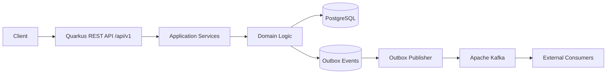
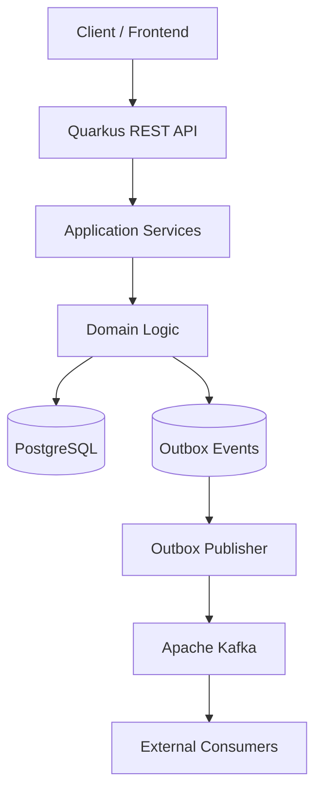
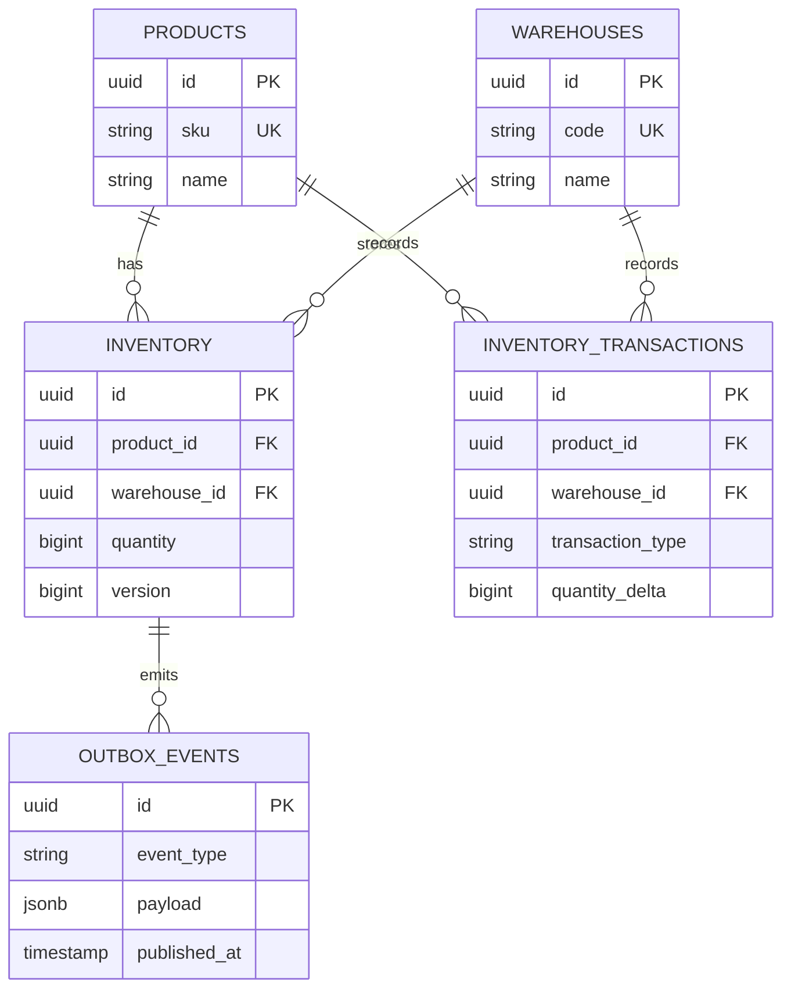
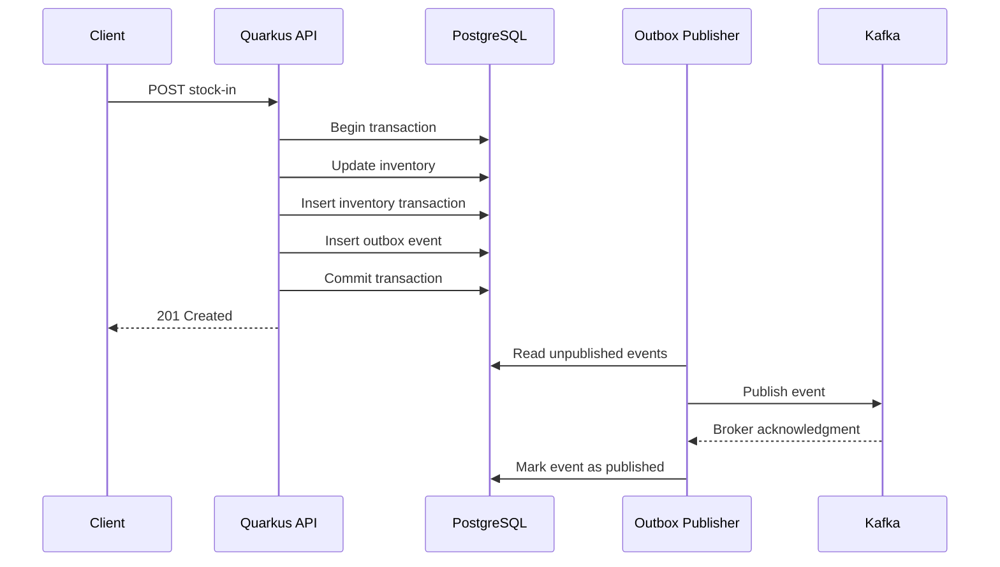
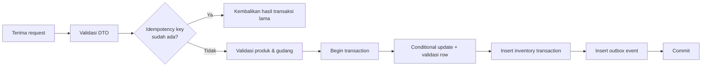
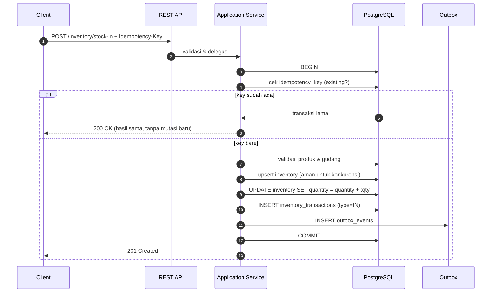
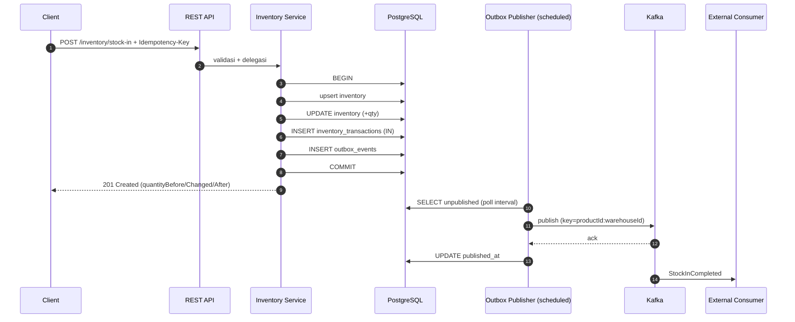

# StockFlow - Dokumen Desain Lengkap

> **Ekspor gabungan.** Dokumen ini menggabungkan seluruh dokumen desain
> StockFlow ke dalam satu berkas markdown.

| Item | Keterangan |
| --- | --- |
| Sistem | StockFlow (`com.stockflow:stockflow-service`) |
| Jenis | Backend inventory management (REST API + event-driven) |
| Teknologi | Java 21+, Quarkus, PostgreSQL, Apache Kafka, Flyway |
| Bahasa dokumen | Indonesia |
| Dibuat | 2026-10-17 |

## Ringkasan Eksekutif

StockFlow adalah **modular monolith** Quarkus dengan **event-driven integration**
melalui Kafka. PostgreSQL adalah **source of truth** untuk stok. Setiap perubahan
stok dicatat dalam satu transaksi database bersama histori transaksi dan
**Transactional Outbox**, sehingga perubahan data dan publikasi event tidak pernah
terpisah.

Alur utama:

```
Client -> REST API /api/v1 -> Application Service -> PostgreSQL
                                 |-> inventory_transactions (audit trail)
                                 |-> outbox_events (satu transaksi)
outbox_events -> Outbox Publisher -> Kafka -> External Consumers
```

### Jaminan Utama

| Jaminan | Cara dijamin |
| --- | --- |
| Stok tidak pernah negatif | Atomic conditional update + `CHECK (quantity >= 0)` |
| Request berulang tidak menggandakan mutasi | `Idempotency-Key` + unique constraint database |
| Data dan event selalu konsisten | Satu transaksi PostgreSQL untuk stok + histori + outbox |
| Event tidak hilang | Transactional Outbox dengan retry |
| Konsumen aman dari duplikasi | At-least-once + idempotensi berdasarkan `eventId` |

## Daftar Isi Dokumen Gabungan

1. Indeks Dokumentasi
2. Architecture Plan
3. Software Requirements Specification (SRS)
4. Functional Specification Document (FSD)
5. Design System (Dokumen Sumber)

---

<a id="01-indeks-dokumentasi"></a>

## Bagian 1 - Indeks Dokumentasi

*Sumber berkas: `docs/README.md`*

---

## Dokumentasi StockFlow

Kumpulan dokumen desain dan spesifikasi StockFlow — backend system untuk
inventory management berbasis REST API dan event-driven architecture.

| Dokumen | Isi | Audiens |
| --- | --- | --- |
| [design-system.md](design-system.md) | Dokumen sumber: tinjauan sistem, technology stack, desain database, REST API, business rules, Kafka event design, konfigurasi, security, testing, observability, roadmap, dan Definition of Done | Semua |
| [architecture-plan.md](architecture-plan.md) | Arsitektur plan: prinsip, struktur modul, desain data & messaging, transactional outbox, strategi concurrency & idempotency, observability, keamanan, testing, referensi implementasi, ADR, roadmap, risiko | Arsitek, Tech Lead |
| [srs.md](srs.md) | Software Requirements Specification: kebutuhan fungsional (FR) per modul, non-fungsional (NFR), antarmuka eksternal, kebutuhan data, matriks keterlacakan, kriteria rilis | Product, QA, Engineer |
| [fsd.md](fsd.md) | Functional Specification Document: konvensi API, spesifikasi fungsi (FS-01..FS-12), skema event, idempotency & concurrency, skema database, validasi, error mapping, konfigurasi | Engineer, QA |
| [stockflow-design.md](stockflow-design.md) | **Ekspor gabungan**: seluruh dokumen di atas dalam satu berkas | Distribusi / arsip |

### Ringkasan Sistem

StockFlow adalah **modular monolith** Quarkus dengan **event-driven integration**
melalui Kafka. PostgreSQL adalah **source of truth** untuk stok, dan setiap
perubahan stok dicatat dalam satu transaksi bersama histori transaksi dan
**Transactional Outbox**.



### Cara Membaca

1. Mulai dari **architecture-plan.md** §2–§9 untuk memahami prinsip dan alur.
2. Gunakan **srs.md** §3–§4 sebagai daftar kebutuhan yang harus dipenuhi.
3. Gunakan **fsd.md** §4–§9 sebagai acuan implementasi dan pengujian.
4. **design-system.md** tetap menjadi dokumen sumber apabila terjadi perbedaan
   penafsiran.

### Jaminan Utama yang Wajib Terpenuhi

| Jaminan | Diuji oleh |
| --- | --- |
| Stok tidak pernah negatif, termasuk pada request bersamaan | Integration test konkurensi (FSD §6.3) |
| Request berulang tidak menggandakan mutasi stok | Unit + integration test idempotency (FSD §6.1) |
| Perubahan stok, histori, dan outbox tersimpan atomik | Integration test transaksional (FSD §9.3) |
| Event dapat dipublikasikan ulang bila gagal | Integration test retry publisher |
| Migrasi database dapat dijalankan dari lingkungan baru | Flyway `migrate` pada database kosong |

### Roadmap

| Fase | Fokus |
| --- | --- |
| Phase 1 | Foundation — project Quarkus, PostgreSQL, Docker Compose, Flyway, exception & response standar, unit testing |
| Phase 2 | Master Data — CRUD produk & gudang, validasi, database constraints |
| Phase 3 | Inventory Core — stock-in/out, history, concurrency, idempotency, adjustment |
| Phase 4 | Kafka Integration — event schema, transactional outbox, publisher, retry & dead-letter |
| Phase 5 | Production Readiness — auth, observability, integration testing, CI/CD, deployment |


---


<a id="02-architecture-plan"></a>

## Bagian 2 - Architecture Plan

*Sumber berkas: `docs/architecture-plan.md`*

---

## StockFlow — Architecture Plan

> Turunan resmi dari `docs/design-system.md` (*StockFlow — Inventory Management Backend
> System*). Dokumen ini memformalkan arsitektur StockFlow, sedangkan pola implementasi
> yang sudah terbukti diambil dari layanan sejenis `policy-processing-service`
> (Quarkus + Kafka + Transactional Outbox) dan ditandai eksplisit pada §15.

| Item | Keterangan |
| --- | --- |
| Nama Sistem | StockFlow |
| Artifact ID | `stockflow-service` |
| Group ID | `com.stockflow` |
| Versi Dokumen | Draft 1.0 |
| Status | Rencana arsitektur (belum ada implementasi kode) |
| Basis | `docs/design-system.md` |
| Bahasa | Indonesia |

---

### 1. Tujuan & Ruang Lingkup

StockFlow adalah **backend system inventory management** berbasis REST API dan
event-driven architecture. Sistem dibangun dengan Quarkus, PostgreSQL sebagai
database utama, dan Apache Kafka untuk mendistribusikan perubahan stok secara
asynchronous.

#### 1.1 Tujuan

| No | Tujuan |
| --- | --- |
| O-1 | Mengelola data produk dan kategori barang |
| O-2 | Mengelola stok berdasarkan kombinasi produk dan gudang |
| O-3 | Mencatat setiap perubahan stok sebagai inventory transaction |
| O-4 | Mencegah stok menjadi negatif |
| O-5 | Menyediakan REST API untuk membaca dan mengubah data stok |
| O-6 | Menerbitkan event perubahan stok melalui Kafka |
| O-7 | Mendukung integrasi dengan sistem eksternal |
| O-8 | Menyediakan audit trail untuk setiap mutasi stok |

#### 1.2 Ruang Lingkup Rilis Awal

- Product Management
- Warehouse Management
- Inventory Management
- Stock Adjustment
- Stock In dan Stock Out
- Inventory Transaction History
- Kafka Event Publishing
- Basic Monitoring dan Health Check

#### 1.3 Di Luar Ruang Lingkup Rilis Awal

Purchase order, supplier management, reservation, dan stock transfer antar-gudang
berbasis workflow penuh (transfer sudah dirancang pada kontrak API, tetapi
diimplementasikan bertahap — lihat §17).

#### 1.4 Technology Stack

| Teknologi | Fungsi |
| --- | --- |
| Java 21+ | Bahasa pemrograman |
| Quarkus | Backend framework |
| RESTEasy Reactive / Quarkus REST | REST API |
| Hibernate ORM with Panache | ORM dan akses database |
| PostgreSQL | Database relasional |
| Apache Kafka | Event streaming dan asynchronous messaging |
| SmallRye Reactive Messaging | Integrasi Kafka dengan Quarkus |
| Flyway | Database migration |
| Bean Validation | Validasi request |
| JUnit 5 | Unit testing |
| Testcontainers | Integration testing |
| Docker Compose | Local development environment |

> Versi dependency dikelola melalui **Quarkus BOM**. Gunakan versi Java dan
> dependency yang kompatibel dengan versi Quarkus yang dipilih.

---

### 2. Prinsip Arsitektur

1. **PostgreSQL adalah sumber kebenaran utama (source of truth) untuk stok.**
2. **Perubahan stok dan pencatatan transaksi dilakukan dalam satu database transaction.**
3. **Event yang harus dipublikasikan dicatat dalam tabel outbox pada transaksi yang sama.**
4. **Kafka digunakan untuk integrasi asynchronous, bukan sebagai pengganti database utama.**
5. **Consumer harus dirancang agar idempotent.**
6. **API menggunakan DTO dan tidak mengekspos entity database secara langsung.**
7. **Stok tidak boleh negatif**, termasuk pada kondisi request bersamaan
   (lihat §9).
8. **Setiap mutasi stok wajib memiliki identitas request unik (idempotency key).**
9. **Audit trail tidak boleh hilang**: histori transaksi bersifat append-only;
   koreksi dilakukan melalui transaksi baru.

---

### 3. Arsitektur Sistem

StockFlow menggunakan **modular monolith dengan event-driven integration**.
Business logic berada dalam satu aplikasi Quarkus; Kafka mendistribusikan event
ke sistem lain tanpa membuat proses bisnis bergantung pada komunikasi synchronous.



#### 3.1 Component Responsibilities

| Komponen | Tanggung Jawab |
| --- | --- |
| REST API | Menerima request HTTP dan mengembalikan response |
| Application Services | Mengorkestrasi use case bisnis |
| Domain Logic | Menjalankan aturan inventory dan validasi stok |
| PostgreSQL | Menyimpan data utama secara durable |
| Outbox Events | Menyimpan event yang menunggu dipublikasikan |
| Outbox Publisher | Mengirim event dari outbox ke Kafka |
| Kafka | Mendistribusikan event ke consumer |
| External Consumers | Memproses event untuk kebutuhan sistem lain |

#### 3.2 Batasan Arsitektur

| ID | Batasan |
| --- | --- |
| AB-1 | Satu aplikasi deployable (modular monolith), bukan microservices |
| AB-2 | Sinkronisasi antar-modul dilakukan in-process (method call), bukan RPC |
| AB-3 | Komunikasi ke sistem eksternal searah (publish-only) pada rilis awal |
| AB-4 | Consumer eksternal bertanggung jawab atas idempotensinya sendiri |

---

### 4. Struktur Modul

Struktur package menggunakan pendekatan **modular berdasarkan domain bisnis**.

```
stockflow-service/
├── pom.xml
├── Dockerfile
├── compose.yaml
├── README.md
├── PROJECT_DESIGN.md
├── src/
│   ├── main/
│   │   ├── java/com/stockflow/
│   │   │   ├── common/
│   │   │   │   ├── exception/
│   │   │   │   ├── response/
│   │   │   │   └── validation/
│   │   │   ├── product/
│   │   │   │   ├── api/
│   │   │   │   ├── application/
│   │   │   │   ├── domain/
│   │   │   │   └── infrastructure/
│   │   │   ├── warehouse/
│   │   │   │   ├── api/
│   │   │   │   ├── application/
│   │   │   │   ├── domain/
│   │   │   │   └── infrastructure/
│   │   │   ├── inventory/
│   │   │   │   ├── api/
│   │   │   │   ├── application/
│   │   │   │   ├── domain/
│   │   │   │   └── infrastructure/
│   │   │   ├── transaction/
│   │   │   ├── messaging/
│   │   │   │   ├── event/
│   │   │   │   ├── publisher/
│   │   │   │   └── consumer/
│   │   │   └── outbox/
│   │   └── resources/
│   │       ├── application.properties
│   │       └── db/migration/
│   │           ├── V1__create_products.sql
│   │           ├── V2__create_warehouses.sql
│   │           ├── V3__create_inventory.sql
│   │           ├── V4__create_inventory_transactions.sql
│   │           └── V5__create_outbox_events.sql
│   └── test/
│       └── java/com/stockflow/
│           ├── product/
│           ├── inventory/
│           ├── transaction/
│           └── messaging/
└── deploy/
└── docker/
```

#### 4.1 Package Responsibilities

| Package | Tanggung Jawab |
| --- | --- |
| `api` | REST resources, request DTO, response DTO |
| `application` | Use case dan orchestration; pemilik batas transaksi bisnis |
| `domain` | Domain model, business rules, domain services |
| `infrastructure` | Implementasi repository dan integrasi persistence |
| `messaging` | Kafka producer, consumer, event schema, konfigurasi messaging |
| `outbox` | Penyimpanan event dan mekanisme publikasi |
| `common` | Komponen lintas domain, exception, response standar |

> Untuk implementasi Panache, repository dapat menggunakan `PanacheRepository` atau
> `PanacheRepositoryBase`, sementara **application service bertanggung jawab atas
> transaksi bisnis**.

#### 4.2 Aturan Ketergantungan Antar-Modul

| Aturan | Penjelasan |
| --- | --- |
| AD-1 | `api` → `application` → `domain` (satu arah) |
| AD-2 | `domain` tidak boleh bergantung pada `api` maupun `infrastructure` |
| AD-3 | Akses antar-domain dilakukan melalui application service, bukan repository milik domain lain |
| AD-4 | `messaging` dan `outbox` hanya boleh diakses dari `application`/`infrastructure` |
| AD-5 | Entity JPA tidak boleh keluar dari batas modul (selalu dipetakan ke DTO) |

---

### 5. Desain Data

Database awal terdiri dari lima tabel utama: `products`, `warehouses`, `inventory`,
`inventory_transactions`, dan `outbox_events`. Detail kolom penuh ada di
`fsd.md` §7.



> Relasi `inventory` terhadap `outbox_events` pada diagram bersifat **konseptual**.
> Pada implementasi, outbox memakai `aggregate_type` dan `aggregate_id` sehingga
> dapat mencatat event dari berbagai domain.

#### 5.1 Constraint dan Index Kunci

| Tabel | Constraint / Index |
| --- | --- |
| `products` | Unique pada `sku` |
| `warehouses` | Unique pada `code` |
| `inventory` | `UNIQUE(product_id, warehouse_id)`; `CHECK (quantity >= 0)` |
| `inventory_transactions` | FK ke produk & gudang; unique pada `idempotency_key`; index `(product_id, created_at)`, `(warehouse_id, created_at)`, `reference_id` |
| `outbox_events` | Index `created_at`; index parsial untuk event yang belum dipublikasikan |

#### 5.2 Keputusan Representasi Kuantitas

- Gunakan `BIGINT` untuk jumlah stok bila barang dihitung dalam unit utuh.
- Jika mendukung berat atau volume pecahan, tentukan **precision numerik** yang
  sesuai (mis. `NUMERIC(19,4)`) dan tetapkan skala secara eksplisit.
- Keputusan ini harus konsisten antara `inventory.quantity`,
  `inventory_transactions.quantity_delta/before/after`, dan payload event.

#### 5.3 Aturan Integritas Audit

- `quantity_delta` harus konsisten dengan `quantity_before` dan `quantity_after`:
  `quantity_before + quantity_delta = quantity_after`.
- Transaksi **tidak boleh diubah** setelah tercatat; koreksi dilakukan melalui
  transaksi baru.
- Validasi konsistensi ini sebaiknya ditegakkan di level aplikasi **dan**
  diverifikasi oleh integration test.

---

### 6. Desain Messaging (Kafka)

#### 6.1 Suggested Topics

| Topic | Purpose |
| --- | --- |
| `stockflow.inventory.stock-in.v1` | Event penambahan stok |
| `stockflow.inventory.stock-out.v1` | Event pengurangan stok |
| `stockflow.inventory.adjusted.v1` | Event penyesuaian stok |
| `stockflow.inventory.transferred.v1` | Event transfer stok |

**Keputusan awal:** seluruh event inventory menggunakan **satu topic**
`stockflow.inventory.events.v1` dengan `eventType` sebagai discriminator.
Pemisahan topic dilakukan ketika kebutuhan operasional dan consumer sudah jelas
(lihat ADR-04).

#### 6.2 Event Schema

Contoh `StockInCompleted`:

```json
{
  "eventId": "b6e7a4d1-2c8f-4a5b-9d3e-7f1a2b3c4d5e",
  "eventType": "StockInCompleted",
  "eventVersion": 1,
  "occurredAt": "2026-10-16T14:00:00Z",
  "aggregateId": "c9f0a7d2-8c8d-4f25-a4a2-1e2d9b2c3f11",
  "productId": "c9f0a7d2-8c8d-4f25-a4a2-1e2d9b2c3f11",
  "warehouseId": "a1d4f8c2-2b9e-4a3d-8f5c-6e7a9b0c1d22",
  "quantityBefore": 50,
  "quantityChanged": 100,
  "quantityAfter": 150,
  "transactionId": "f4b4d88d-5b47-4f67-bc6d-1a2b3c4d5e6f",
  "referenceId": "PO-2026-0001"
}
```

**Aturan identitas:**

- `eventId` **wajib berbeda** dari `transactionId`.
- `aggregateId` merepresentasikan identitas aggregate inventory. Karena aggregate
  inventory adalah **kombinasi produk dan gudang**, representasinya harus
  ditetapkan eksplisit — direkomendasikan memakai `id` baris `inventory` (UUID),
  bukan gabungan string `productId:warehouseId`.

#### 6.3 Kafka Message Key

Gunakan key yang konsisten: `{productId}:{warehouseId}`.

Dengan demikian, event untuk kombinasi produk dan gudang yang sama dipartisi
secara konsisten sehingga urutan per-partition terjaga.

#### 6.4 Delivery Semantics

| Aspek | Ketentuan |
| --- | --- |
| Jaminan pengiriman | **At-least-once** (melalui outbox publisher) |
| Duplikasi | Mungkin terjadi akibat retry; consumer **wajib idempotent** berdasarkan `eventId` |
| Retry | Gunakan retry dengan backoff |
| Kegagalan permanen | Gunakan dead-letter topic |
| Urutan | Jangan mengasumsikan urutan global antar-partition; urutan hanya dijamin per-partition |
| Evolusi skema | Gunakan `eventVersion` (schema versioning) |
| Mekanisme publikasi | Pilih **satu** mekanisme (outbox publisher biasa **atau** CDC seperti Debezium) — jangan menjalankan keduanya untuk event yang sama |

---

### 7. Pola Transactional Outbox

#### 7.1 Alur Transaksi & Outbox



#### 7.2 Ketentuan Wajib

1. Pembaruan inventory, penyimpanan histori, dan penulisan outbox harus berada
   dalam **satu transaksi PostgreSQL**.
2. Publikasi ke Kafka berlangsung **setelah** transaksi database berhasil.
3. Jika publikasi gagal, event tetap berada di outbox dan dapat dicoba kembali.
4. Jika menggunakan beberapa publisher, tambahkan mekanisme **klaim event yang aman**
   (lease/locking) dan kebijakan retry agar event tidak diproses bersamaan tanpa kontrol.
5. Response HTTP ke client dikembalikan setelah commit database — **tidak** menunggu
   publikasi Kafka.

#### 7.3 Siklus Hidup Event Outbox

| State | Kondisi | Transisi |
| --- | --- | --- |
| `PENDING` | `published_at IS NULL` | → `PUBLISHED` setelah broker meng-ack |
| `PUBLISHED` | `published_at IS NOT NULL` | Terminal |
| `FAILED_PERMANENT` | Melewati batas `attempts` | Perlu intervensi/DLQ (rekomendasi) |

**Rekomendasi:** tambahkan kolom `attempts` dan `last_error` untuk observabilitas
serta kebijakan batas percobaan (lihat §15 butir R-3).

---

### 8. Strategi Concurrency & Idempotency

#### 8.1 Concurrency Control

Untuk operasi **stock out**, pilih salah satu pendekatan:

| Pendekatan | Deskripsi | Catatan |
| --- | --- | --- |
| Pessimistic locking | `SELECT ... FOR UPDATE` pada baris inventory | Paling mudah dipahami; menahan lock sampai commit |
| Atomic conditional update | `UPDATE inventory SET quantity = quantity - :qty WHERE product_id = :p AND warehouse_id = :w AND quantity >= :qty`, lalu validasi jumlah row terpengaruh | Disarankan — menghindari overselling tanpa lock eksplisit |
| Optimistic locking | Memakai kolom `version` | Cocok untuk pola akses dengan konflik rendah |

**Rekomendasi utama:** *conditional update* untuk stock out, karena secara
satu operasi memastikan ketersediaan stok. Jika jumlah row terpengaruh = 0,
kembalikan `409 Conflict`.

#### 8.2 Idempotency

| Aspek | Ketentuan |
| --- | --- |
| Cakupan | Setiap operasi mutasi stok (stock-in, stock-out, adjustment, transfer) |
| Carrier | Header `Idempotency-Key` pada request |
| Penyimpanan | Kolom `inventory_transactions.idempotency_key` |
| Pengaman utama | **Unique constraint di database**, bukan hanya pemeriksaan di level aplikasi |
| Perilaku saat duplikat | Kembalikan hasil transaksi yang sudah ada, **bukan** menjalankan perubahan stok lagi |
| Konflik request bersamaan | Manfaatkan `unique violation` sebagai sinyal balapan; ambil transaksi yang menang dan kembalikan hasilnya |

#### 8.3 Urutan Pemeriksaan pada Mutasi



---

### 9. REST API — Ringkasan Arsitektural

Base path: `/api/v1`. Kontrak lengkap ada di `fsd.md` §4 dan `srs.md` §5.

| Grup | Endpoint | Jumlah |
| --- | --- | --- |
| Product | `POST/GET /products`, `GET/PUT /products/{id}`, `PATCH /products/{id}/status` | 5 |
| Warehouse | `POST/GET /warehouses`, `GET/PUT /warehouses/{id}` | 4 |
| Inventory | `GET /inventory`, `GET /inventory/{productId}/{warehouseId}`, `POST /inventory/stock-in`, `POST /inventory/stock-out`, `POST /inventory/adjustments`, `GET /inventory/transactions`, `POST /inventory/transfers` | 7 |

**Prinsip kontrak:**

1. Semua response memakai envelope standar: `{ success, message, data }`.
2. Semua request mutasi stok menerima header `Idempotency-Key`.
3. Entity database tidak pernah diekspos langsung; selalu melalui DTO.
4. Pagination wajib untuk endpoint list (`page`, `size` atau cursor).

#### 9.1 Peta HTTP Status

| Status | Makna |
| --- | --- |
| `200 OK` | Operasi berhasil |
| `201 Created` | Resource berhasil dibuat |
| `400 Bad Request` | Request tidak valid |
| `404 Not Found` | Resource tidak ditemukan |
| `409 Conflict` | Stok tidak cukup atau konflik bisnis |
| `422 Unprocessable Entity` | Aturan bisnis tidak terpenuhi (jika digunakan secara konsisten) |
| `500 Internal Server Error` | Kesalahan yang tidak tertangani |

**Keputusan:** `409` dipakai untuk **stok tidak cukup**; `422` hanya dipakai untuk
pelanggaran aturan bisnis non-stok agar tidak tumpang tindih (lihat ADR-05).

---

### 10. Konfigurasi & Runtime

Contoh konfigurasi dasar `application.properties`:

```properties
quarkus.application.name=stockflow-service

# PostgreSQL
quarkus.datasource.db-kind=postgresql
quarkus.datasource.username=${DB_USERNAME:stockflow}
quarkus.datasource.password=${DB_PASSWORD:stockflow}
quarkus.datasource.jdbc.url=${DB_JDBC_URL:jdbc:postgresql://localhost:5432/stockflow}

# Hibernate ORM
quarkus.hibernate-orm.schema-management.strategy=validate

# Flyway
quarkus.flyway.migrate-at-start=true

# Kafka
kafka.bootstrap.servers=${KAFKA_BOOTSTRAP_SERVERS:localhost:9092}

# Health and observability
quarkus.smallrye-health.root-path=/q/health
quarkus.micrometer.export.prometheus.enabled=true
```

#### 10.1 Ketentuan Konfigurasi

| ID | Ketentuan |
| --- | --- |
| CF-1 | Skema database dikelola **Flyway**; Hibernate memakai `validate` (bukan `update`) |
| CF-2 | Kredensial dibaca dari environment variable / secret manager |
| CF-3 | Channel Kafka didefinisikan eksplisit via `mp.messaging.outgoing.*` dan `mp.messaging.incoming.*` |
| CF-4 | Nama channel pada kode **harus** sama persis dengan nama channel pada konfigurasi |
| CF-5 | Publisher outbox berjalan sebagai scheduled job dengan interval konfigurabel |

#### 10.2 Suggested Quarkus Extensions

```
quarkus-rest-jackson
quarkus-hibernate-orm-panache
quarkus-jdbc-postgresql
quarkus-flyway
quarkus-hibernate-validator
quarkus-smallrye-reactive-messaging-kafka
quarkus-smallrye-health
quarkus-micrometer-registry-prometheus
quarkus-junit
quarkus-test-security        # jika pengujian keamanan diperlukan
```

> Pastikan extension test diletakkan pada scope yang tepat dan **verifikasi nama
> extension terhadap versi Quarkus yang digunakan**.

#### 10.3 Lingkungan Lokal

Docker Compose menyediakan PostgreSQL, Kafka, dan (opsional) Kafka UI. Nama file
disarankan `compose.yaml` sesuai struktur proyek pada §4.

---

### 11. Observability & Health

#### 11.1 Metrik

| Metrik | Alasan |
| --- | --- |
| Jumlah request dan error HTTP | Kesehatan endpoint |
| Latency endpoint | Deteksi degradasi |
| Jumlah stock-in dan stock-out | Volume bisnis |
| Jumlah konflik stok | Indikasi overselling/contention |
| Jumlah event outbox menunggu publikasi | **Backlog** — indikator utama kesehatan integrasi |
| Umur event tertua yang belum dipublikasikan | Deteksi publisher macet |
| Kafka publish failure dan retry count | Keandalan integrasi |
| Consumer lag | Hanya jika aplikasi memiliki consumer sendiri |

#### 11.2 Health Check

- Readiness aplikasi harus memeriksa **database** dan **Kafka**.
- Endpoint health tersedia pada root path yang dikonfigurasi (`/q/health`).

#### 11.3 Tracing

Tambahkan **correlation ID / trace ID** agar request API dapat ditelusuri hingga
event Kafka:

1. Terima/generate `X-Correlation-Id` pada REST layer.
2. Simpan pada `inventory_transactions` (kolom `correlation_id`, rekomendasi) dan
   pada payload event.
3. Teruskan ke header Kafka pada saat publikasi.

---

### 12. Keamanan

Untuk deployment produksi, tambahkan:

| ID | Kebutuhan |
| --- | --- |
| SEC-1 | Authentication menggunakan OAuth2/OIDC |
| SEC-2 | Role-based authorization dengan role `INVENTORY_READ`, `INVENTORY_WRITE`, `WAREHOUSE_ADMIN` |
| SEC-3 | Validasi input dan batas ukuran request |
| SEC-4 | TLS untuk koneksi database dan Kafka |
| SEC-5 | Kafka ACL untuk membatasi akses producer dan consumer |
| SEC-6 | Secret management untuk kredensial |
| SEC-7 | Audit log untuk operasi sensitif |

> **Jangan menyimpan password atau secret produksi langsung di source code maupun
> file konfigurasi yang masuk ke repository.**

#### 12.1 Matriks Otorisasi Usulan

| Endpoint | Role Minimal |
| --- | --- |
| `GET /products`, `GET /warehouses`, `GET /inventory*` | `INVENTORY_READ` |
| `POST/PUT/PATCH /products`, `POST/PUT /warehouses` | `WAREHOUSE_ADMIN` |
| `POST /inventory/stock-in`, `stock-out`, `adjustments`, `transfers` | `INVENTORY_WRITE` |

---

### 13. Strategi Pengujian

#### 13.1 Unit Tests

Uji business rules **tanpa** database atau Kafka:

- Stock in menambah jumlah stok.
- Stock out mengurangi jumlah stok.
- Stock out ditolak ketika stok tidak cukup.
- Quantity nol atau negatif ditolak.
- Produk atau gudang tidak ditemukan.
- Request dengan idempotency key yang sama tidak menggandakan transaksi.

#### 13.2 Integration Tests

Gunakan PostgreSQL dan Kafka melalui **Testcontainers** untuk menguji:

- Repository dan constraint database.
- Transaction rollback.
- Concurrent stock-out requests (tidak menghasilkan stok negatif).
- Penerbitan event dari outbox.
- Retry publisher.
- Idempotensi consumer.
- Kegagalan koneksi Kafka.

#### 13.3 API Tests

Uji status HTTP, request validation, response schema, pagination, dan error response.

---

### 14. Referensi Implementasi dari `policy-processing-service`

`policy-processing-service` adalah layanan Quarkus lain yang sudah menerapkan pola
serupa (Kafka command/event, Transactional Outbox, scheduled publisher, DLQ, health
check, metrik). Pola yang **terbukti berhasil dipakai** dan **pitfall yang harus
dihindari** dirangkum berikut.

#### 14.1 Pola yang Diadopsi

| ID | Pola | Alasan |
| --- | --- | --- |
| P-1 | Outbox diisi dalam transaksi yang sama dengan perubahan domain | Menghilangkan dual-write problem |
| P-2 | Publisher sebagai **scheduled job** dengan `page-size` dan `poll-interval` konfigurabel | Sederhana, mudah di-tune |
| P-3 | Paging saat membaca outbox dan saat batch (mis. 50/200 per halaman) | Mencegah konsumsi memori berlebih |
| P-4 | Entity outbox generik (`aggregate_type`, `aggregate_id`, `event_type`, `payload`) | Dapat dipakai lintas domain |
| P-5 | Health check konektivitas database (`SELECT 1`) | Readiness dasar |
| P-6 | Counter Micrometer dengan prefix aplikasi (mis. `stockflow.inventory.*`) | Observabilitas konsisten |
| P-7 | Optimistic locking (`@Version`) + retry terbatas | Alternatif konkurensi yang aman |
| P-8 | Relay event ke topic finalisasi terpisah dari publisher outbox | Memisahkan transport internal dari kontrak publik |

#### 14.2 Pitfall yang Harus Dihindari

| ID | Pitfall pada layanan referensi | Mitigasi untuk StockFlow |
| --- | --- | --- |
| R-1 | Nama channel pada kode berbeda dari nama channel pada konfigurasi (mis. `policy-retry` vs `policy-retry-in`) sehingga binding gagal | Terapkan **CF-4**: buat konvensi penamaan dan verifikasi saat startup/test |
| R-2 | Retry dan DLQ hanya dideklarasikan sebagai emitter tetapi tidak pernah dipanggil — fitur "ada" tapi tidak berfungsi | Definisikan **acceptance test** untuk retry/DLQ sejak Fase 4 (§17) |
| R-3 | Tabel outbox tanpa kolom `attempts`/`last_error`, sehingga event yang gagal menahun tidak terdeteksi | Tambahkan `attempts`, `last_error`, dan alarm backlog + umur event tertua |
| R-4 | `@Transactional` membungkus seluruh proses publish termasuk loop paging, dan penandaan `published` dilakukan tanpa menunggu acknowledgement broker | Pisahkan transaksi klaim vs penandaan; publikasikan di luar transaksi; tandai published hanya setelah ack |
| R-5 | Dua library JSON dipakai bersamaan (Jackson untuk menulis, JSON-B untuk membaca) | Standarkan pada **satu** library saja (Jackson) |
| R-6 | `aggregateId` tidak konsisten antar event (ada yang memakai natural key, ada yang memakai numeric id) | Tetapkan satu representasi aggregate identity (§6.2) |
| R-7 | Skema database dibuat otomatis oleh Hibernate (`generation=update`) tanpa tool migrasi | Terapkan **CF-1**: Flyway + `validate` sejak Fase 1 |
| R-8 | Kredensial dan endpoint hard-coded pada file konfigurasi yang masuk repo | Terapkan **CF-2** dan **SEC-6** |
| R-9 | Emitter Kafka tidak diberi key sehingga urutan per-aggregate tidak terjaga | Wajib set key `{productId}:{warehouseId}` (§6.3) |
| R-10 | Konsumen mengonsumsi topic yang juga diproduksi oleh service sendiri, berpotensi echo | Hindari pola ini atau dokumentasikan alasannya secara eksplisit |

---

### 15. Keputusan Arsitektur (ADR)

| ID | Keputusan | Alasan | Konsekuensi |
| --- | --- | --- | --- |
| ADR-01 | Modular monolith, bukan microservices | Kompleksitas operasional rendah di tahap awal; domain masih erat terkait | Perlu disiplin batas modul (§4.2); refactor ke services lebih mahal nanti |
| ADR-02 | Transactional Outbox untuk integrasi event | Atomisitas antara DB dan Kafka | Perlu publisher terjadwal + idempotensi consumer |
| ADR-03 | PostgreSQL sebagai single source of truth | Konsistensi stok | Kafka tidak boleh dipakai untuk membaca state |
| ADR-04 | Satu topic `stockflow.inventory.events.v1` dengan `eventType` sebagai discriminator | Topic belum banyak dan consumer belum jelas | Perlu strategi pemisahan topic di masa depan |
| ADR-05 | `409` untuk stok tidak cukup; `422` untuk aturan bisnis lain | Menghindari tumpang tindih makna status | Harus didokumentasikan pada OpenAPI |
| ADR-06 | Conditional update untuk stock out | Menghindari overselling tanpa lock eksplisit | Perlu verifikasi `rows affected` dan pemetaan ke `409` |
| ADR-07 | Flyway sebagai satu-satunya pengelola skema | Reproducible dari lingkungan baru | Migrasi tidak boleh diubah setelah dirilis |
| ADR-08 | Key Kafka `{productId}:{warehouseId}` | Urutan per-partition untuk aggregate yang sama | Perlu konsistensi pada semua event inventory |

---

### 16. Roadmap Implementasi

| Fase | Nama | Deliverable |
| --- | --- | --- |
| Phase 1 | Foundation | Inisialisasi project Quarkus; setup PostgreSQL, Docker Compose, Flyway; exception handling & response standar; setup unit testing |
| Phase 2 | Master Data | CRUD produk; CRUD gudang; validasi dan database constraints |
| Phase 3 | Inventory Core | Stock-in & stock-out; inventory transaction history; concurrency control; idempotency; stock adjustment |
| Phase 4 | Kafka Integration | Definisi event schema; transactional outbox; publisher ke Kafka; consumer idempotent bila diperlukan; retry dan dead-letter handling |
| Phase 5 | Production Readiness | Authentication & authorization; observability; integration testing; CI/CD; deployment dan backup strategy |

#### 16.1 Prasyarat Keluar Tiap Fase

| Fase | Kriteria Keluar |
| --- | --- |
| 1 | `mvn verify` hijau; Flyway migrate berjalan dari database kosong; response & error standar terbukti pada satu endpoint dummy |
| 2 | CRUD produk & gudang lolos API test; unique constraint terbukti menolak duplikat |
| 3 | Concurrent stock-out test membuktikan stok tidak pernah negatif; idempotency test membuktikan request berulang tidak menggandakan mutasi |
| 4 | Event tersimpan atomik dengan perubahan stok; publisher retry terbukti; backlog metrik tersedia |
| 5 | Health check database & Kafka hijau; secret tidak ada di repo; pipeline CI menjalankan unit + integration test |

---

### 17. Risiko & Mitigasi

| ID | Risiko | Dampak | Mitigasi |
| --- | --- | --- | --- |
| RSK-1 | Overselling akibat request bersamaan | Stok negatif, data tidak valid | Conditional update + `CHECK (quantity >= 0)` + integration test konkurensi |
| RSK-2 | Event hilang atau ganda | Konsumen eksternal tidak sinkron | Outbox + idempotensi consumer berdasarkan `eventId` |
| RSK-3 | Publisher outbox macet tanpa terdeteksi | Backlog menumpuk | Alarm backlog & umur event tertua |
| RSK-4 | Drift skema database | Kegagalan deploy | Flyway + `validate` |
| RSK-5 | Kontrak event berubah tanpa kompatibilitas | Konsumen rusak | `eventVersion` dan kebijakan kompatibilitas |
| RSK-6 | Kebocoran kredensial | Insiden keamanan | Secret manager, rotasi kredensial, review repo |

---

### 18. Definition of Done

Project dianggap siap untuk rilis awal apabila:

1. Semua endpoint utama memiliki validasi.
2. Stok tidak dapat menjadi negatif melalui request bersamaan.
3. Setiap mutasi stok tercatat dalam histori transaksi.
4. Request berulang tidak menggandakan mutasi stok.
5. Perubahan stok dan outbox event tersimpan secara atomik.
6. Event dapat dipublikasikan ulang ketika terjadi kegagalan.
7. Consumer yang relevan mendukung idempotensi.
8. Unit test dan integration test berjalan.
9. Database migration dapat dijalankan dari lingkungan baru.
10. Health check dan metrik tersedia.
11. Konfigurasi produksi tidak menyimpan secret di source code.

---

### 19. Future Enhancements

- Stock reservation untuk checkout atau order processing.
- Multi-warehouse transfer dengan transaksi yang terkontrol.
- Reorder point dan low-stock alert.
- Supplier dan purchase order management.
- Batch dan expiry date tracking.
- Stock opname dan reconciliation.
- Audit reporting.
- Schema Registry dan Avro/Protobuf.
- CDC menggunakan Debezium untuk publikasi outbox.
- Kubernetes deployment dan autoscaling.

---

### 20. Rekomendasi Akhir

1. Gunakan nama **StockFlow** dengan artifact ID **`stockflow-service`**.
2. Mulailah dengan **modular monolith** berbasis Quarkus, PostgreSQL sebagai sumber
   data utama, dan Apache Kafka untuk integrasi event-driven.
3. Terapkan **transaksi database yang aman, idempotency, inventory history, serta
   transactional outbox sejak awal**.
4. Tegakkan disiplin operasional sejak Fase 1: Flyway, konfigurasi berbasis
   environment, dan verifikasi nama channel Kafka (§14.2 R-1).
5. Pendekatan ini memberikan fondasi yang relatif sederhana untuk dikembangkan,
   tetapi tetap mendukung integrasi dengan order management, procurement, reporting,
   dan sistem eksternal di masa depan.


---


<a id="03-software-requirements-specification-srs"></a>

## Bagian 3 - Software Requirements Specification (SRS)

*Sumber berkas: `docs/srs.md`*

---

## StockFlow — Software Requirements Specification (SRS)

> Turunan resmi dari `docs/design-system.md`, disusun mengikuti struktur umum
> IEEE 830. Dokumen ini menetapkan **apa** yang harus dibangun; **bagaimana**
> rinciannya ada pada `fsd.md`, sedangkan keputusan arsitekturnya pada
> `architecture-plan.md`.

| Item | Keterangan |
| --- | --- |
| Nama Sistem | StockFlow |
| Artifact | `com.stockflow:stockflow-service` |
| Versi Dokumen | Draft 1.0 |
| Basis | `docs/design-system.md` |
| Dokumen Terkait | `architecture-plan.md`, `fsd.md` |

---

### 1. Pendahuluan

#### 1.1 Tujuan Dokumen

Menetapkan kebutuhan fungsional dan non-fungsional StockFlow sebagai acuan
pengembangan, pengujian, dan penerimaan rilis awal.

#### 1.2 Ruang Lingkup Produk

StockFlow adalah backend inventory management berbasis REST API dan event-driven
integration. Sistem menyediakan manajemen produk, gudang, stok, mutasi stok
(stock in/out/adjustment/transfer), histori transaksi, serta publikasi event
perubahan stok ke Kafka.

#### 1.3 Definisi, Akronim, dan Singkatan

| Istilah | Definisi |
| --- | --- |
| **SKU** | *Stock Keeping Unit* — kode unik barang |
| **Inventory** | Jumlah stok untuk kombinasi produk dan gudang |
| **Inventory Transaction** | Catatan histori perubahan stok (append-only) |
| **Stock In** | Penambahan stok |
| **Stock Out** | Pengurangan stok |
| **Adjustment** | Penyesuaian stok ke nilai tertentu |
| **Transfer** | Perpindahan stok antar gudang |
| **Outbox** | Tabel penyimpan sementara event sebelum dipublikasikan |
| **Idempotency Key** | Identitas unik request agar retry tidak menggandakan efek |
| **Overselling** | Kondisi stok terpakai melebihi jumlah tersedia |
| **At-least-once** | Jaminan pengiriman: pesan tidak hilang, tetapi bisa ganda |
| **DTO** | *Data Transfer Object* |
| **DLQ** | *Dead Letter Queue* |

#### 1.4 Referensi

1. `docs/design-system.md` (StockFlow — Inventory Management Backend System)
2. `docs/architecture-plan.md`
3. `docs/fsd.md`

#### 1.5 Ikhtisar Dokumen

§2 deskripsi umum; §3 kebutuhan fungsional (FR); §4 kebutuhan non-fungsional (NFR);
§5 antarmuka eksternal; §6 kebutuhan data; §7 matriks keterlacakan; §8 kriteria rilis.

---

### 2. Deskripsi Umum

#### 2.1 Perspektif Produk

StockFlow adalah sistem baru (greenfield) yang menjadi **source of truth** untuk
data persediaan. Sistem lain berintegrasi melalui REST untuk operasi tulis/baca
dan melalui Kafka untuk menerima notifikasi perubahan stok.

#### 2.2 Fungsi Produk

| No | Modul | Fungsi |
| --- | --- | --- |
| F-1 | Product Management | CRUD produk dan perubahan status aktif |
| F-2 | Warehouse Management | CRUD gudang |
| F-3 | Inventory Management | Baca stok per produk/gudang dan daftar stok |
| F-4 | Stock In | Penambahan stok disertai pencatatan transaksi |
| F-5 | Stock Out | Pengurangan stok dengan pencegahan stok negatif |
| F-6 | Stock Adjustment | Penyesuaian stok ke nilai tertentu |
| F-7 | Stock Transfer | Perpindahan stok antar gudang |
| F-8 | Transaction History | Histori seluruh mutasi stok |
| F-9 | Event Publishing | Publikasi event perubahan stok ke Kafka via outbox |
| F-10 | Monitoring | Health check dan metrik dasar |

#### 2.3 Karakteristik Pengguna

| Aktor | Tipe | Deskripsi | Role usulan |
| --- | --- | --- | --- |
| Operator Gudang | Manusia | Menjalankan stock in/out dan adjustment | `INVENTORY_WRITE` |
| Supervisor Gudang | Manusia | Mengelola master produk & gudang | `WAREHOUSE_ADMIN` |
| Analis | Manusia | Membaca stok dan histori | `INVENTORY_READ` |
| Sistem Eksternal (ERP/OMS) | Sistem | Mengirim mutasi & menerima event | `INVENTORY_WRITE` / consumer |
| Operations | Manusia | Memantau health & metrik | — |

#### 2.4 Batasan

| ID | Batasan |
| --- | --- |
| C-01 | Java 21+ dan Quarkus (versi sesuai BOM yang dipilih) |
| C-02 | Database wajib PostgreSQL |
| C-03 | Skema database dikelola Flyway; Hibernate memakai strategi `validate` |
| C-04 | API memakai DTO; entity tidak diekspos |
| C-05 | Integrasi async ke sistem lain hanya melalui Kafka |
| C-06 | Versi dependency dikelola melalui Quarkus BOM |

#### 2.5 Asumsi dan Ketergantungan

| ID | Asumsi |
| --- | --- |
| A-01 | PostgreSQL dan Kafka tersedia saat runtime |
| A-02 | Client dapat mengirim `Idempotency-Key` pada operasi mutasi |
| A-03 | Consumer eksternal menangani duplikasi event (at-least-once) |
| A-04 | Kuantitas stok berupa bilangan bulat (`BIGINT`) pada rilis awal |

---

### 3. Kebutuhan Fungsional (FR)

Prioritas: **W** = Wajib, **S** = Seharusnya, **B** = Bisa.

#### 3.1 Product Management

##### FR-PROD-01 — Membuat Produk

| Atribut | Nilai |
| --- | --- |
| Prioritas | W |
| Endpoint | `POST /api/v1/products` |

**Deskripsi:** Sistem harus membuat produk baru dengan `sku` unik.

**Kriteria penerimaan:**

1. Request valid → `201 Created` dengan data produk yang dibuat.
2. `sku` duplikat → ditolak (unique constraint) dengan response error yang jelas.
3. Field wajib kosong → `400 Bad Request`.

##### FR-PROD-02 — Daftar Produk

| Atribut | Nilai |
| --- | --- |
| Prioritas | W |
| Endpoint | `GET /api/v1/products` |

**Deskripsi:** Mengembalikan daftar produk dengan pagination.

**Kriteria penerimaan:**

1. Response `200 OK` memuat `data` dan metadata pagination.
2. Mendukung filter minimal berdasarkan status aktif dan pencarian `sku`/`name`.

##### FR-PROD-03 — Detail Produk

| Atribut | Nilai |
| --- | --- |
| Prioritas | W |
| Endpoint | `GET /api/v1/products/{id}` |

**Kriteria penerimaan:** `200 OK` bila ada; `404 Not Found` bila tidak.

##### FR-PROD-04 — Memperbarui Produk

| Atribut | Nilai |
| --- | --- |
| Prioritas | W |
| Endpoint | `PUT /api/v1/products/{id}` |

**Kriteria penerimaan:**

1. Perubahan tersimpan dan `updated_at` diperbarui.
2. `sku` tidak boleh berubah menjadi milik produk lain.

##### FR-PROD-05 — Mengubah Status Produk

| Atribut | Nilai |
| --- | --- |
| Prioritas | W |
| Endpoint | `PATCH /api/v1/products/{id}/status` |

**Deskripsi:** Mengaktifkan/menonaktifkan produk tanpa mengubah data lain.

**Kriteria penerimaan:**

1. Produk nonaktif tidak dapat dipakai pada operasi mutasi stok baru
   (harus dikembalikan sebagai `422`/`409` sesuai kebijakan §5.4).
2. Produk yang sudah memiliki stok tidak dihapus, hanya dinonaktifkan.

#### 3.2 Warehouse Management

##### FR-WH-01 — Membuat Gudang

| Atribut | Nilai |
| --- | --- |
| Prioritas | W |
| Endpoint | `POST /api/v1/warehouses` |

**Kriteria penerimaan:** `code` unik; pelanggaran → ditolak.

##### FR-WH-02 — Daftar Gudang

| Atribut | Nilai |
| --- | --- |
| Prioritas | W |
| Endpoint | `GET /api/v1/warehouses` |

##### FR-WH-03 — Detail Gudang

| Atribut | Nilai |
| --- | --- |
| Prioritas | W |
| Endpoint | `GET /api/v1/warehouses/{id}` |

##### FR-WH-04 — Memperbarui Gudang

| Atribut | Nilai |
| --- | --- |
| Prioritas | W |
| Endpoint | `PUT /api/v1/warehouses/{id}` |

#### 3.3 Inventory Management

##### FR-INV-01 — Daftar Stok

| Atribut | Nilai |
| --- | --- |
| Prioritas | W |
| Endpoint | `GET /api/v1/inventory` |

**Deskripsi:** Daftar stok dengan pagination, dapat difilter berdasarkan produk
dan/atau gudang.

##### FR-INV-02 — Stok per Produk & Gudang

| Atribut | Nilai |
| --- | --- |
| Prioritas | W |
| Endpoint | `GET /api/v1/inventory/{productId}/{warehouseId}` |

**Kriteria penerimaan:**

1. Bila kombinasi belum pernah ada, kembalikan `200 OK` dengan kuantitas `0`
   **atau** `404` sesuai keputusan kontrak yang ditetapkan (lihat ADR pada
   `architecture-plan.md` §15); keputusan harus konsisten dan teruji.
2. Nilai `quantity` dan `updated_at` akurat.

##### FR-INV-03 — Stock In

| Atribut | Nilai |
| --- | --- |
| Prioritas | W |
| Endpoint | `POST /api/v1/inventory/stock-in` |
| Header khusus | `Idempotency-Key` (wajib) |

**Deskripsi:** Menambah stok produk pada gudang tertentu.

**Alur wajib:**

1. Validasi produk dan gudang (harus ada dan aktif).
2. Validasi `quantity > 0`.
3. Mulai database transaction.
4. Ambil atau buat record `inventory` secara aman (upsert aman untuk kondisi bersamaan).
5. Tambahkan jumlah stok.
6. Tulis `inventory_transactions` bertipe `IN`.
7. Tulis event ke `outbox_events`.
8. Commit transaksi.

**Kriteria penerimaan:**

1. `quantityBefore`, `quantityChanged`, `quantityAfter` pada response konsisten.
2. Request berulang dengan `Idempotency-Key` sama **tidak** menambah stok dua kali
   dan mengembalikan hasil transaksi yang sama.
3. Kegagalan pada langkah mana pun membatalkan seluruh transaksi.

##### FR-INV-04 — Stock Out

| Atribut | Nilai |
| --- | --- |
| Prioritas | W |
| Endpoint | `POST /api/v1/inventory/stock-out` |
| Header khusus | `Idempotency-Key` (wajib) |

**Deskripsi:** Mengurangi stok dengan jaminan stok tidak menjadi negatif.

**Alur wajib:**

1. Validasi produk dan gudang.
2. Validasi `quantity > 0`.
3. Mulai database transaction.
4. Lock record inventory **atau** gunakan *atomic conditional update*.
5. Pastikan stok mencukupi.
6. Kurangi stok.
7. Tulis `inventory_transactions` bertipe `OUT`.
8. Tulis event ke `outbox_events`.
9. Commit transaksi.

**Kriteria penerimaan:**

1. Stok tidak mencukupi → `409 Conflict`, **tanpa** perubahan data dan **tanpa** event.
2. Dua request bersamaan yang totalnya melebihi stok: tepat satu berhasil, sisanya
   `409 Conflict`.
3. Stok tidak pernah bernilai negatif, terbukti melalui integration test konkurensi.

##### FR-INV-05 — Stock Adjustment

| Atribut | Nilai |
| --- | --- |
| Prioritas | W |
| Endpoint | `POST /api/v1/inventory/adjustments` |
| Header khusus | `Idempotency-Key` (wajib) |

**Deskripsi:** Menyesuaikan stok ke nilai target, dengan alasan/notes wajib.

**Kriteria penerimaan:**

1. `quantity_delta` = nilai target − stok saat ini, dan tercatat pada transaksi.
2. Nilai target tidak boleh negatif.
3. `notes` wajib agar audit trail bermakna.

##### FR-INV-06 — Stock Transfer

| Atribut | Nilai |
| --- | --- |
| Prioritas | S (dirancang; implementasi dapat bertahap) |
| Endpoint | `POST /api/v1/inventory/transfers` |
| Header khusus | `Idempotency-Key` (wajib) |

**Deskripsi:** Memindahkan stok dari gudang sumber ke gudang tujuan.

**Kriteria penerimaan:**

1. Terbentuk **dua** transaksi: `TRANSFER_OUT` pada sumber dan `TRANSFER_IN` pada tujuan.
2. Keduanya berada dalam **satu transaksi database**.
3. Sumber dan tujuan tidak boleh sama.
4. Stok sumber harus mencukupi (aturan sama dengan stock out).

##### FR-INV-07 — Histori Transaksi

| Atribut | Nilai |
| --- | --- |
| Prioritas | W |
| Endpoint | `GET /api/v1/inventory/transactions` |

**Deskripsi:** Menyediakan histori mutasi stok dengan pagination dan filter
(produk, gudang, tipe transaksi, rentang tanggal, `referenceId`).

**Kriteria penerimaan:** hasil terurut menurun berdasarkan `created_at` secara default.

#### 3.4 Event Publishing

##### FR-EVT-01 — Pencatatan Event ke Outbox

| Atribut | Nilai |
| --- | --- |
| Prioritas | W |

**Deskripsi:** Setiap mutasi stok harus menulis satu baris `outbox_events` pada
transaksi yang sama dengan perubahan stok.

**Kriteria penerimaan:** tidak ada mutasi stok ter-commit tanpa baris outbox yang
menyertainya, dan sebaliknya.

##### FR-EVT-02 — Publikasi Event ke Kafka

| Atribut | Nilai |
| --- | --- |
| Prioritas | W |

**Deskripsi:** Publisher harus membaca event yang belum dipublikasikan dan
mengirimkannya ke Kafka, lalu menandainya sebagai published.

**Kriteria penerimaan:**

1. Event yang berhasil dikirim memiliki `published_at` terisi.
2. Event yang gagal tetap belum published dan akan dicoba kembali.
3. Publisher tidak memblokir response API (publikasi terjadi setelah commit).
4. Key pesan = `{productId}:{warehouseId}`.

##### FR-EVT-03 — Retry dan Dead-Letter

| Atribut | Nilai |
| --- | --- |
| Prioritas | S |

**Deskripsi:** Publikasi yang gagal dicoba ulang dengan backoff; kegagalan permanen
dipindahkan ke dead-letter dan dapat ditindaklanjuti.

**Kriteria penerimaan:** jumlah percobaan terbatas dan tercatat (kolom `attempts`),
dengan alarm bila backlog/umur event melewati ambang.

#### 3.5 Monitoring

##### FR-MON-01 — Health Check

| Atribut | Nilai |
| --- | --- |
| Prioritas | W |

**Kriteria penerimaan:** readiness memeriksa **database** dan **Kafka**; health
tersedia pada root path yang dikonfigurasi.

##### FR-MON-02 — Metrik

| Atribut | Nilai |
| --- | --- |
| Prioritas | W |

**Kriteria penerimaan:** metrik pada `architecture-plan.md` §11.1 tersedia melalui
endpoint Prometheus.

#### 3.6 Kebutuhan Lintas-Fungsi

##### FR-X-01 — Idempotency

| Atribut | Nilai |
| --- | --- |
| Prioritas | W |

**Deskripsi:** Seluruh operasi mutasi stok harus idempotent berdasarkan
`Idempotency-Key`, dengan **unique constraint database** sebagai pengaman utama.

##### FR-X-02 — Standard Response Envelope

| Atribut | Nilai |
| --- | --- |
| Prioritas | W |

**Deskripsi:** Semua response memakai `{ "success", "message", "data" }` dan error
memakai format konsisten (kode error, pesan, detail validasi, `traceId`).

##### FR-X-03 — Audit Trail

| Atribut | Nilai |
| --- | --- |
| Prioritas | W |

**Deskripsi:** Setiap mutasi stok tercatat permanen dengan aktor, waktu, tipe,
`quantity_before`, `quantity_delta`, `quantity_after`, dan `reference_id`.
Koreksi dilakukan dengan transaksi baru, bukan update histori.

---

### 4. Kebutuhan Non-Fungsional (NFR)

#### 4.1 Performa & Skalabilitas

| ID | Kebutuhan | Target |
| --- | --- | --- |
| NFR-P-01 | Latency endpoint baca (p95) | ≤ 200 ms pada beban normal |
| NFR-P-02 | Latency endpoint mutasi (p95) | ≤ 500 ms (tidak termasuk publikasi Kafka) |
| NFR-P-03 | Publikasi event | Tunda maksimum 1 menit (interval publisher konfigurabel) |
| NFR-P-04 | Pagination | Semua endpoint list wajib mendukung pagination |
| NFR-P-05 | Throughput mutasi | Menangani beban konkuren tanpa stok negatif |

#### 4.2 Keandalan & Konsistensi

| ID | Kebutuhan |
| --- | --- |
| NFR-R-01 | Perubahan stok, histori transaksi, dan outbox event tersimpan atomik dalam satu transaksi PostgreSQL |
| NFR-R-02 | Stok tidak pernah bernilai negatif, termasuk pada kondisi bersamaan |
| NFR-R-03 | Event bersifat at-least-once; event gagal harus dapat dipublikasikan ulang |
| NFR-R-04 | Duplikasi akibat retry tidak menghasilkan efektivitas ganda pada konsumen yang idempotent |
| NFR-R-05 | Respons API tidak boleh bergantung pada keberhasilan publikasi Kafka |

#### 4.3 Keamanan

| ID | Kebutuhan |
| --- | --- |
| NFR-S-01 | Authentication OAuth2/OIDC dan role-based authorization |
| NFR-S-02 | Role: `INVENTORY_READ`, `INVENTORY_WRITE`, `WAREHOUSE_ADMIN` |
| NFR-S-03 | Validasi input dan batas ukuran request |
| NFR-S-04 | TLS untuk koneksi database dan Kafka |
| NFR-S-05 | Kafka ACL untuk producer/consumer |
| NFR-S-06 | Secret tidak boleh tersimpan di source code / file konfigurasi repo |
| NFR-S-07 | Audit log untuk operasi sensitif |

#### 4.4 Pemeliharaan

| ID | Kebutuhan |
| --- | --- |
| NFR-M-01 | Struktur modular berdasarkan domain (product, warehouse, inventory, transaction, messaging, outbox, common) |
| NFR-M-02 | Skema database dikelola Flyway; migrasi dapat dijalankan dari lingkungan baru |
| NFR-M-03 | Nama channel Kafka pada kode identik dengan nama pada konfigurasi |
| NFR-M-04 | Satu library JSON saja yang dipakai secara konsisten |
| NFR-M-05 | Build lolos `mvn verify` termasuk unit test |

#### 4.5 Observability

| ID | Kebutuhan |
| --- | --- |
| NFR-O-01 | Health check database dan Kafka |
| NFR-O-02 | Metrik HTTP, bisnis, dan outbox backlog tersedia |
| NFR-O-03 | Correlation/trace ID dari request API hingga event Kafka |
| NFR-O-04 | Log terstruktur dengan konteks produk, gudang, dan transaksi |

#### 4.6 Pengujian

| ID | Kebutuhan |
| --- | --- |
| NFR-T-01 | Unit test business rules tanpa database/Kafka |
| NFR-T-02 | Integration test dengan Testcontainers (PostgreSQL + Kafka) |
| NFR-T-03 | Test konkurensi untuk stock out |
| NFR-T-04 | Test idempotency untuk seluruh operasi mutasi |
| NFR-T-05 | Test rollback transaksi dan retry publisher |

---

### 5. Antarmuka Eksternal

#### 5.1 REST API — Base Path `/api/v1`

**Product**

| Method | Endpoint | Deskripsi | FR |
| --- | --- | --- | --- |
| POST | `/products` | Membuat produk | FR-PROD-01 |
| GET | `/products` | Daftar produk | FR-PROD-02 |
| GET | `/products/{id}` | Detail produk | FR-PROD-03 |
| PUT | `/products/{id}` | Memperbarui produk | FR-PROD-04 |
| PATCH | `/products/{id}/status` | Mengubah status produk | FR-PROD-05 |

**Warehouse**

| Method | Endpoint | Deskripsi | FR |
| --- | --- | --- | --- |
| POST | `/warehouses` | Membuat gudang | FR-WH-01 |
| GET | `/warehouses` | Daftar gudang | FR-WH-02 |
| GET | `/warehouses/{id}` | Detail gudang | FR-WH-03 |
| PUT | `/warehouses/{id}` | Memperbarui gudang | FR-WH-04 |

**Inventory**

| Method | Endpoint | Deskripsi | FR |
| --- | --- | --- | --- |
| GET | `/inventory` | Daftar stok | FR-INV-01 |
| GET | `/inventory/{productId}/{warehouseId}` | Stok per produk & gudang | FR-INV-02 |
| POST | `/inventory/stock-in` | Menambah stok | FR-INV-03 |
| POST | `/inventory/stock-out` | Mengurangi stok | FR-INV-04 |
| POST | `/inventory/adjustments` | Penyesuaian stok | FR-INV-05 |
| GET | `/inventory/transactions` | Histori transaksi | FR-INV-07 |
| POST | `/inventory/transfers` | Transfer stok antar-gudang | FR-INV-06 |

#### 5.2 Kontrak Request Stock In (contoh)

```
POST /api/v1/inventory/stock-in
Idempotency-Key: 8b56c9c1-unique-request-key
Content-Type: application/json
```

```json
{
  "productId": "c9f0a7d2-8c8d-4f25-a4a2-1e2d9b2c3f11",
  "warehouseId": "a1d4f8c2-2b9e-4a3d-8f5c-6e7a9b0c1d22",
  "quantity": 100,
  "referenceId": "PO-2026-0001",
  "notes": "Penerimaan barang dari supplier"
}
```

#### 5.3 Kontrak Response Sukses

```json
{
  "success": true,
  "message": "Stock received successfully",
  "data": {
    "productId": "c9f0a7d2-8c8d-4f25-a4a2-1e2d9b2c3f11",
    "warehouseId": "a1d4f8c2-2b9e-4a3d-8f5c-6e7a9b0c1d22",
    "quantityBefore": 50,
    "quantityChanged": 100,
    "quantityAfter": 150,
    "transactionId": "f4b4d88d-5b47-4f67-bc6d-1a2b3c4d5e6f"
  }
}
```

> ID pada contoh merupakan placeholder untuk ilustrasi kontrak API.

#### 5.4 HTTP Status Codes

| Status | Makna | Ketentuan pemakaian |
| --- | --- | --- |
| `200 OK` | Operasi berhasil | Baca, update, mutasi tanpa pembuatan resource |
| `201 Created` | Resource berhasil dibuat | Pembuatan produk, gudang, dan hasil mutasi stok |
| `400 Bad Request` | Request tidak valid | Kegagalan validasi input/format |
| `404 Not Found` | Resource tidak ditemukan | Produk/gudang/id tidak ada |
| `409 Conflict` | Konflik bisnis | **Stok tidak cukup**; duplikasi SKU/code |
| `422 Unprocessable Entity` | Aturan bisnis tidak terpenuhi | Dipakai konsisten untuk aturan non-stok (mis. produk nonaktif) |
| `500 Internal Server Error` | Kesalahan tidak tertangani | — |

**Keputusan konsistensi:** `409` khusus untuk stok tidak cukup dan konflik
keunikan; `422` untuk pelanggaran aturan bisnis lain. Pemakaian harus konsisten
agar client dapat menangani error secara deterministik.

#### 5.5 Antarmuka Kafka

| Topic | Arah | Tujuan |
| --- | --- | --- |
| `stockflow.inventory.events.v1` | Out | Seluruh event inventory dengan `eventType` sebagai discriminator |
| `stockflow.inventory.stock-in.v1` | Out | (Opsi pemisahan) event penambahan stok |
| `stockflow.inventory.stock-out.v1` | Out | (Opsi pemisahan) event pengurangan stok |
| `stockflow.inventory.adjusted.v1` | Out | (Opsi pemisahan) event penyesuaian stok |
| `stockflow.inventory.transferred.v1` | Out | (Opsi pemisahan) event transfer stok |

**Key:** `{productId}:{warehouseId}`

#### 5.6 Antarmuka Operasional

| Item | Nilai |
| --- | --- |
| Health endpoint | Root path `/q/health` (konfigurabel) |
| Metrics | Prometheus via `quarkus-micrometer-registry-prometheus` |
| Database | PostgreSQL (JDBC) |
| Broker | Apache Kafka |

---

### 6. Kebutuhan Data

| ID | Kebutuhan |
| --- | --- |
| DR-01 | Lima tabel utama: `products`, `warehouses`, `inventory`, `inventory_transactions`, `outbox_events` |
| DR-02 | `products.sku` unik; `warehouses.code` unik |
| DR-03 | `inventory` unik pada `(product_id, warehouse_id)` dan `CHECK (quantity >= 0)` |
| DR-04 | `inventory_transactions.idempotency_key` unik (pengaman idempotency) |
| DR-05 | `inventory_transactions` bersifat append-only |
| DR-06 | `quantity_before + quantity_delta = quantity_after` wajib konsisten |
| DR-07 | `inventory.version` disediakan untuk kebutuhan concurrency |
| DR-08 | `outbox_events.payload` disimpan sebagai JSONB |
| DR-09 | Index wajib: `(product_id, created_at)`, `(warehouse_id, created_at)`, `reference_id`, `created_at` pada outbox, dan index parsial untuk event belum dipublikasikan |
| DR-10 | Semua migrasi skema melalui Flyway dengan skrip versioned |

Skema kolom lengkap ada pada `fsd.md` §7.

---

### 7. Matriks Keterlacakan

| Requirement | Endpoint / Komponen | Fase |
| --- | --- | --- |
| FR-PROD-01..05 | `/products*`, modul `product` | Phase 2 |
| FR-WH-01..04 | `/warehouses*`, modul `warehouse` | Phase 2 |
| FR-INV-01..02 | `/inventory*` (baca), modul `inventory` | Phase 3 |
| FR-INV-03, FR-INV-04 | `/inventory/stock-in`, `/inventory/stock-out` | Phase 3 |
| FR-INV-05 | `/inventory/adjustments` | Phase 3 |
| FR-INV-06 | `/inventory/transfers` | Phase 3+ |
| FR-INV-07 | `/inventory/transactions` | Phase 3 |
| FR-EVT-01 | modul `outbox` | Phase 4 |
| FR-EVT-02 | modul `messaging/publisher` + scheduled job | Phase 4 |
| FR-EVT-03 | retry & dead-letter | Phase 4 |
| FR-MON-01, FR-MON-02 | `quarkus-smallrye-health`, `quarkus-micrometer` | Phase 5 |
| FR-X-01 | kolom `idempotency_key` + unique constraint | Phase 3 |
| FR-X-02 | `common/response` + exception handler | Phase 1 |
| FR-X-03 | `inventory_transactions` | Phase 3 |

---

### 8. Kriteria Rilis

Rilis awal diterima apabila seluruh Definition of Done pada
`architecture-plan.md` §18 terpenuhi, khususnya:

1. Stok tidak dapat menjadi negatif melalui request bersamaan.
2. Request berulang tidak menggandakan mutasi stok.
3. Perubahan stok dan outbox event tersimpan secara atomik.
4. Event dapat dipublikasikan ulang ketika terjadi kegagalan.
5. Migrasi database dapat dijalankan dari lingkungan baru.
6. Health check dan metrik tersedia.
7. Tidak ada secret produksi di source code.


---


<a id="04-functional-specification-document-fsd"></a>

## Bagian 4 - Functional Specification Document (FSD)

*Sumber berkas: `docs/fsd.md`*

---

## StockFlow — Functional Specification Document (FSD)

> Turunan resmi dari `docs/design-system.md`. Menjelaskan **bagaimana** setiap
> kebutuhan pada `srs.md` diimplementasikan: alur, kontrak request/response,
> algoritma, aturan validasi, penanganan error, dan struktur data.

| Item | Keterangan |
| --- | --- |
| Nama Sistem | StockFlow |
| Artifact | `com.stockflow:stockflow-service` |
| Versi Dokumen | Draft 1.0 |
| Basis | `docs/design-system.md` |
| Dokumen Terkait | `architecture-plan.md`, `srs.md` |

---

### 1. Ikhtisar

| Bagian | Isi |
| --- | --- |
| §2 | Konvensi umum API (envelope, pagination, error, header) |
| §3 | Aktor & matriks otorisasi |
| §4 | Spesifikasi fungsi (FS-01..FS-12) |
| §5 | Skema event Kafka |
| §6 | Mekanisme idempotency dan concurrency secara rinci |
| §7 | Skema database |
| §8 | Aturan validasi |
| §9 | Pemetaan error & exception handling |
| §10 | Konfigurasi runtime |
| §11 | Referensi implementasi dari `policy-processing-service` |

---

### 2. Konvensi Umum API

#### 2.1 Base Path dan Versioning

- Base path: `/api/v1`
- Perubahan breaking → naikkan versi path (`/api/v2`).

#### 2.2 Response Envelope

**Sukses:**

```json
{ "success": true, "message": "...", "data": { } }
```

**Gagal:**

```json
{
  "success": false,
  "message": "Insufficient stock for product ... at warehouse ...",
  "error": {
    "code": "INSUFFICIENT_STOCK",
    "details": [],
    "traceId": "8b56c9c1-..."
  }
}
```

#### 2.3 Pagination

| Parameter | Default | Batas |
| --- | --- | --- |
| `page` | `0` | ≥ 0 |
| `size` | `20` | 1..100 |
| `sort` | `created_at,desc` | kolom yang diizinkan saja |

**Metadata response:**

```json
{
  "page": 0,
  "size": 20,
  "totalElements": 137,
  "totalPages": 7
}
```

#### 2.4 Header Standar

| Header | Arah | Wajib | Keterangan |
| --- | --- | --- | --- |
| `Idempotency-Key` | Request | Ya untuk semua mutasi stok | UUID/string unik per request |
| `X-Correlation-Id` | Request/Response | Tidak | Untuk tracing; digenerate bila tidak ada |
| `Content-Type` | Request | Ya | `application/json` |

#### 2.5 Kode Error Standar

| Kode | HTTP | Makna |
| --- | --- | --- |
| `VALIDATION_ERROR` | 400 | Validasi field gagal |
| `PRODUCT_NOT_FOUND` | 404 | Produk tidak ditemukan |
| `WAREHOUSE_NOT_FOUND` | 404 | Gudang tidak ditemukan |
| `INVENTORY_NOT_FOUND` | 404 | Kombinasi produk–gudang tidak ditemukan (bila kontrak memilih 404) |
| `DUPLICATE_SKU` | 409 | SKU sudah dipakai |
| `DUPLICATE_CODE` | 409 | Kode gudang sudah dipakai |
| `INSUFFICIENT_STOCK` | 409 | Stok tidak mencukupi |
| `CONCURRENCY_CONFLICT` | 409 | Konflik konkurensi; client dapat mencoba ulang |
| `BUSINESS_RULE_VIOLATION` | 422 | Aturan bisnis non-stok tidak terpenuhi |
| `INTERNAL_ERROR` | 500 | Kesalahan tidak tertangani |

---

### 3. Aktor & Otorisasi

| Aktor | Role | Izin |
| --- | --- | --- |
| Analis | `INVENTORY_READ` | Baca produk, gudang, stok, histori |
| Operator Gudang | `INVENTORY_WRITE` | Mutasi stok (in/out/adjustment/transfer) + baca |
| Supervisor Gudang | `WAREHOUSE_ADMIN` | CRUD master produk & gudang + semua izin lain |

**Matriks izin per endpoint:**

| Endpoint | `INVENTORY_READ` | `INVENTORY_WRITE` | `WAREHOUSE_ADMIN` |
| --- | --- | --- | --- |
| `GET /products`, `GET /warehouses`, `GET /inventory*` | ✅ | ✅ | ✅ |
| `POST/PUT/PATCH /products*`, `POST/PUT /warehouses*` | ❌ | ❌ | ✅ |
| `POST /inventory/stock-in|stock-out|adjustments|transfers` | ❌ | ✅ | ✅ |

---

### 4. Spesifikasi Fungsi

#### FS-01 — Membuat Produk

**Rujukan:** FR-PROD-01

| Aspek | Detail |
| --- | --- |
| Method | `POST /api/v1/products` |
| Auth | `WAREHOUSE_ADMIN` |
| Idempotency | Tidak wajib (dilindungi unique `sku`) |

**Request:**

```json
{
  "sku": "SKU-0001",
  "name": "Kopi Arabika 1kg",
  "description": "Biji kopi arabika single origin",
  "unit": "BAG",
  "active": true
}
```

**Validasi:**

| Field | Aturan |
| --- | --- |
| `sku` | Wajib, ≤ 100 karakter, unik (case-insensitive dianjurkan), pola `[A-Za-z0-9._-]+` |
| `name` | Wajib, ≤ 255 karakter |
| `description` | Opsional |
| `unit` | Wajib, ≤ 30 karakter |
| `active` | Opsional, default `true` |

**Alur:**

1. Validasi DTO (Bean Validation).
2. Normalisasi `sku` (trim, uppercase bila disepakati).
3. Cek keberadaan `sku` → bila ada, kembalikan `409 DUPLICATE_SKU`.
4. Simpan produk (`created_at`, `updated_at` terisi).
5. Kembalikan `201 Created` dengan `data` = produk yang dibuat.

**Response `201`:**

```json
{
  "success": true,
  "message": "Product created successfully",
  "data": { "id": "c9f0a7d2-...", "sku": "SKU-0001", "name": "Kopi Arabika 1kg", "unit": "BAG", "active": true }
}
```

> **Catatan race condition:** pengecekan (langkah 3) bersifat *advisory*.
> Pengaman sebenarnya adalah unique constraint pada `sku`; pelanggaran constraint
> dipetakan menjadi `409 DUPLICATE_SKU`.

---

#### FS-02 — Daftar & Detail Produk

**Rujukan:** FR-PROD-02, FR-PROD-03

| Aspek | Detail |
| --- | --- |
| Method | `GET /api/v1/products`, `GET /api/v1/products/{id}` |
| Auth | `INVENTORY_READ` |

**Filter `GET /products`:**

| Parameter | Tipe | Keterangan |
| --- | --- | --- |
| `active` | boolean | Filter status aktif |
| `q` | string | Pencarian pada `sku` dan `name` (contains, case-insensitive) |
| `page`, `size`, `sort` | — | Sesuai §2.3 |

**Perilaku:** `GET /products/{id}` mengembalikan `200` bila ada, `404 PRODUCT_NOT_FOUND`
bila tidak.

---

#### FS-03 — Memperbarui Produk

**Rujukan:** FR-PROD-04

| Aspek | Detail |
| --- | --- |
| Method | `PUT /api/v1/products/{id}` |
| Auth | `WAREHOUSE_ADMIN` |

**Aturan:**

1. `name`, `description`, `unit`, `active` dapat diubah.
2. `sku` hanya boleh diubah bila target tidak dipakai produk lain; pelanggaran → `409 DUPLICATE_SKU`.
3. `updated_at` selalu diperbarui.
4. Perubahan tidak menyentuh `inventory` maupun `inventory_transactions`.

---

#### FS-04 — Mengubah Status Produk

**Rujukan:** FR-PROD-05

| Aspek | Detail |
| --- | --- |
| Method | `PATCH /api/v1/products/{id}/status` |
| Auth | `WAREHOUSE_ADMIN` |

**Request:** `{ "active": false }`

**Aturan:**

1. Menonaktifkan produk **tidak** menghapus stok atau histori.
2. Operasi mutasi stok baru terhadap produk nonaktif ditolak dengan
   `422 BUSINESS_RULE_VIOLATION` (kode: `PRODUCT_INACTIVE`).
3. Operasi **baca** terhadap produk nonaktif tetap diizinkan.
4. Reaktivasi produk diperbolehkan tanpa syarat tambahan.

---

#### FS-05 — Mengelola Gudang

**Rujukan:** FR-WH-01..04

| Fungsi | Method | Auth |
| --- | --- | --- |
| Membuat gudang | `POST /warehouses` | `WAREHOUSE_ADMIN` |
| Daftar gudang | `GET /warehouses` | `INVENTORY_READ` |
| Detail gudang | `GET /warehouses/{id}` | `INVENTORY_READ` |
| Memperbarui gudang | `PUT /warehouses/{id}` | `WAREHOUSE_ADMIN` |

**Request create:**

```json
{ "code": "WH-JKT-01", "name": "Gudang Jakarta", "location": "Cakung, Jakarta Timur", "active": true }
```

**Validasi:**

| Field | Aturan |
| --- | --- |
| `code` | Wajib, ≤ 50 karakter, unik, pola `[A-Za-z0-9._-]+` |
| `name` | Wajib, ≤ 255 karakter |
| `location` | Opsional |
| `active` | Opsional, default `true` |

**Aturan tambahan:** gudang nonaktif tidak boleh dipakai pada mutasi stok baru
(`422 BUSINESS_RULE_VIOLATION`, kode `WAREHOUSE_INACTIVE`).

---

#### FS-06 — Membaca Stok

**Rujukan:** FR-INV-01, FR-INV-02

| Aspek | Detail |
| --- | --- |
| Method | `GET /api/v1/inventory`, `GET /api/v1/inventory/{productId}/{warehouseId}` |
| Auth | `INVENTORY_READ` |

**Response detail:**

```json
{
  "success": true,
  "message": "Inventory retrieved successfully",
  "data": {
    "productId": "c9f0a7d2-...",
    "warehouseId": "a1d4f8c2-...",
    "quantity": 150,
    "version": 4,
    "updatedAt": "2026-10-16T14:00:00Z"
  }
}
```

**Keputusan kombinasi belum ada:** kembalikan `404 INVENTORY_NOT_FOUND`.
Keputusan ini **wajib konsisten** di seluruh endpoint baca dan diuji pada API test
(alternatif `200` dengan `quantity = 0` dapat dipilih, tetapi tidak boleh campur).

**Filter `GET /inventory`:** `productId`, `warehouseId`, plus pagination.
Tidak mengembalikan kombinasi yang belum pernah ada.

---

#### FS-07 — Stock In

**Rujukan:** FR-INV-03

| Aspek | Detail |
| --- | --- |
| Method | `POST /api/v1/inventory/stock-in` |
| Auth | `INVENTORY_WRITE` |
| Idempotency | **Wajib** (`Idempotency-Key`) |

**Request:**

```json
{
  "productId": "c9f0a7d2-8c8d-4f25-a4a2-1e2d9b2c3f11",
  "warehouseId": "a1d4f8c2-2b9e-4a3d-8f5c-6e7a9b0c1d22",
  "quantity": 100,
  "referenceId": "PO-2026-0001",
  "notes": "Penerimaan barang dari supplier"
}
```

**Validasi:**

| Field | Aturan |
| --- | --- |
| `productId` | Wajib, UUID, produk harus ada dan aktif |
| `warehouseId` | Wajib, UUID, gudang harus ada dan aktif |
| `quantity` | Wajib, integer, > 0 |
| `referenceId` | Opsional, ≤ 100 karakter |
| `notes` | Opsional |
| `Idempotency-Key` | Wajib, ≤ 150 karakter |

**Alur (satu transaksi):**



**Langkah rinci:**

1. Validasi DTO (`quantity > 0`, id wajib terisi).
2. **Begin transaction.**
3. Cek `idempotency_key` pada `inventory_transactions`.
   - Jika ada → ambil transaksi tersebut, kembalikan hasil yang sama (`200 OK`).
   - Jika tidak ada → lanjut.
4. Validasi produk dan gudang ada dan aktif → `404` / `422` bila tidak.
5. Dapatkan/ciptakan baris `inventory` untuk `(product_id, warehouse_id)`
   menggunakan pola aman konkurensi (mis. `INSERT ... ON CONFLICT DO NOTHING`
   lalu `SELECT`, atau `SELECT ... FOR UPDATE`).
6. `quantity_before = inventory.quantity`.
7. `UPDATE inventory SET quantity = quantity + :qty WHERE product_id = :p AND warehouse_id = :w RETURNING quantity`
   → `quantity_after`. Jika baris terpengaruh = 0, perlakuan sebagai konflik konkurensi
   dan ulangi langkah 5.
8. `quantity_delta = +qty`.
9. `INSERT inventory_transactions` dengan seluruh field audit dan `idempotency_key`.
10. `INSERT outbox_events` (`eventType = StockInCompleted`, payload berisi
    `quantityBefore/Changed/After` dan `transactionId`).
11. **Commit.** Response dikembalikan setelah commit.

**Response `201`:**

```json
{
  "success": true,
  "message": "Stock received successfully",
  "data": {
    "productId": "c9f0a7d2-8c8d-4f25-a4a2-1e2d9b2c3f11",
    "warehouseId": "a1d4f8c2-2b9e-4a3d-8f5c-6e7a9b0c1d22",
    "quantityBefore": 50,
    "quantityChanged": 100,
    "quantityAfter": 150,
    "transactionId": "f4b4d88d-5b47-4f67-bc6d-1a2b3c4d5e6f"
  }
}
```

**Error yang mungkin:** `400`, `404`, `409 CONCURRENCY_CONFLICT` (bila retry internal habis), `422`.

---

#### FS-08 — Stock Out

**Rujukan:** FR-INV-04

| Aspek | Detail |
| --- | --- |
| Method | `POST /api/v1/inventory/stock-out` |
| Auth | `INVENTORY_WRITE` |
| Idempotency | **Wajib** |

**Request:** sama dengan FS-07 (tanpa `notes` opsional tetap didukung).

**Alur (satu transaksi):**

1. Validasi DTO dan idempotency (sama dengan FS-07 langkah 1–4).
2. **Begin transaction.**
3. **Atomic conditional update** (pendekatan utama):

```sql
UPDATE inventory
   SET quantity = quantity - :qty,
       version  = version + 1,
       updated_at = now()
 WHERE product_id = :productId
   AND warehouse_id = :warehouseId
   AND quantity >= :qty
RETURNING quantity;
```

4. Jika jumlah baris terpengaruh = **0**, maka stok tidak mencukupi (atau baris belum ada):
   - Rollback.
   - Kembalikan `409 INSUFFICIENT_STOCK` dengan pesan yang menyebut produk, gudang,
     dan jumlah tersedia (bila dapat dibaca tanpa mengunci).
5. Jika berhasil: `quantity_after` = nilai `RETURNING`, `quantity_delta = -qty`.
6. `INSERT inventory_transactions` bertipe `OUT`.
7. `INSERT outbox_events` (`StockOutCompleted`).
8. **Commit.**

> **Alternatif (pessimistic):** `SELECT ... FOR UPDATE` pada baris inventory,
> periksa ketersediaan di aplikasi, lalu update. Kedua pendekatan harus menghasilkan
> perilaku identik terhadap `409`. **Pilih satu** untuk implementasi.

**Kriteria penting:** pada dua request bersamaan dengan total kebutuhan melebihi stok,
tepat satu request berhasil; sisanya `409`. Stok akhir tidak pernah negatif.

---

#### FS-09 — Stock Adjustment

**Rujukan:** FR-INV-05

| Aspek | Detail |
| --- | --- |
| Method | `POST /api/v1/inventory/adjustments` |
| Auth | `INVENTORY_WRITE` |
| Idempotency | **Wajib** |

**Request:**

```json
{
  "productId": "c9f0a7d2-...",
  "warehouseId": "a1d4f8c2-...",
  "targetQuantity": 80,
  "reason": "STOCK_OPNAME",
  "notes": "Hasil opname fisik periode Oktober"
}
```

**Validasi:**

| Field | Aturan |
| --- | --- |
| `targetQuantity` | Wajib, integer, ≥ 0, harus berbeda dari stok saat ini |
| `reason` | Wajib, enum (`STOCK_OPNAME`, `DAMAGE`, `CORRECTION`, `SYSTEM_MIGRATION`, …) |
| `notes` | Wajib bila `reason = CORRECTION` |

**Alur:**

1. Validasi + idempotency check.
2. Begin transaction; lock baris inventory (`FOR UPDATE`).
3. `quantity_before = inventory.quantity`; `quantity_delta = targetQuantity - quantity_before`.
4. Set `quantity = targetQuantity`.
5. `INSERT inventory_transactions` bertipe `ADJUSTMENT` (delta dapat positif atau negatif).
6. `INSERT outbox_events` (`StockAdjusted`), payload memuat `reason` dan `notes`.
7. Commit.

**Catatan:** adjustment **tidak** boleh menurunkan stok di bawah nol karena
`targetQuantity ≥ 0`; constraint `CHECK (quantity >= 0)` menjadi jaring pengaman terakhir.

---

#### FS-10 — Stock Transfer

**Rujukan:** FR-INV-06

| Aspek | Detail |
| --- | --- |
| Method | `POST /api/v1/inventory/transfers` |
| Auth | `INVENTORY_WRITE` |
| Idempotency | **Wajib** |
| Prioritas | S — dapat diimplementasikan bertahap |

**Request:**

```json
{
  "productId": "c9f0a7d2-...",
  "sourceWarehouseId": "a1d4f8c2-...",
  "targetWarehouseId": "b2e5f9d3-...",
  "quantity": 25,
  "referenceId": "TRF-2026-0007",
  "notes": "Pemenuhan permintaan cabang"
}
```

**Aturan:**

1. `sourceWarehouseId != targetWarehouseId` → jika sama, `422 BUSINESS_RULE_VIOLATION`.
2. `quantity > 0`.
3. Kedua gudang harus ada dan aktif.
4. **Satu transaksi database** mencakup pengurangan sumber dan penambahan tujuan.
5. Menghasilkan **dua** baris `inventory_transactions`:
   - `TRANSFER_OUT` (delta negatif) pada sumber
   - `TRANSFER_IN` (delta positif) pada tujuan
   - keduanya memakai `referenceId` yang sama dan `idempotency_key` turunan
     (mis. `{key}:OUT` dan `{key}:IN`) agar unique constraint tetap terjaga.
6. Menghasilkan **satu** event `StockTransferred` (memuat sumber, tujuan, kuantitas).
   Bila kebijakan memilih dua event, keduanya harus berada pada transaksi yang sama.
7. Kekurangan stok pada sumber → `409 INSUFFICIENT_STOCK`, **seluruh** transaksi dibatalkan.

---

#### FS-11 — Histori Transaksi

**Rujukan:** FR-INV-07

| Aspek | Detail |
| --- | --- |
| Method | `GET /api/v1/inventory/transactions` |
| Auth | `INVENTORY_READ` |

**Filter:**

| Parameter | Keterangan |
| --- | --- |
| `productId` | Opsional |
| `warehouseId` | Opsional |
| `type` | Opsional: `IN`, `OUT`, `ADJUSTMENT`, `TRANSFER_IN`, `TRANSFER_OUT` |
| `referenceId` | Opsional |
| `from`, `to` | Opsional, filter rentang `created_at` (ISO-8601) |
| `page`, `size`, `sort` | Sesuai §2.3 |

**Item response:**

```json
{
  "id": "f4b4d88d-...",
  "productId": "c9f0a7d2-...",
  "warehouseId": "a1d4f8c2-...",
  "transactionType": "IN",
  "quantityDelta": 100,
  "quantityBefore": 50,
  "quantityAfter": 150,
  "referenceId": "PO-2026-0001",
  "notes": "Penerimaan barang dari supplier",
  "createdAt": "2026-10-16T14:00:00Z"
}
```

**Catatan:** `idempotency_key` **tidak** diekspos pada response API publik
(informasi internal), kecuali disepakati lain.

---

#### FS-12 — Health Check & Metrik

**Rujukan:** FR-MON-01, FR-MON-02

| Item | Spesifikasi |
| --- | --- |
| Readiness | Memeriksa konektivitas PostgreSQL (`SELECT 1`) dan Kafka |
| Health path | `/q/health` (konfigurabel melalui `quarkus.smallrye-health.root-path`) |
| Metrics | `/q/metrics` (Prometheus) |

**Metrik bisnis yang wajib tersedia:**

| Nama | Tipe | Keterangan |
| --- | --- | --- |
| `stockflow.inventory.stock_in.count` | Counter | Jumlah operasi stock in |
| `stockflow.inventory.stock_out.count` | Counter | Jumlah operasi stock out |
| `stockflow.inventory.conflict.count` | Counter | Jumlah konflik stok (`409`) |
| `stockflow.outbox.pending.count` | Gauge | Jumlah event belum dipublikasikan |
| `stockflow.outbox.oldest_pending.age_seconds` | Gauge | Umur event tertua yang belum dipublikasikan |
| `stockflow.outbox.publish.failure.count` | Counter | Kegagalan publikasi |
| `stockflow.outbox.publish.retry.count` | Counter | Percobaan publikasi ulang |

---

### 5. Skema Event Kafka

#### 5.1 Envelope Umum

| Field | Tipe | Wajib | Keterangan |
| --- | --- | --- | --- |
| `eventId` | UUID | Ya | Unik per event; **berbeda** dari `transactionId` |
| `eventType` | string | Ya | Discriminator, mis. `StockInCompleted` |
| `eventVersion` | integer | Ya | Mulai dari `1` |
| `occurredAt` | timestamp | Ya | Waktu kejadian (UTC) |
| `aggregateId` | UUID | Ya | Identitas aggregate inventory (disarankan `inventory.id`) |
| `productId` | UUID | Ya | |
| `warehouseId` | UUID | Ya | |
| `quantityBefore` | number | Ya | |
| `quantityChanged` | number | Ya | Selalu positif (arah ditentukan `eventType`) |
| `quantityAfter` | number | Ya | |
| `transactionId` | UUID | Ya | ID transaksi pada `inventory_transactions` |
| `referenceId` | string | Tidak | Referensi proses eksternal |
| `correlationId` | string | Tidak | Rekomendasi untuk tracing end-to-end |

#### 5.2 Tipe Event

| `eventType` | Topic | `transaction_type` |
| --- | --- | --- |
| `StockInCompleted` | `stockflow.inventory.events.v1` | `IN` |
| `StockOutCompleted` | `stockflow.inventory.events.v1` | `OUT` |
| `StockAdjusted` | `stockflow.inventory.events.v1` | `ADJUSTMENT` |
| `StockTransferred` | `stockflow.inventory.events.v1` | `TRANSFER_IN` / `TRANSFER_OUT` |

#### 5.3 Contoh `StockInCompleted`

```json
{
  "eventId": "b6e7a4d1-2c8f-4a5b-9d3e-7f1a2b3c4d5e",
  "eventType": "StockInCompleted",
  "eventVersion": 1,
  "occurredAt": "2026-10-16T14:00:00Z",
  "aggregateId": "9d7a2f13-4c1e-4a77-9b2c-0e5f6a7b8c90",
  "productId": "c9f0a7d2-8c8d-4f25-a4a2-1e2d9b2c3f11",
  "warehouseId": "a1d4f8c2-2b9e-4a3d-8f5c-6e7a9b0c1d22",
  "quantityBefore": 50,
  "quantityChanged": 100,
  "quantityAfter": 150,
  "transactionId": "f4b4d88d-5b47-4f67-bc6d-1a2b3c4d5e6f",
  "referenceId": "PO-2026-0001"
}
```

#### 5.4 Aturan Key, Ordering, dan Duplikasi

| Aspek | Ketentuan |
| --- | --- |
| Message key | `{productId}:{warehouseId}` |
| Ordering | Dijamin **per partition** untuk aggregate yang sama; tidak ada urutan global |
| Duplikasi | Mungkin; consumer idempotent berdasarkan `eventId` |
| Retry | Backoff eksponensial dengan batas percobaan |
| Dead-letter | Topic DLQ terpisah untuk kegagalan permanen |
| Evolusi | Perubahan non-breaking → naikkan `eventVersion` minor; breaking → topic/versi baru |

---

### 6. Idempotency & Concurrency (Rinci)

#### 6.1 Tabel Kebenaran Idempotency

| Kondisi | Perilaku |
| --- | --- |
| `Idempotency-Key` belum ada | Jalankan mutasi, simpan key pada `inventory_transactions` |
| Key sudah ada, payload identik | Kembalikan hasil transaksi lama, **tanpa** mutasi baru, status `200` |
| Key sudah ada, payload **berbeda** | Tolak dengan `409 CONCURRENCY_CONFLICT` (kode: `IDEMPOTENCY_KEY_REUSED`) |
| Dua request bersamaan dengan key sama | Salah satu gagal pada unique constraint → tangkap, baca transaksi yang menang, kembalikan hasilnya |
| `Idempotency-Key` tidak dikirim pada mutasi | `400 VALIDATION_ERROR` |

#### 6.2 Perbandingan Payload untuk Deteksi Reuse

Disarankan menyimpan **hash** payload (`sha256`) pada baris transaksi. Bila key yang
sama datang dengan hash berbeda, permintaan dianggap penyalahgunaan kunci → `409`.

#### 6.3 Skenario Konkurensi Stock Out

```mermaid
sequenceDiagram
    autonumber
    participant R1 as Request A (qty 60)
    participant R2 as Request B (qty 60)
    participant DB as PostgreSQL (stok 100)

    R1->>DB: BEGIN
    R2->>DB: BEGIN
    R1->>DB: UPDATE ... WHERE quantity >= 60 RETURNING quantity
    DB-->>R1: 40 (berhasil)
    R2->>DB: UPDATE ... WHERE quantity >= 60 RETURNING quantity
    Note over R2,DB: evaluasi ulang terhadap nilai terbaru → 40 < 60
    DB-->>R2: 0 baris
    R1->>DB: INSERT transaksi + outbox ; COMMIT
    R2->>DB: ROLLBACK
    R1-->>R1: 201 Created
    R2-->>R2: 409 INSUFFICIENT_STOCK
```

**Bukti yang wajib diuji (integration test):**

1. Stok akhir = 40 (bukan −20).
2. Tepat satu request sukses.
3. Hanya satu baris `inventory_transactions` dan satu `outbox_events` yang tercipta.

#### 6.4 Retry Internal

| Operasi | Mekanisme | Batas |
| --- | --- | --- |
| Upsert `inventory` saat baris belum ada | `INSERT ... ON CONFLICT DO NOTHING` lalu baca ulang | 3 kali |
| Optimistic locking (bila dipakai) | Retry pada `OptimisticLockException` | 3 kali, lalu `409 CONCURRENCY_CONFLICT` |
| Publisher outbox | Retry terjadwal pada poll berikutnya | Sampai batas `attempts` |

---

### 7. Skema Database

Dikelola **Flyway** dengan skrip versioned. Struktur folder:
`src/main/resources/db/migration/`.

#### 7.1 `products`

| Kolom | Tipe | Null | Keterangan |
| --- | --- | --- | --- |
| `id` | UUID | No | PK |
| `sku` | VARCHAR(100) | No | Unik |
| `name` | VARCHAR(255) | No | |
| `description` | TEXT | Yes | |
| `unit` | VARCHAR(30) | No | |
| `active` | BOOLEAN | No | Default `true` |
| `created_at` | TIMESTAMPTZ | No | |
| `updated_at` | TIMESTAMPTZ | No | |

**Constraint:** `UNIQUE (sku)`; index tambahan pada `name` bila pencarian sering dipakai.

#### 7.2 `warehouses`

| Kolom | Tipe | Null | Keterangan |
| --- | --- | --- | --- |
| `id` | UUID | No | PK |
| `code` | VARCHAR(50) | No | Unik |
| `name` | VARCHAR(255) | No | |
| `location` | TEXT | Yes | |
| `active` | BOOLEAN | No | Default `true` |
| `created_at` | TIMESTAMPTZ | No | |
| `updated_at` | TIMESTAMPTZ | No | |

**Constraint:** `UNIQUE (code)`.

#### 7.3 `inventory`

| Kolom | Tipe | Null | Keterangan |
| --- | --- | --- | --- |
| `id` | UUID | No | PK (dipakai sebagai `aggregateId`) |
| `product_id` | UUID | No | FK → `products(id)` |
| `warehouse_id` | UUID | No | FK → `warehouses(id)` |
| `quantity` | BIGINT | No | Jumlah stok tersedia; default `0` |
| `version` | BIGINT | No | Versi data untuk concurrency |
| `updated_at` | TIMESTAMPTZ | No | |

**Constraint & index:**

| Nama | Definisi |
| --- | --- |
| Unique | `UNIQUE (product_id, warehouse_id)` |
| Check | `CHECK (quantity >= 0)` |
| Index | `(product_id, warehouse_id)` (implisit dari unique) |

#### 7.4 `inventory_transactions`

| Kolom | Tipe | Null | Keterangan |
| --- | --- | --- | --- |
| `id` | UUID | No | PK |
| `product_id` | UUID | No | FK → `products(id)` |
| `warehouse_id` | UUID | No | FK → `warehouses(id)` |
| `transaction_type` | VARCHAR(30) | No | `IN`, `OUT`, `ADJUSTMENT`, `TRANSFER_IN`, `TRANSFER_OUT` |
| `quantity_delta` | BIGINT | No | Bertanda positif/negatif |
| `quantity_before` | BIGINT | No | |
| `quantity_after` | BIGINT | No | |
| `reference_id` | VARCHAR(100) | Yes | Referensi proses eksternal |
| `idempotency_key` | VARCHAR(150) | Yes | Unik bila diisi |
| `payload_hash` | VARCHAR(64) | Yes | Rekomendasi: sha256 payload untuk deteksi reuse |
| `reason` | VARCHAR(50) | Yes | Untuk adjustment |
| `notes` | TEXT | Yes | |
| `created_at` | TIMESTAMPTZ | No | Waktu transaksi |

**Constraint & index:**

| Nama | Definisi |
| --- | --- |
| Unique | `UNIQUE (idempotency_key)` |
| Check | `quantity_before + quantity_delta = quantity_after` (dianjurkan) |
| Index | `(product_id, created_at)`, `(warehouse_id, created_at)`, `(reference_id)` |

**Sifat:** append-only. Tidak ada operasi `UPDATE`/`DELETE` pada tabel ini.

#### 7.5 `outbox_events`

| Kolom | Tipe | Null | Keterangan |
| --- | --- | --- | --- |
| `id` | UUID | No | PK (Event ID) |
| `aggregate_type` | VARCHAR(100) | No | Jenis aggregate |
| `aggregate_id` | UUID | No | ID aggregate terkait |
| `event_type` | VARCHAR(150) | No | Jenis event |
| `payload` | JSONB | No | Payload event |
| `created_at` | TIMESTAMPTZ | No | Waktu event dibuat |
| `published_at` | TIMESTAMPTZ | Yes | Waktu berhasil dipublikasikan |
| `attempts` | INTEGER | No | Jumlah percobaan (default `0`) — **rekomendasi** |
| `last_error` | TEXT | Yes | Error terakhir — **rekomendasi** |

**Index yang disarankan:**

| Nama | Definisi |
| --- | --- |
| `idx_outbox_created_at` | `(created_at)` |
| `idx_outbox_pending` | Partial: `(created_at) WHERE published_at IS NULL` |

#### 7.6 Migrasi Awal (Rencana)

| Versi | Isi |
| --- | --- |
| `V1__create_products.sql` | Tabel `products` + unique `sku` |
| `V2__create_warehouses.sql` | Tabel `warehouses` + unique `code` |
| `V3__create_inventory.sql` | Tabel `inventory` + unique + check quantity |
| `V4__create_inventory_transactions.sql` | Tabel + unique `idempotency_key` + index |
| `V5__create_outbox_events.sql` | Tabel + index + partial index |

---

### 8. Aturan Validasi

#### 8.1 Validasi Umum

| ID | Aturan |
| --- | --- |
| V-01 | Semua UUID mengikuti format UUID yang valid |
| V-02 | `quantity` selalu integer > 0 untuk in/out/transfer |
| V-03 | `targetQuantity` ≥ 0 dan ≠ stok saat ini untuk adjustment |
| V-04 | `Idempotency-Key` wajib dan ≤ 150 karakter untuk semua mutasi |
| V-05 | `referenceId` ≤ 100 karakter |
| V-06 | Ukuran request dibatasi (mis. 1 MB) |
| V-07 | Produk dan gudang harus `active = true` untuk mutasi |
| V-08 | `sourceWarehouseId != targetWarehouseId` pada transfer |

#### 8.2 Validasi Silang (Cross-field)

| ID | Aturan | Error |
| --- | --- | --- |
| V-09 | `reason = CORRECTION` pada adjustment → `notes` wajib | `400 VALIDATION_ERROR` |
| V-10 | Total transfer tidak melebihi stok sumber | `409 INSUFFICIENT_STOCK` |
| V-11 | Key idempotensi sama + hash payload berbeda | `409 IDEMPOTENCY_KEY_REUSED` |
| V-12 | Produk nonaktif / gudang nonaktif | `422 BUSINESS_RULE_VIOLATION` |

---

### 9. Pemetaan Error & Exception Handling

#### 9.1 Peta Exception → HTTP

| Exception Domain | HTTP | Kode |
| --- | --- | --- |
| `ValidationException` (Bean Validation) | 400 | `VALIDATION_ERROR` |
| `ProductNotFoundException` | 404 | `PRODUCT_NOT_FOUND` |
| `WarehouseNotFoundException` | 404 | `WAREHOUSE_NOT_FOUND` |
| `InventoryNotFoundException` | 404 | `INVENTORY_NOT_FOUND` |
| `DuplicateSkuException` / unique violation | 409 | `DUPLICATE_SKU` |
| `DuplicateCodeException` / unique violation | 409 | `DUPLICATE_CODE` |
| `InsufficientStockException` | 409 | `INSUFFICIENT_STOCK` |
| `IdempotencyKeyReusedException` | 409 | `IDEMPOTENCY_KEY_REUSED` |
| `OptimisticLockConflict` (setelah retry) | 409 | `CONCURRENCY_CONFLICT` |
| `BusinessRuleViolationException` | 422 | `BUSINESS_RULE_VIOLATION` |
| Exception tak terduga | 500 | `INTERNAL_ERROR` |

#### 9.2 Ketentuan Exception Handler

1. Satu *exception mapper* global di `common/exception` menghasilkan envelope error standar.
2. Pesan untuk `500` **tidak** membocorkan detail internal (stack trace/SQL); detail
   lengkap hanya di log dengan `traceId`.
3. `traceId` dikembalikan pada body error dan header response.
4. Pelanggaran unique constraint dari database **harus** dipetakan ke kode error
   domain yang tepat (bukan `500`).

#### 9.3 Ketentuan Rollback

| Kondisi | Perilaku |
| --- | --- |
| Validasi gagal sebelum transaction | Tidak ada transaksi dibuka |
| Kegagalan di tengah transaksi | Rollback penuh; tidak ada perubahan stok, histori, maupun outbox |
| Konflik stok | Rollback; kembalikan `409` |
| Kegagalan insert outbox | Rollback penuh — **mutasi stok juga dibatalkan** (atomisitas) |

---

### 10. Konfigurasi Runtime

#### 10.1 Aplikasi & Database

| Properti | Nilai |
| --- | --- |
| `quarkus.application.name` | `stockflow-service` |
| `quarkus.datasource.db-kind` | `postgresql` |
| `quarkus.datasource.username` | `${DB_USERNAME:stockflow}` |
| `quarkus.datasource.password` | `${DB_PASSWORD:stockflow}` |
| `quarkus.datasource.jdbc.url` | `${DB_JDBC_URL:jdbc:postgresql://localhost:5432/stockflow}` |
| `quarkus.hibernate-orm.schema-management.strategy` | `validate` |
| `quarkus.flyway.migrate-at-start` | `true` |
| `quarkus.smallrye-health.root-path` | `/q/health` |
| `quarkus.micrometer.export.prometheus.enabled` | `true` |

#### 10.2 Kafka

| Properti (contoh) | Nilai |
| --- | --- |
| `kafka.bootstrap.servers` | `${KAFKA_BOOTSTRAP_SERVERS:localhost:9092}` |
| `mp.messaging.outgoing.stock-events.connector` | `smallrye-kafka` |
| `mp.messaging.outgoing.stock-events.topic` | `stockflow.inventory.events.v1` |
| `mp.messaging.outgoing.stock-events.key.serializer` | `StringSerializer` |
| `mp.messaging.outgoing.stock-events.value.serializer` | `StringSerializer` (atau `JsonObjectSerializer`) |

> **Aturan wajib:** nama channel pada anotasi (`@Channel`, `@Incoming`) **harus
> identik** dengan nama channel pada `application.properties`.

#### 10.3 Publisher Outbox

| Properti | Default | Keterangan |
| --- | --- | --- |
| `outbox.publisher.enabled` | `true` | Kill switch |
| `outbox.publisher.poll-interval` | `1m` | Interval polling |
| `outbox.publisher.page-size` | `50` | Jumlah event per halaman |
| `outbox.publisher.max-attempts` | `10` | Batas percobaan sebelum ditandai gagal permanen |
| `outbox.publisher.lock-lease` | `30s` | Lease untuk klaim event (bila multi-instance) |

#### 10.4 Lingkungan Lokal

Docker Compose (`compose.yaml`) menyediakan PostgreSQL, Kafka, dan opsional Kafka UI.
Aplikasi dijalankan dengan `./mvnw quarkus:dev`.

---

### 11. Referensi Implementasi dari `policy-processing-service`

Pola nyata dari layanan Quarkus lain di lingkungan yang sama, dipakai sebagai acuan
implementasi sekaligus daftar hal yang harus dihindari.

| ID | Acuan / Pitfall | Implikasi untuk StockFlow |
| --- | --- | --- |
| REF-1 | Outbox diisi dalam transaksi yang sama dengan perubahan domain | Terapkan langsung pada FS-07..FS-10 |
| REF-2 | Publisher scheduled dengan `page-size` dan `poll-interval` konfigurabel | Adopsi pada §10.3 |
| REF-3 | Paging saat membaca outbox mencegah beban memori | Adopsi |
| REF-4 | Optimistic locking (`@Version`) + retry terbatas | Disiapkan pada `inventory.version` (§7.3) |
| REF-5 | Health check `SELECT 1` ke database | Perluas: tambahkan Kafka pada readiness |
| REF-6 | **Pitfall:** nama channel kode ≠ nama channel konfigurasi | Wajib dicek saat startup/test (§10.2) |
| REF-7 | **Pitfall:** retry/DLQ terdeklarasi tetapi tidak pernah dipanggil | Uji secara eksplisit (FS-12 / integration test) |
| REF-8 | **Pitfall:** outbox tanpa `attempts`/`last_error` | Sudah diadopsi sebagai kolom (§7.5) |
| REF-9 | **Pitfall:** `@Transactional` membungkus seluruh proses publish sehingga penandaan `published` terjadi sebelum broker ack | Pisahkan transaksi klaim vs penandaan; tandai setelah ack |
| REF-10 | **Pitfall:** dua library JSON dipakai bersamaan | Standarkan pada satu library |
| REF-11 | **Pitfall:** `aggregateId` tidak konsisten antar event | Tetapkan `inventory.id` sebagai `aggregateId` (§5.1) |
| REF-12 | **Pitfall:** skema dibuat otomatis tanpa tool migrasi | Flyway sejak `V1` (§7.6) |
| REF-13 | **Pitfall:** kredensial hard-coded di konfigurasi yang masuk repo | Gunakan environment variable (§10.1) |
| REF-14 | **Pitfall:** emitter Kafka tanpa key | Wajib set key `{productId}:{warehouseId}` |

---

### 12. Lampiran — Urutan End-to-End Stock In




---


<a id="05-design-system-dokumen-sumber"></a>

## Bagian 5 - Design System (Dokumen Sumber)

*Sumber berkas: `docs/design-system.md`*

---

StockFlow — Inventory Management Backend System
1. Project Overview

StockFlow adalah backend system untuk mengelola persediaan barang (inventory management) menggunakan pendekatan REST API dan event-driven architecture.

Sistem dibangun menggunakan Quarkus sebagai backend framework, PostgreSQL sebagai database utama, dan Apache Kafka sebagai event streaming platform untuk mengirimkan perubahan stok ke sistem lain secara asynchronous.

Technology Stack
Teknologi	Fungsi
Java 21+	Bahasa pemrograman
Quarkus	Backend framework
RESTEasy Reactive / Quarkus REST	REST API
Hibernate ORM with Panache	ORM dan akses database
PostgreSQL	Database relasional
Apache Kafka	Event streaming dan asynchronous messaging
SmallRye Reactive Messaging	Integrasi Kafka dengan Quarkus
Flyway	Database migration
Bean Validation	Validasi request
JUnit 5	Unit testing
Testcontainers	Integration testing
Docker Compose	Local development environment
Catatan: Gunakan versi Java dan dependency yang kompatibel dengan versi Quarkus yang dipilih. Gunakan Quarkus BOM untuk mengelola versi dependency.
2. Project Objectives

Tujuan utama StockFlow:

Mengelola data produk dan kategori barang.
Mengelola stok berdasarkan produk dan gudang.
Mencatat setiap perubahan stok sebagai inventory transaction.
Mencegah stok menjadi negatif.
Menyediakan REST API untuk membaca dan mengubah data stok.
Menerbitkan event perubahan stok melalui Kafka.
Mendukung integrasi dengan sistem eksternal.
Menyediakan audit trail untuk setiap mutasi stok.
Scope of Initial Release

Versi pertama berfokus pada:

Product Management
Warehouse Management
Inventory Management
Stock Adjustment
Stock In dan Stock Out
Inventory Transaction History
Kafka Event Publishing
Basic Monitoring dan Health Check

Fitur purchase order, supplier management, reservation, dan stock transfer antar-gudang dapat ditambahkan pada fase berikutnya.

3. System Architecture

StockFlow menggunakan pendekatan modular monolith dengan event-driven integration.

Pada tahap awal, business logic tetap berada dalam satu aplikasi Quarkus. Kafka digunakan untuk mendistribusikan event ke sistem lain tanpa membuat semua proses bisnis bergantung pada komunikasi synchronous.

flowchart TB
CLIENT[Client / Frontend]
API[Quarkus REST API]
APP[Application Services]
DOMAIN[Domain Logic]
DB[(PostgreSQL)]
OUTBOX[(Outbox Events)]
RELAY[Outbox Publisher]
KAFKA[Apache Kafka]
CONSUMER[External Consumers]

    CLIENT --> API
    API --> APP
    APP --> DOMAIN
    DOMAIN --> DB
    DOMAIN --> OUTBOX
    OUTBOX --> RELAY
    RELAY --> KAFKA
    KAFKA --> CONSUMER

Component Responsibilities
Component	Responsibility
REST API	Menerima request HTTP dan mengembalikan response
Application Services	Mengorkestrasi use case bisnis
Domain Logic	Menjalankan aturan inventory dan validasi stok
PostgreSQL	Menyimpan data utama secara durable
Outbox Events	Menyimpan event yang menunggu dipublikasikan
Outbox Publisher	Mengirim event dari outbox ke Kafka
Kafka	Mendistribusikan event ke consumer
External Consumers	Memproses event untuk kebutuhan sistem lain
Architectural Principles
PostgreSQL adalah sumber kebenaran utama (source of truth) untuk stok.
Perubahan stok dan pencatatan transaksi dilakukan dalam satu database transaction.
Event yang harus dipublikasikan dicatat dalam tabel outbox pada transaksi yang sama.
Kafka digunakan untuk integrasi asynchronous, bukan sebagai pengganti database utama.
Consumer harus dirancang agar idempotent.
API menggunakan DTO dan tidak mengekspos entity database secara langsung.
4. Suggested Project Structure

Struktur package menggunakan pendekatan modular berdasarkan domain bisnis.

stockflow-service/
├── pom.xml
├── Dockerfile
├── compose.yaml
├── README.md
├── PROJECT_DESIGN.md
├── src/
│   ├── main/
│   │   ├── java/com/stockflow/
│   │   │   ├── common/
│   │   │   │   ├── exception/
│   │   │   │   ├── response/
│   │   │   │   └── validation/
│   │   │   ├── product/
│   │   │   │   ├── api/
│   │   │   │   ├── application/
│   │   │   │   ├── domain/
│   │   │   │   └── infrastructure/
│   │   │   ├── warehouse/
│   │   │   │   ├── api/
│   │   │   │   ├── application/
│   │   │   │   ├── domain/
│   │   │   │   └── infrastructure/
│   │   │   ├── inventory/
│   │   │   │   ├── api/
│   │   │   │   ├── application/
│   │   │   │   ├── domain/
│   │   │   │   └── infrastructure/
│   │   │   ├── transaction/
│   │   │   ├── messaging/
│   │   │   │   ├── event/
│   │   │   │   ├── publisher/
│   │   │   │   └── consumer/
│   │   │   └── outbox/
│   │   └── resources/
│   │       ├── application.properties
│   │       └── db/migration/
│   │           ├── V1__create_products.sql
│   │           ├── V2__create_warehouses.sql
│   │           ├── V3__create_inventory.sql
│   │           ├── V4__create_inventory_transactions.sql
│   │           └── V5__create_outbox_events.sql
│   └── test/
│       └── java/com/stockflow/
│           ├── product/
│           ├── inventory/
│           ├── transaction/
│           └── messaging/
└── deploy/
└── docker/

Package Responsibilities
api: REST resources, request DTO, response DTO.
application: use cases dan orchestration.
domain: domain models, business rules, dan domain services.
infrastructure: repository implementations dan integrasi persistence.
messaging: Kafka producer, consumer, event schema, dan konfigurasi messaging.
outbox: penyimpanan event dan mekanisme publikasi.
common: komponen lintas domain, exception, dan response standar.

Untuk implementasi Panache, repository dapat menggunakan PanacheRepository atau PanacheRepositoryBase, sementara application service bertanggung jawab atas transaksi bisnis.

5. Database Design

Database awal terdiri dari lima tabel utama: products, warehouses, inventory, inventory_transactions, dan outbox_events.

5.1 Products

Menyimpan master data barang.

Column	Type	Description
id	UUID	Primary key
sku	VARCHAR(100)	Kode unik barang
name	VARCHAR(255)	Nama barang
description	TEXT	Deskripsi barang
unit	VARCHAR(30)	Satuan barang
active	BOOLEAN	Status aktif
created_at	TIMESTAMPTZ	Waktu pembuatan
updated_at	TIMESTAMPTZ	Waktu pembaruan

Constraint: sku harus unik.

5.2 Warehouses

Menyimpan informasi gudang.

Column	Type	Description
id	UUID	Primary key
code	VARCHAR(50)	Kode gudang
name	VARCHAR(255)	Nama gudang
location	TEXT	Lokasi gudang
active	BOOLEAN	Status aktif
created_at	TIMESTAMPTZ	Waktu pembuatan
updated_at	TIMESTAMPTZ	Waktu pembaruan

Constraint: code harus unik.

5.3 Inventory

Menyimpan jumlah stok untuk setiap kombinasi produk dan gudang.

Column	Type	Description
id	UUID	Primary key
product_id	UUID	Foreign key ke products
warehouse_id	UUID	Foreign key ke warehouses
quantity	BIGINT	Jumlah stok tersedia
version	BIGINT	Versi data untuk kebutuhan concurrency
updated_at	TIMESTAMPTZ	Waktu pembaruan

Constraint:

UNIQUE(product_id, warehouse_id)
quantity >= 0

Gunakan BIGINT untuk jumlah stok apabila barang dihitung dalam unit utuh. Jika mendukung berat atau volume pecahan, tentukan precision numerik yang sesuai.

5.4 Inventory Transactions

Menyimpan histori perubahan stok.

Column	Type	Description
id	UUID	Primary key
product_id	UUID	Produk terkait
warehouse_id	UUID	Gudang terkait
transaction_type	VARCHAR(30)	IN, OUT, ADJUSTMENT, TRANSFER_IN, TRANSFER_OUT
quantity_delta	BIGINT	Perubahan stok bertanda positif atau negatif
quantity_before	BIGINT	Stok sebelum perubahan
quantity_after	BIGINT	Stok sesudah perubahan
reference_id	VARCHAR(100)	Referensi proses eksternal
idempotency_key	VARCHAR(150)	Identitas request unik
notes	TEXT	Keterangan transaksi
created_at	TIMESTAMPTZ	Waktu transaksi

Constraint dan index yang disarankan:

Foreign key ke produk dan gudang.
Unique constraint pada idempotency_key untuk mencegah transaksi ganda.
Index pada (product_id, created_at).
Index pada (warehouse_id, created_at).
Index pada reference_id jika sering digunakan untuk pencarian.

Kolom quantity_delta harus konsisten dengan quantity_before dan quantity_after. Transaksi tidak boleh diubah secara sembarangan setelah tercatat; koreksi dilakukan melalui transaksi baru.

5.5 Outbox Events

Menyimpan event yang akan dipublikasikan ke Kafka.

Column	Type	Description
id	UUID	Event ID
aggregate_type	VARCHAR(100)	Jenis aggregate
aggregate_id	UUID	ID aggregate terkait
event_type	VARCHAR(150)	Jenis event
payload	JSONB	Payload event
created_at	TIMESTAMPTZ	Waktu event dibuat
published_at	TIMESTAMPTZ	Waktu event berhasil dipublikasikan
attempts	INTEGER	Jumlah percobaan publikasi

Index yang disarankan:

Index pada created_at.
Index parsial untuk event yang belum dipublikasikan.
Mekanisme retry dan monitoring untuk event yang gagal.
Entity Relationship
erDiagram
PRODUCTS ||--o{ INVENTORY : has
WAREHOUSES ||--o{ INVENTORY : stores
PRODUCTS ||--o{ INVENTORY_TRANSACTIONS : records
WAREHOUSES ||--o{ INVENTORY_TRANSACTIONS : records
INVENTORY ||--o{ OUTBOX_EVENTS : emits

    PRODUCTS {
        uuid id PK
        string sku UK
        string name
    }
    WAREHOUSES {
        uuid id PK
        string code UK
        string name
    }
    INVENTORY {
        uuid id PK
        uuid product_id FK
        uuid warehouse_id FK
        bigint quantity
        bigint version
    }
    INVENTORY_TRANSACTIONS {
        uuid id PK
        uuid product_id FK
        uuid warehouse_id FK
        string transaction_type
        bigint quantity_delta
    }
    OUTBOX_EVENTS {
        uuid id PK
        string event_type
        jsonb payload
        timestamp published_at
    }


Catatan: Relasi outbox terhadap inventory pada diagram bersifat konseptual. Pada implementasi, outbox menggunakan aggregate_type dan aggregate_id sehingga dapat mencatat event dari berbagai domain.

6. REST API Design

Base path:

/api/v1

Product API
Method	Endpoint	Description
POST	/products	Membuat produk
GET	/products	Mendapatkan daftar produk
GET	/products/{id}	Detail produk
PUT	/products/{id}	Memperbarui produk
PATCH	/products/{id}/status	Mengubah status produk
Warehouse API
Method	Endpoint	Description
POST	/warehouses	Membuat gudang
GET	/warehouses	Daftar gudang
GET	/warehouses/{id}	Detail gudang
PUT	/warehouses/{id}	Memperbarui gudang
Inventory API
Method	Endpoint	Description
GET	/inventory	Daftar stok
GET	/inventory/{productId}/{warehouseId}	Stok per produk dan gudang
POST	/inventory/stock-in	Menambah stok
POST	/inventory/stock-out	Mengurangi stok
POST	/inventory/adjustments	Penyesuaian stok
GET	/inventory/transactions	Histori transaksi
POST	/inventory/transfers	Transfer stok antar-gudang

Untuk stock-in, stock-out, dan adjustments, gunakan idempotency key pada request agar retry dari client tidak menyebabkan perubahan stok ganda.

Example: Stock In Request

POST /api/v1/inventory/stock-in

{
"productId": "c9f0a7d2-8c8d-4f25-a4a2-1e2d9b2c3f11",
"warehouseId": "a1d4f8c2-2b9e-4a3d-8f5c-6e7a9b0c1d22",
"quantity": 100,
"referenceId": "PO-2026-0001",
"notes": "Penerimaan barang dari supplier"
}


Header:

Idempotency-Key: 8b56c9c1-unique-request-key

Example: Success Response
{
"success": true,
"message": "Stock received successfully",
"data": {
"productId": "c9f0a7d2-8c8d-4f25-a4a2-1e2d9b2c3f11",
"warehouseId": "a1d4f8c2-2b9e-4a3d-8f5c-6e7a9b0c1d22",
"quantityBefore": 50,
"quantityChanged": 100,
"quantityAfter": 150,
"transactionId": "f4b4d88d-5b47-4f67-bc6d-1a2b3c4d5e6f"
}
}


ID pada contoh merupakan placeholder untuk ilustrasi kontrak API.

HTTP Status Codes
200 OK: operasi berhasil.
201 Created: resource berhasil dibuat.
400 Bad Request: request tidak valid.
404 Not Found: resource tidak ditemukan.
409 Conflict: stok tidak cukup atau terjadi konflik bisnis.
422 Unprocessable Entity: aturan bisnis tidak terpenuhi, jika digunakan secara konsisten.
500 Internal Server Error: kesalahan yang tidak tertangani.
7. Inventory Business Rules
   Stock In
   Validasi produk dan gudang.
   Validasi jumlah harus lebih besar dari nol.
   Mulai database transaction.
   Ambil atau buat record inventory secara aman.
   Tambahkan jumlah stok.
   Simpan inventory transaction.
   Simpan event ke outbox.
   Commit transaksi.
   Stock Out
   Validasi produk dan gudang.
   Validasi jumlah harus lebih besar dari nol.
   Mulai database transaction.
   Lock record inventory atau gunakan atomic conditional update.
   Pastikan stok mencukupi.
   Kurangi stok.
   Simpan inventory transaction.
   Simpan event ke outbox.
   Commit transaksi.
   Concurrency Control

Gunakan salah satu pendekatan berikut:

Pessimistic locking melalui SELECT ... FOR UPDATE.
Atomic update, misalnya UPDATE inventory SET quantity = quantity - :qty WHERE product_id = :productId AND warehouse_id = :warehouseId AND quantity >= :qty, kemudian validasi jumlah row yang diperbarui.
Optimistic locking menggunakan kolom versi, jika sesuai dengan pola akses.

Untuk operasi stok, conditional update atau pessimistic locking sering lebih mudah untuk memastikan tidak terjadi overselling akibat request bersamaan.

Idempotency

Setiap operasi mutasi stok harus memiliki identitas request unik.

Jika request yang sama dikirim ulang, sistem mengembalikan hasil transaksi yang sudah ada, bukan menjalankan perubahan stok sekali lagi.

Gunakan unique constraint di database sebagai pengaman utama, bukan hanya pemeriksaan di level aplikasi.

8. Kafka Event Design

Kafka digunakan untuk memberitahukan sistem lain ketika stok berubah.

Suggested Topics
Topic	Purpose
stockflow.inventory.stock-in.v1	Event penambahan stok
stockflow.inventory.stock-out.v1	Event pengurangan stok
stockflow.inventory.adjusted.v1	Event penyesuaian stok
stockflow.inventory.transferred.v1	Event transfer stok

Pada tahap awal, seluruh event inventory juga dapat menggunakan satu topic stockflow.inventory.events.v1 dengan eventType sebagai discriminator. Pemisahan topic dilakukan ketika kebutuhan operasional dan consumer sudah jelas.

Event Schema

Contoh payload StockInCompleted:

{
"eventId": "b6e7a4d1-2c8f-4a5b-9d3e-7f1a2b3c4d5e",
"eventType": "StockInCompleted",
"eventVersion": 1,
"occurredAt": "2026-10-16T14:00:00Z",
"aggregateId": "c9f0a7d2-8c8d-4f25-a4a2-1e2d9b2c3f11",
"productId": "c9f0a7d2-8c8d-4f25-a4a2-1e2d9b2c3f11",
"warehouseId": "a1d4f8c2-2b9e-4a3d-8f5c-6e7a9b0c1d22",
"quantityBefore": 50,
"quantityChanged": 100,
"quantityAfter": 150,
"transactionId": "f4b4d88d-5b47-4f67-bc6d-1a2b3c4d5e6f",
"referenceId": "PO-2026-0001"
}


Gunakan UUID yang berbeda untuk eventId dan transactionId. aggregateId sebaiknya merepresentasikan identitas aggregate yang konsisten; jika aggregate inventory adalah kombinasi produk dan gudang, tentukan representasi identitasnya secara eksplisit.

Kafka Message Key

Gunakan key yang konsisten, misalnya:

{productId}:{warehouseId}

Dengan demikian, event untuk kombinasi produk dan gudang yang sama dapat dipartisi secara konsisten, sehingga membantu menjaga urutan event dalam partition.

Delivery Semantics
Outbox mengurangi risiko perubahan database berhasil tetapi event hilang.
Publisher dapat mengirim event lebih dari satu kali ketika terjadi retry.
Consumer harus idempotent berdasarkan eventId.
Gunakan retry dengan backoff dan dead-letter topic untuk kegagalan permanen.
Jangan mengasumsikan urutan global antar-partition.
Gunakan schema versioning untuk evolusi event.

Outbox dengan publisher biasa memberikan pola publikasi yang umumnya bersifat at-least-once. Jika menggunakan CDC seperti Debezium, outbox dapat dipublikasikan berdasarkan perubahan database. Pilih satu mekanisme publikasi yang jelas dan hindari menjalankan dua publisher untuk event yang sama.

9. Quarkus Configuration

Contoh konfigurasi dasar pada application.properties:

quarkus.application.name=stockflow-service

# PostgreSQL
quarkus.datasource.db-kind=postgresql
quarkus.datasource.username=${DB_USERNAME:stockflow}
quarkus.datasource.password=${DB_PASSWORD:stockflow}
quarkus.datasource.jdbc.url=${DB_JDBC_URL:jdbc:postgresql://localhost:5432/stockflow}

# Hibernate ORM
quarkus.hibernate-orm.schema-management.strategy=validate

# Flyway
quarkus.flyway.migrate-at-start=true

# Kafka
kafka.bootstrap.servers=${KAFKA_BOOTSTRAP_SERVERS:localhost:9092}

# Health and observability
quarkus.smallrye-health.root-path=/q/health
quarkus.micrometer.export.prometheus.enabled=true


Contoh konfigurasi ini menggunakan JDBC untuk persistence dan membutuhkan dependency yang sesuai. Untuk deployment produksi, atur kredensial melalui secret manager atau environment yang aman.

Untuk Kafka, konfigurasi channel producer dan consumer sebaiknya didefinisikan secara eksplisit menggunakan SmallRye Reactive Messaging, misalnya dengan mp.messaging.outgoing dan mp.messaging.incoming, sesuai kebutuhan masing-masing channel.

Suggested Quarkus Extensions
quarkus-rest-jackson
quarkus-hibernate-orm-panache
quarkus-jdbc-postgresql
quarkus-flyway
quarkus-hibernate-validator
quarkus-smallrye-reactive-messaging-kafka
quarkus-smallrye-health
quarkus-micrometer-registry-prometheus
quarkus-junit
quarkus-test-security jika pengujian keamanan diperlukan

Pastikan extension test diletakkan pada scope yang tepat dan nama extension diverifikasi terhadap versi Quarkus yang digunakan.

10. Transaction and Outbox Workflow
    sequenceDiagram
    participant C as Client
    participant API as Quarkus API
    participant DB as PostgreSQL
    participant OB as Outbox Publisher
    participant K as Kafka

    C->>API: POST stock-in
    API->>DB: Begin transaction
    API->>DB: Update inventory
    API->>DB: Insert inventory transaction
    API->>DB: Insert outbox event
    API->>DB: Commit transaction
    API-->>C: 201 Created
    OB->>DB: Read unpublished events
    OB->>K: Publish event
    K-->>OB: Broker acknowledgment
    OB->>DB: Mark event as published


Pembaruan inventory, penyimpanan histori, dan penulisan outbox harus berada dalam satu transaksi PostgreSQL.

Publikasi ke Kafka berlangsung setelah transaksi database berhasil. Jika proses publikasi gagal, event tetap berada di outbox dan dapat dicoba kembali.

Jika menggunakan beberapa publisher, tambahkan mekanisme klaim event yang aman, lease atau locking, dan kebijakan retry agar event tidak diproses secara bersamaan tanpa kontrol.

11. Security

Untuk deployment produksi, tambahkan:

Authentication menggunakan OAuth2/OIDC.
Role-based authorization.
Role seperti INVENTORY_READ, INVENTORY_WRITE, dan WAREHOUSE_ADMIN.
Validasi input dan batas ukuran request.
TLS untuk koneksi database dan Kafka.
Kafka ACL untuk membatasi akses producer dan consumer.
Secret management untuk kredensial.
Audit log untuk operasi sensitif.

Jangan menyimpan password atau secret produksi langsung di source code maupun file konfigurasi yang masuk ke repository.

12. Testing Strategy
    Unit Tests

Uji business rules tanpa bergantung pada database atau Kafka.

Contoh:

Stock in menambah jumlah stok.
Stock out mengurangi jumlah stok.
Stock out ditolak ketika stok tidak cukup.
Quantity nol atau negatif ditolak.
Produk atau gudang tidak ditemukan.
Request dengan idempotency key yang sama tidak menggandakan transaksi.
Integration Tests

Gunakan PostgreSQL dan Kafka melalui Testcontainers untuk menguji:

Repository dan constraint database.
Transaction rollback.
Concurrent stock-out requests.
Penerbitan event dari outbox.
Retry publisher.
Idempotensi consumer.
Kegagalan koneksi Kafka.
API Tests

Uji status HTTP, request validation, response schema, pagination, dan error response.

13. Observability

Metrik yang disarankan:

Jumlah request dan error HTTP.
Latency endpoint.
Jumlah stock-in dan stock-out.
Jumlah konflik stok.
Jumlah event outbox yang menunggu publikasi.
Umur event tertua yang belum dipublikasikan.
Kafka publish failure dan retry count.
Consumer lag jika aplikasi memiliki consumer sendiri.

Gunakan health check untuk database dan Kafka sesuai kebutuhan readiness aplikasi. Tambahkan correlation ID atau trace ID agar request API dapat ditelusuri hingga event Kafka.

14. Development Roadmap
    Phase 1 — Foundation
    Inisialisasi project Quarkus.
    Setup PostgreSQL, Docker Compose, dan Flyway.
    Implementasi exception handling dan response standar.
    Setup unit testing.
    Phase 2 — Master Data
    CRUD produk.
    CRUD gudang.
    Validasi dan database constraints.
    Phase 3 — Inventory Core
    Stock-in dan stock-out.
    Inventory transaction history.
    Concurrency control.
    Idempotency.
    Stock adjustment.
    Phase 4 — Kafka Integration
    Definisi event schema.
    Implementasi transactional outbox.
    Publisher ke Kafka.
    Consumer idempotent jika diperlukan.
    Retry dan dead-letter handling.
    Phase 5 — Production Readiness
    Authentication dan authorization.
    Observability.
    Integration testing.
    CI/CD.
    Deployment dan backup strategy.
15. Definition of Done

Project dianggap siap untuk rilis awal apabila:

Semua endpoint utama memiliki validasi.
Stok tidak dapat menjadi negatif melalui request bersamaan.
Setiap mutasi stok tercatat dalam histori transaksi.
Request berulang tidak menggandakan mutasi stok.
Perubahan stok dan outbox event tersimpan secara atomik.
Event dapat dipublikasikan ulang ketika terjadi kegagalan.
Consumer yang relevan mendukung idempotensi.
Unit test dan integration test berjalan.
Database migration dapat dijalankan dari lingkungan baru.
Health check dan metrik tersedia.
Konfigurasi produksi tidak menyimpan secret di source code.
16. Future Enhancements

Fitur yang dapat ditambahkan setelah versi awal:

Stock reservation untuk checkout atau order processing.
Multi-warehouse transfer dengan transaksi yang terkontrol.
Reorder point dan low-stock alert.
Supplier dan purchase order management.
Batch dan expiry date tracking.
Stock opname dan reconciliation.
Audit reporting.
Schema Registry dan Avro/Protobuf.
CDC menggunakan Debezium untuk publikasi outbox.
Kubernetes deployment dan autoscaling.
17. Final Recommendation

Gunakan nama StockFlow dengan artifact ID stockflow-service.

Mulailah dengan modular monolith berbasis Quarkus, PostgreSQL sebagai sumber data utama, dan Apache Kafka untuk integrasi event-driven. Terapkan transaksi database yang aman, idempotency, inventory history, serta transactional outbox sejak awal.

Pendekatan ini memberikan fondasi yang relatif sederhana untuk dikembangkan, tetapi tetap mendukung integrasi dengan order management, procurement, reporting, dan sistem eksternal di masa depan.


---
